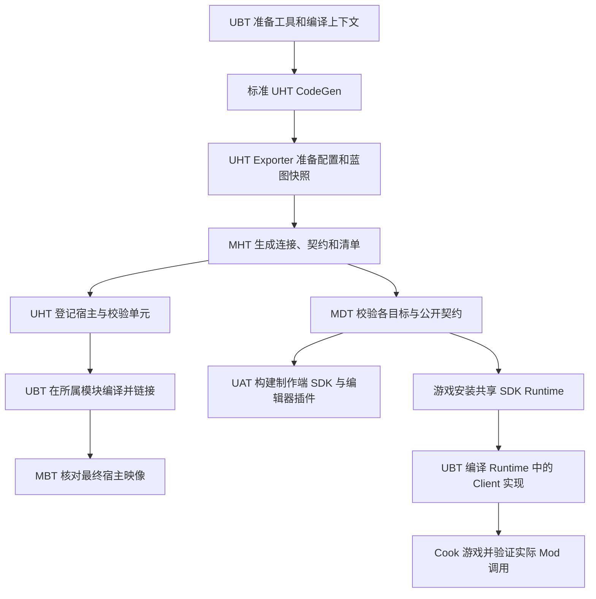

<!-- Copyright (c) 2026 Nelaric Contributors -->

# UnrealModFramework 游戏端详细设计

> 设计基线 v0.5 · 实现快照 `b0db0aa`（2026 年 11 月 24 日核对）\
> 开发基线 Unreal Engine 5.6

游戏通过 C++ 或蓝图声明扩展契约，并在开放玩法前准备 World 扩展。MHT 生成类型化连接、投影与契约，UBT 在每个所属模块内编译宿主。MBT 驱动自动 C++ Hook 的编译动作并校验受支持桌面目标的最终链接。MDT 发布宿主版和独立制作端 SDK，由共享 Runtime 承载 Client 调用表。

## 当前实现与限制

| 链路 | 当前实现 | 仍需验收或扩展的范围 |
| --- | --- | --- |
| 导出和宿主构建 | MHT 解析活动 C++ 声明与 `ModExportBlueprints` 快照。UBT 直接编译宿主单元，MBT 驱动 Hook 源替换并校验桌面最终链接。Development CI 调度 Editor 自动化与独立的 Game 编译链接。 | 更丰富的类型与异步调用形状、远程编译、更多目标与工具链组合 |
| SDK 和作者工程 | MDT 生成作者端 SDK、独立制作插件及可选的宿主 SDK 源插件；`TestMod` 演示独立制作、Cook 与完整生命周期 | 扩展至更多目标构建与实际 Shipping 发行 |
| 包加载 | `ModLoader` 发现并验证 v1/v3 归档，执行依赖与授权准入，挂载内容并分发结果。桌面 Pak Game 通过 C ABI 装载经授权的目标共享库 | 各平台的 Shipping Pak/IoStore、完整资源清理与独立扩展生命周期验收 |
| World 扩展 | `UModExtensionSubsystem` 管理同步 Hook、`Immediate`/`NextTick` Event、内容槽、Actor/组件/数据 Patch 及版本化跨模组服务 | 任意结构或容器投影、工作线程扩展、游戏业务的完整回归矩阵 |
| 宿主集成 | `ModExtensions` 模式接入玩法指纹、多人握手与单机存档迁移；独立项目已具备 UE 调用基准 | Dedicated Server 与无缝旅行矩阵、长会话及 Shader/RHI 等发布验收 |

以下各节约定系统架构与验收目标，现行接口以源码入口与已生成契约为准。第 28 节列出通过标准，具体的验证目标与证据须随发布登记。

## 目录

- [1 游戏端最终交付](#1-游戏端最终交付)
- [2 固定架构决策](#2-固定架构决策)
- [3 物理模块与依赖](#3-物理模块与依赖)
- [4 运行时服务边界](#4-运行时服务边界)
- [5 作用域与生命周期](#5-作用域与生命周期)
- [6 宿主配置](#6-宿主配置)
- [7 契约与运行时数据模型](#7-契约与运行时数据模型)
- [8 游戏声明与蓝图接入](#8-游戏声明与蓝图接入)
- [9 SDK 与公共反射身份](#9-sdk-与公共反射身份)
- [10 契约生成与构建流水线](#10-契约生成与构建流水线)
- [11 类型化调用连接](#11-类型化调用连接)
- [12 Provider 与绑定租约](#12-provider-与绑定租约)
- [13 宿主状态机与就绪屏障](#13-宿主状态机与就绪屏障)
- [14 独立原生扩展与稳定 C ABI](#14-独立原生扩展与稳定-c-abi)
- [15 模组清单与依赖决议](#15-模组清单与依赖决议)
- [16 Cook Profile 与资源准备](#16-cook-profile-与资源准备)
- [17 Shader 与渲染能力](#17-shader-与渲染能力)
- [18 Hook 语义与执行计划](#18-hook-语义与执行计划)
- [19 Event 通道与订阅](#19-event-通道与订阅)
- [20 内容注册与冲突决议](#20-内容注册与冲突决议)
- [21 世界扩展与 Patch](#21-世界扩展与-patch)
- [22 异步任务与并发规则](#22-异步任务与并发规则)
- [23 权限与信任边界](#23-权限与信任边界)
- [24 多人会话与存档](#24-多人会话与存档)
- [25 诊断与错误合同](#25-诊断与错误合同)
- [26 性能设计与验证方法](#26-性能设计与验证方法)
- [27 宿主能力报告](#27-宿主能力报告)
- [28 功能验收矩阵](#28-功能验收矩阵)
- [29 实施顺序与里程碑](#29-实施顺序与里程碑)
- [30 游戏接入示例](#30-游戏接入示例)
- [31 兼容性与发布变更规则](#31-兼容性与发布变更规则)
- [32 首版决策与后续验证](#32-首版决策与后续验证)
- [参考资料](#参考资料)

## 1 游戏端最终交付

| 交付 | 内容 | 使用者 |
| --- | --- | --- |
| Runtime | 契约目录、绑定、宿主生命周期、扩展点与资源服务 | 游戏接入模块和正式游戏 |
| ExportCodeGenerator | 基于 `ModExportOptions` 导出的配置与重定向，以及基于 `ModExportBlueprints` 导出的配置指定宿主蓝图 | 游戏开发者与 CI |
| BlueprintIntegration | 独立导出面板、声明图、实现图、业务节点与编译展开 | 游戏开发者 |
| ModHeaderTool | 导出声明与真实类型分析、统一 IR、投影/调用/ABI/验证代码及生成清单 | 游戏开发者与 CI |
| ModBuildTool | 构建上下文校验、宿主与客户端库编译、缓存管理与最终链接关联 | 游戏开发者与 CI |
| ModSourceTool | 失败返回与异常分析、错误目录及宿主链接头 | 游戏开发者与 CI |
| ModSDKTool | 生成契约与公共产物组织，以及作者 SDK 和独立制作插件构建 | 游戏开发者与 CI |
| Game Export Definitions | Shipping 描述符、注册入口、投影类型、专用转换代码与类型化调用连接 | 正式游戏 |
| Game Mod SDK Bundle | 受限视图、公共投影与蓝图包装、ABI 头、源码/库/模块元数据、Cook Profile 与能力报告的同批交付 | 独立模组作者工程 |
| GameModSDKEditor | 消费同批 SDK 的游戏专属节点、注册逻辑与编辑器适配二进制 | 独立模组作者工程 |
| Host Capability Report | 精确构建组合、支持状态、限制条件与验收证据 | 游戏和制作工具 |

独立 DevelopmentEditor 消费 SDK 与能力报告。其制作、打包和发布界面不在本方案范围内；游戏端须提供可机器读取的输入格式、验证规则、错误码及最小联调样例。

发布目标涵盖固定模组集合、Global/World/Player 服务、公开 API、同步 Hook、类型化 Event、逻辑内容以及受控 Patch。当前 World Hook 已接通受授权的 `On` 包装或替换，具体注册方式按 C++、蓝图及独立原生回调的实际支持范围选择。IoStore、独立原生扩展与模组 Shader 分别按平台和目标验收。运行时新增全局 Shader 类型、任意 DLL 热重载、任意反射类型替换以及自动拦截未接入业务，均不属于首版默认支持的能力。

## 2 固定架构决策

1. 声明产生契约，业务接入决定行为。API 标记不会替换所有既有调用；Hook 必须显式放入游戏实际执行路径，Event 也必须显式发布。
2. 编辑器阶段发现并验证声明，Shipping 仅使用生成产物，运行时不以编辑器元数据决定公开范围。Epic 明确指出元数据仅存在于编辑器中，不应由游戏逻辑读取。[^R01]
3. Catalog 与 Binder 允许按 ID 查询，但绑定结果必须落到构建期已生成的类型化入口；绑定成功后的普通 API 调用不经过统一的 InvokeById 入口。
4. 游戏依赖 Runtime，Runtime 不反向依赖具体游戏模块。实际访问真实成员的连接代码编译进该类型所属模块，接入模块仅负责编排实例与公开注册入口；编辑器模块不得被 Shipping 间接链接。[^R02]
5. 定义、实现、实例与绑定四者分离保存。声明不会隐含生成服务对象，CDO 也不作为默认玩法服务实例。
6. 蓝图保留独立的导出面板、声明图与实现图。编译结果可以是普通 UFunction，但编辑工作流不得退化为普通函数上的导出开关。
7. 原生扩展经由稳定 C ABI 接入。Modular 与 Monolithic 的 Pak 游戏使用同一注册和关闭协议，UE 反射类型由宿主提供。
8. 作用域 Ready 后即固定实现选择。变更模组集合、DLL 或公共反射身份均须重启，重启层级由已产生的进程级状态决定。
9. 所有运行时操作均须携带明确的作用域。Global 仅指 GameInstance 会话，禁止以全局单例保存“当前 World”或“当前玩家”。
10. 失败处理划分为提交前拒绝、受控补偿、关闭会话与重启进程四类，不得将 UObject、DLL 或引擎容器的任意副作用包装为可回滚事务。
11. C++ 使用声明前导出标记，MHT 负责导出语义与代码生成，UHT 负责 UE 反射。UBT 负责编译 UE 模块和最终链接，目标规则决定宿主实现采用 MBT 独立归档还是由 UBT 直接编译。自动 C++ Hook 由顶层 MBT 构建命令处理动作替换，具体宏组合和生成时序按目标验收。
12. 宿主业务连接、公开 SDK 与游戏编辑器适配属于不同产物，源自同一契约但按各自 Target 构建。完整 SDK Bundle 是最小交付单位，单个 DLL 不代表 SDK 或运行时能力已完成交付。
13. MHT 通过生成清单交付代码与契约，MBT 仅对照清单、实际构建输入与产物凭证核对批次及兼容性，不重新理解成员的 C++ 类型、计算投影或补写连接代码。

### 静态生成原则

> 所有跨契约边界的类型映射、签名投影、参数与结果转换规则、可空性、只读性、错误表示、ABI 表示及调用连接，均由 Export Generator 在构建期确定并生成。
>
> 游戏开发者通过导出声明提供契约信息，无需手工编写对应的受限接口类型、第二套函数签名和常规转换代码。
>
> 生成器必须验证完整的类型依赖闭包。任何无法静态确定、存在歧义或不受支持的类型与转换，均在生成或编译阶段失败。
>
> 运行时仅执行生成代码，使用已经建立的类型化绑定，并处理具体对象、作用域、授权与调用数据，不提供动态转换器选择或通用反射转换回退。
>
> 类型化访问面在编译期固定；UE 原有的虚调用与蓝图覆盖语义按契约保留。

本原则为固定架构约束，适用于 API、Event、Hook 及其 C++、蓝图与 C ABI 产物。下文提及的“类型转换层”均指生成器中的类型分析与代码生成阶段；运行时仅存在已经生成的具体转换代码。

## 3 物理模块与依赖

| 模块或角色 | 位置 | Target 与职责 |
| --- | --- | --- |
| ExportMetadata | Source/Runtime/ExportMetadata | Runtime；提供导出元数据与配置选项 |
| HAL | Source/Runtime/Core/HAL | Runtime；提供原生目录通知 |
| ModLoader | Source/Runtime/ModLoader | Runtime；负责进程准入、包序、挂载与会话实例 |
| ModAPI | Source/Runtime/ModAPI | Runtime；提供生成 API 与 World 扩展 |
| ExportCodeGenerator | Source/Editor/ExportCodeGenerator | Editor；提供选项目录及蓝图快照 Commandlet |
| BlueprintIntegration | Source/Editor/BlueprintIntegration | Editor；提供面板、图、K2 节点与编译扩展 |
| ModHeaderTool（MHT） | Plugins/ModRuntime/Tools/ModHeaderTool | 独立 C++ 工具；通过 C# UHT Exporter 适配器接入，负责类型、投影与生成语义 |
| ModBuildTool（MBT） | Plugins/ModRuntime/Tools/ModBuildTool | 独立 CMake/C++ 工具；从原生 UBT 步骤获取上下文，管理构建输入、产物与发布 |
| ModSourceTool（MST） | Plugins/ModRuntime/Tools/ModSourceTool | 独立工具；负责源码错误分析与宿主链接头生成 |
| ModSDKTool（MDT） | Plugins/ModRuntime/Tools/ModSDKTool | 独立工具；负责 SDK 规划、构建、检查及制作插件构建 |
| GameModSDK | 游戏公共插件或模块 | Runtime；提供受限视图、公共投影、蓝图具体反射类型与调用桥声明 |
| GameModSDKEditor | 游戏 SDK 插件的 Editor 模块 | Editor；提供具体节点、显示与注册适配，消费 GameModSDK 与通用制作工具 |
| 真实类型所属模块 | 游戏现有 Source 或项目插件模块 | Runtime；编译该模块自有类型的生成访问桥、参数转换与实际业务调用 |
| GameModIntegration | 游戏 Source 或项目插件，可选独立模块 | Runtime；负责 Provider、GameplayGate、业务接入与各模块公开注册入口的编排 |

Runtime 和 Editor 是目录分类，模块身份来自各模块描述与 Build.cs。非标准目录布局须通过 UBT 发现与打包验证；必要时调整目录，不新增名为 Runtime 或 Editor 的空模块。

运行时由 `ExportMetadata`、`HAL`、`ModLoader` 和 `ModAPI` 分担职责，其中 `ModAPI` 依赖 `ModLoader` 提供的包与会话接口。后续能力按依赖关系和引擎加载阶段组织，详见[模块边界](CodingStandards/Modules.zh-CN.md)。

GameModSDK 承担公共契约模块这一逻辑角色。项目可以保留既有公共模块名；已发布的 /Script 身份不得因文档命名统一而重命名，也不得额外生成重复反射定义。SDK Bundle 必须明确唯一的实际模块名与类型身份。

| 依赖方 | 允许的依赖与限制 |
| --- | --- |
| 游戏业务模块与 GameModIntegration | Runtime、GameModSDK 及明确的游戏公开入口；实际私有成员连接留在所属模块 |
| GameModSDK | 可随 SDK 提供的 Runtime 公开契约和所需 UE Runtime 模块；不依赖游戏私有模块或 Editor |
| GameModSDKEditor | GameModSDK、DevelopmentEditor 的公开扩展接口及所需 UE Editor 模块 |
| 引擎级 DevelopmentEditor | 自包含的版本化共享协议和 UE Editor 模块；不反向依赖项目级 GameModSDK、Runtime 或游戏业务模块 |

通用制作工具继续沿用仓库的共享协议边界；游戏专属适配模块可以依赖通用工具，通用工具通过注册协议消费适配结果。作者工程所需的 Runtime 契约及 UE 模块依赖必须随发布说明和可安装产物提供，不能从原游戏的相对路径隐式获取。插件和模块的安装层级须满足 UE 依赖方向。[^R02]

## 4 运行时服务边界

| 服务 | 主要持有数据 | 调用时机 |
| --- | --- | --- |
| Host Coordinator | 状态、阶段屏障、启动计划、关闭原因 | 启动、切图、退出 |
| Export Catalog | 不可变定义、类型与来源索引 | 注册、绑定、诊断 |
| Provider Binder | 提供者、实例、作用域代次、绑定租约 | 作用域建立与失效 |
| Dependency Resolver | 精确版本集合、约束图、稳定顺序 | 会话选择前 |
| Package Service | 验证记录、挂载状态、资产可见性 | Gameplay 前 |
| Native Loader | DLL 句柄、函数表、模组上下文 | 进程准备与会话建立 |
| Hook Service | 类型化分阶段快照、顺序与注册来源 | 注册与业务调用 |
| Event Service | 作用域通道、订阅快照与队列 | 订阅与发布 |
| Content Resolver | 逻辑内容候选、胜者、来源链 | 决议与对象创建 |
| World Patch Service | Patch 计划、应用凭证、对象来源 | 世界安全阶段 |
| Diagnostics | 阶段记录、错误链、按需采样 | 阶段变化与显式诊断 |

以上为职责划分，不要求每一行对应一个独立的 Subsystem 或模块。协调器通过服务接口推进阶段，各服务不得反向静默开启新的模组会话。包验证、DLL 装载与早期资源准备可早于 GameInstance 执行，但玩法就绪仍由明确屏障决定。

Catalog 注册接口返回定义句柄；Binder 返回生成的类型化视图或专用入口及租约；Package Service 返回准备凭证；Hook/Event 注册返回带有明确生命周期的 token；Patch 返回应用凭证。所有控制面结果均统一携带状态、稳定错误码、来源与可恢复性，普通热路径的错误表示则由成员生成规则确定。

Runtime 不设置按 TypeId 查找转换器的服务。Catalog 中的类型描述仅用于装载、兼容性检查与诊断；Binder 只在已生成且签名匹配的入口之间建立绑定，不解释类型描述来临时合成调用。

## 5 作用域与生命周期

| 层级 | 身份组成 | 所有权与失效 |
| --- | --- | --- |
| Process | ProcessBuildId | 契约模板、挂载与原生库；随进程退出失效 |
| Session | SessionId 与 SessionGeneration | 对应一个 GameInstance；随会话关闭失效 |
| World | SessionId、WorldId 与 WorldGeneration | 对应每个参与玩法的 UWorld；随世界关闭或切图失效 |
| Player | 会话、游戏玩家身份与 PlayerGeneration | 由游戏显式管理，而非全局玩家序号 |
| Object | 实际对象与原生对象有效性信息 | 由调用者与游戏管理，无需注册全局服务 |

Global 服务限定于 Session 范围。GameInstance/World Subsystem 可承担生命周期接点，但 Initialize 完成并不代表模组 Ready。Subsystem 仅提供自动实例化与托管生命周期，业务就绪条件仍由本框架定义。[^R03]

PlayerScope 默认随所属 World 一同关闭。跨无缝旅行保留的是游戏玩家稳定身份与可序列化状态，新 World 将创建新的 PlayerScope 与绑定；即便 Actor 被引擎保留，也必须显式重新归属。LocalPlayerSubsystem 仅适用于本地玩家，服务端玩家则由游戏的 PlayerState、Controller 或专用提供者接入。

同一 Session 在旅行期间可能同时存在旧 World、过渡 World 与新 World。每个作用域均独立标识，仅宿主指定的目标世界可进入玩法。EditorPreview、Thumbnail 及非玩法 World 默认不建立模组玩法作用域；PIE、Game 与 Dedicated Server 的允许组合写入策略。

PIE 可隔离会话可变状态，但仍共享进程包命名空间与已注册反射类型。多个会话可选择同一已准备版本的不同启用子集，而同一包身份的不同模组版本不能同时准备；需要对照不同版本时应启动独立进程。Editor 中凡是会影响契约、已缓存 UFunction 或反射身份的重新编译，都会使相关 PIE 会话失效，首版要求重新启动 PIE。

## 6 宿主配置

开发宿主在 `Config/DefaultGame.ini` 的 `[ModLoader]` 节中记录 `GameId`、`BaseReleaseVersion`、`BaseRegistrySha256` 与 `Backend`，并在同一节配置选择集合、整包摘要及扩展权限。`Config/ModHeaderTool.json` 用于指定生成模式、目标模块、类型身份与蓝图资产。宿主通过 `FWorldPolicy` 配置 World 授权、内容胜者、预期玩法指纹及存档暂存逻辑，详见[加载器配置](CodingStandards/Modules.zh-CN.md#模组加载器)。

| 配置组 | 必填信息 | 验证规则 |
| --- | --- | --- |
| 身份与构建 | GameId、GameVersion、EngineBuildId、Runtime/ProtocolVersion、Target、架构 | 必须匹配发布产物 |
| Cook Profile | 后端、基础发布身份、RHI/Shader 平台、关键 Cook 设置、允许类型与插件 | 指纹匹配；差异按白名单评估 |
| 模组策略 | 启用集合、固定版本、可信来源、Native 策略、缓存根 | 会话 Ready 前冻结 |
| 契约注册 | 公共契约包、生成注册入口、SDK 指纹 | 不依赖运行时编辑器扫描 |
| 实例提供者 | ExportDefinition、ProviderKey、作用域、创建与释放责任 | 每个必需绑定均有唯一决议结果 |
| 扩展点策略 | Hook 阶段、事件队列、内容槽、Patch 安全点 | 与声明和游戏接入保持一致 |
| 权限 | 能力名单、绑定期固定或动态撤销、服务端约束 | 权限模型与调用路径一致 |
| 网络与存档 | 联机模组策略、网络兼容指纹、存档迁移规则 | 加载玩法前完成核对 |
| 性能与资源预算 | 单包和总预算、队列上限、启动超时、回调预算 | 越限时有明确失败策略 |
| 诊断 | 日志级别、采样、报告路径、发布构建开关 | 默认不逐次记录热路径 |

默认情况下，业务 API 在 Game Thread 执行，需在工作线程执行的函数须逐项声明并验证；绑定在作用域内固定，且默认关闭 DLL 热卸载与物理包卸载。可选模组失败时，默认要求以确认后的新启用集合重新开始准备，禁止在 Ready 后静默切换实现。

Cook Profile、Host Capability Report、SDK 与游戏可执行文件必须携带同一发布关联标识。任何可影响行为的配置均参与会话指纹计算，而本地绝对路径、时间戳、显示文本等不参与兼容性哈希。

## 7 契约与运行时数据模型

### 标识与签名

GameId、ModId、ExportId、TypeId、MemberId、ProviderId 与 ExtensionPointId 均为发布后保持稳定的标识，其生成值取自持久化的声明数据。显示名称、文件路径和蓝图节点标题均可独立修改；已发布标识在删除后保留 tombstone，以防复用。

SourceSignatureHash 记录原始游戏成员的所属类型、完整签名与限定符，用于检测生成产物是否过期。SignatureHash 针对生成后的 Mod 侧规范化签名计算，覆盖参数顺序、公开 TypeId、值/引用/const/out、返回类型、同步或异步、公开继承约束、关联类型布局版本及必要分派语义。

ProjectionHash 记录原始类型与公开类型的映射、递归字段投影、可空/只读规则、容器复制或借用方式、输出提交规则、错误表示及转换规则版本。PolicyHash 覆盖作用域、线程、权限、Authority、取消、错误与顺序规则。变更错误表示等同时影响签名的规则时，相关摘要均会同步更新。文档、分类和显示名不进入调用签名；默认参数变化须单独报告，因为已编译的调用方可能仍保留旧默认值。

ExportHash 表示公共定义集合，CookProfileHash 表示资源构建兼容性，NativeABIHash 表示服务表与边界布局，ResolvedModSetHash 表示精确模组集合、权限与决议配置。即便哈希命中，仍须保留可读字段用于差异诊断，且不得凭借“哈希相同”覆盖不同定义。

### 核心记录

| 记录 | 主要字段 | 约束 |
| --- | --- | --- |
| ExportDefinition | ID、版本、成员、所需类型、公开策略 | 注册后不可变 |
| TypeDefinition | ID、公开类型身份、种类、投影字段、布局/序列化版本、边界能力 | 公开投影的递归闭包完整可用 |
| MemberDefinition | MemberId、Mod 侧签名、源签名摘要、投影摘要、线程、作用域、权限、错误 | 不隐含实例，不要求开发者维护两套签名 |
| TypeProjection | 原始类型、公开表示、字段映射、可空/只读、所有权与转换规则 | 构建期 IR；全部解析后生成代码，不作为运行时转换脚本 |
| GeneratedCallPlan | 原始成员、Mod 签名、具体入口、检查、参数/结果转换、输出提交与分派规则 | 构建期生成依据；运行时执行其产物 |
| ImplementationDescriptor | ExportId、ProviderId、目标符号、实现形式、来源 | 一个定义可有多个候选 |
| ProviderDescriptor | ProviderKey、作用域、依赖、提供/释放方式 | 不以查找首个 Actor 决议 |
| InstanceRecord | 实际对象或 native context、ScopeKey、Generation、所有者 | 一个实例可实现多个契约 |
| BindingRecord | 调用方、成员、最终实例、生成入口/类型化表槽、签名、租约与权限模型 | 不承担逐次通用转发或转换方案选择 |
| ModInstance | ModId、会话上下文、生命周期状态、注册 token 集合 | 不与进程 DLL 句柄混同 |
| RegistrationReceipt | 所有者、作用域、资源种类、撤销动作、提交状态 | 支持重复清理 |

控制面保留完整来源信息，包括声明资产或 C++ 符号、生成器版本、模组包哈希与生成指纹。热路径则仅持有所需的类型化引用、连续处理器条目与最小生命周期信息，避免复制完整描述符。

### 类型能力

类型支持按 Native UE、Blueprint、C ABI、序列化与网络五个维度分别发布，每一项支持均须对应已生成的具体投影与转换连接。不得因为某类型可出现在蓝图 Pin 上，便默认其可跨 DLL 传递或可网络复制。

| 类型族 | UE 与蓝图路径 | C ABI 首版策略 |
| --- | --- | --- |
| 定宽整数、浮点、枚举 | 保留 UE 类型语义 | 明确位宽、字节序、枚举范围；布尔规定表示 |
| 字符串与本地化文本 | 使用公共 UE 类型 | UTF-8 字节视图或缓冲区；FText 另定义本地化语义 |
| 公开 USTRUCT | 公共模块或契约资产中的生成投影；字段均允许同形公开时可使用恒等投影 | 仅限已生成逐字段转换的固定布局 DTO |
| UObject、Actor | 生成的 `FModRuntimeObject<T>`；const 对象映射为只读视图 | 不透明句柄及专用验证代码，含类型、作用域、代次与授权 |
| Class | 生成的受限类引用；明确可构造类型及公开工厂 | 受限类句柄，禁止直接获得任意 UClass 操作 |
| 软资产引用 | 保留包和对象身份 | 规范化路径或资源句柄；不自动同步加载 |
| TArray、TMap、TSet | 元素与嵌套类型递归投影；按声明固定复制、借用或受限序列形式，BP 只接受实际支持的组合 | 数组视图或复制记录；Map/Set 采用受限条目序列，均生成专用转换 |
| 用户定义结构体与容器嵌套 | 按公开类型闭包与 Cook 验证 | 首版不自动获得 ABI 能力；须经专门转换验收 |
| Delegate、latent、泛型通配 Pin | 单独契约或拒绝导出 | 不跨边界传递 UE delegate 或任意函数对象 |

游戏侧原始签名可以使用真实游戏类型，生成器须为其生成合法的受限视图或公开值投影。禁止向 Mod 泄漏私有游戏类型的原生定义、裸引用与内存布局，同时拒绝编辑器专属类型、未定义所有权的指针/引用、ABI 中的 UE 容器对象以及任意不受支持的 C++ 模板实例；无法形成完整投影的成员一律在构建期拒绝。

容器元素、嵌套字段、Map Key 的哈希/相等语义、对象可空性、数组长度与递归深度均须写入验证约束。仅当声明固定了缺省构造、遗漏字段处理及写回规则时，才允许将原始结构投影为字段更少的公开结构。

## 8 游戏声明与蓝图接入

### C++ 声明

C++ 导出采用声明前标记，指向真实游戏成员并指定导出范围、投影、作用域、权限与失败策略。游戏函数保持原始签名；MHT 从紧随标记的具体 AST 声明推导 Mod 侧签名，开发者无需重复编写重载成员指针类型、第二套签名或常规对象包装。

开发宿主在 `ChangeHealth` 的声明上使用无参 Hook 标记，详见[角色声明](../UnrealModFramework/Source/ExportTest/GameCharacter.h)。

```cpp
MOD_EXPORT_API(Scope = World, Thread = GameThread, FailureRule = ReturnError, Permissions = (WorldRead))
EXPORTTEST_API float GetCurrentHealth() const;

MOD_EXPORT_HOOK()
UFUNCTION(BlueprintCallable, Category = "Character|Health")
EXPORTTEST_API float ChangeHealth(float Delta);

MOD_EXPORT_EVENT(ExportId = "event/game.character/health-changed", SourceScope = World, PublishRule = Immediate,
                 Permission = "Health.Observe")
EXPORTTEST_API void PublishHealthChanged(float CurrentHealth);
```

| 标记 | 当前绑定形状 | 游戏接入 |
| --- | --- | --- |
| `MOD_EXPORT_API` | 受支持的同步 UObject 成员，以标量和受支持的 UObject 指针作为输入，结果可为标量、`void` 或生成的 World 对象视图 | 定义类型身份与实际提供者，配置调用者授权 |
| `MOD_EXPORT_HOOK()` | World 成员，在 `.cpp` 中定义，接收一个标量并返回同类型结果 | 在声明上标记宏并保留原函数体，由 MHT 与 MST 生成 `Pre`、`On`、`Post` 入口 |
| `MOD_EXPORT_EVENT` | World 成员，接收一个载荷并返回 `void` | 在事实发生处调用生成的 `Publish` |

关联过程仅跨过受支持的 UE 标记、属性及注释，随后按活动 AST 解析声明。宿主在 `Config/ModAPITypes.json` 中保留稳定类型身份，ExportId、类型和权限均参与契约校验。标记本身不构造对象，也不改变成员的 C++ 访问级别或跨模块导出；私有访问桥和额外类型级标记属于设计扩展。[^R08]

### 统一选项 Schema

一个版本化 Schema 统一驱动 C++ 标记语法、蓝图编辑选项、默认值、验证器、文档及兼容摘要，C++ 与蓝图共用同一套语义。DefaultGameMod 配置提供候选选项，生成时须核对同一 Schema 与宿主能力策略。

MHT 按类型与公开名生成 C++ API 的契约标识，类型映射、生成清单和发布清单均引用对应的导出标识。

| 类别 | 必须表达的配置 |
| --- | --- |
| 公共 | 版本、显示名称、描述、作用域、线程、Authority 与稳定身份关联 |
| API | 调用权限、FailureRule（可恢复失败统一 ReturnError）、同步/显式异步、完成/取消关联、Pure/执行引脚、副作用、绑定要求、参数方向与生命周期 |
| Event | 发布/订阅权限、发布/分发线程、同步/队列、载荷策略、顺序、重入/限深、容量/预算、溢出/合并、退订与监听失败 |
| Hook | 参与权限、`AllowedStages`、`AllowedOperations`、输入和结果的可写字段、取消及完整结果、包装与替换规则、重入、阶段失败、排序与输入提交 |

`MOD_EXPORT_HOOK()` 默认生成 `Pre`、`On` 和 `Post` 三个阶段，以及 `ModifyInputs`、`Cancel` 和 `Replace` 三种需授权操作。`NoPre` 关闭 `Pre` 及修改入参、取消调用两项操作；`NoOn` 关闭 `On` 及替换操作；`NoPost` 关闭执行后通知。三项同时指定时，当前名和曾用名均不发布 Hook，游戏直接执行原函数。蓝图编辑器创建的 Hook 声明通过 `AllowedStages` 和 `AllowedOperations` 保存策略，初始值分别为 `(Post)` 和 `()`。每项操作均要求开放对应阶段，具体规则见[第18节](#18-hook-语义与执行计划)；任意字段级修改策略仍需单独扩展。

旧蓝图资产加载时，`Observe`、`Modify`、`Intercept` 分别映射为 `Post`、`Pre`、`On`，且 `AllowedOperations` 为空。如需修改输入、取消、包装、替换或修改结果，须由游戏开发者在对应 Hook 上显式授权。

语法支持字符串、布尔、数值、枚举、列表与嵌套字段；类型、成员路径及契约引用以明确的引用种类保存。未知/重复字段与非法组合将直接报错。文本、权限列表与嵌套数据按公开的可配置预算进行验证，不使用未声明的固定数量或静默截断。

首版核心 DSL 仅使用字面量与 Schema 枚举；若后续允许命名 constexpr 表达式，必须交由 AST 常量求值，不得靠字符串替换模拟 C++。API 的 const 不自动意味着 Pure、线程安全或已授权，Event 的只读性也不要求发布者和监听者的 this 为 const。Hook 的 `Core` 即为 `On` 阶段的原版业务体，`On` 的包装与替换分别受能力开关与 Hook 声明限制。

业务接入点至少涵盖提供实例、调用 Hook、发布 Event、注册逻辑内容槽与登记世界锚点，既可由游戏 C++ 接入，也可由对应蓝图业务节点接入。构建报告分别展示“已声明”“已实现”“已接入”“已 Cook 验证”四项状态，仅标记声明不得显示为运行时可用。

### 蓝图工作流

**蓝图Mod导出** 面板提供 API、Event 和 Hook 管理：API 与 Hook 的实现图由各自的独立声明持有，Event 保存发布设置。游戏将声明对应的 **Hook Point** 或 **Publish Event** 节点放入业务图，并连接其执行输入。C++ 宿主通过 `UModExtensionSubsystem` 另行提供内容槽与锚点，并通过 `UModAPIHostSubsystem` 提供 API 实例。

`Config/ModHeaderTool.json` 中的 `blueprintExports` 列出待导出的已保存资产、typeId 与所属模块，由 `ModExportBlueprints` 将编译后的受支持签名写入快照。当前蓝图 API 使用 `World`、`GameThread` 与 `ReturnError`，接受标量输入和最多一个标量结果；已连线的 Hook/Event 可使用标量、受支持的结构体或具备 World 视图的 UObject，未连线的扩展声明则跳过导出。已导出的宿主蓝图由游戏注册 World 实例，生成的 SDK 通过活动 `UModInstance` 获取已授权的引用，详见[UHT 蓝图导出](../UnrealModFramework/Plugins/ModRuntime/Source/ModRuntimeUht/README.zh-CN.md#从宿主蓝图导出-api)。

在目标设计中，C++ 与蓝图声明汇入统一的生成模型，按受支持的类型闭包、签名投影与检查规则完成解析，进而生成 C++ 受限视图、蓝图具体包装类型、API 函数桥、Event 回调签名、Hook 阶段上下文及节点展开规则。蓝图不直接使用任意 C++ 模板实例，所需的具体反射包装按第 10 节的构建顺序生成并编译。

独立实现图编译为常规反射成员或接口实现。调用节点在编译时连接至具体生成入口：恒等投影且无需附加检查时可展开为标准 UE 函数或接口调用，其余情况则展开至专用桥。Provider 获取节点仅用于作用域建立。禁止框架新增每次执行都包含 GetService、FindFunction 和通用参数包的隐藏链；正常 UE 事件/接口内部为保留覆盖语义所执行的查找属于原生基准。UE 蓝图编译包含节点展开、UFunction 建立与 VM 字节码生成；生成 C++ 风格调试输出并不代表蓝图变成原生机器码。[^R05]

蓝图 API 默认采用带执行引脚的调用形式。仅已绑定、无副作用、无需动态权限/日志/异步操作的成员才允许声明为 Pure；由于 Pure 无法保证仅求值一次，框架不得借其执行隐式注册或资源加载。同步 Hook 中禁止使用 latent 节点；异步 API 使用独立的请求/完成/取消契约。

必需诊断包括：重复 ID、未实现声明、未接入扩展点、私有类型泄漏、未解析/歧义/不受支持的投影、可空或只读冲突、错误返回与绑定模式冲突、非法借用、错误 World/Player 来源、Pure 副作用、latent 混入同步链、缺少 Provider 以及生成产物过期。双击诊断条目必须定位到源资产、图、节点或 C++ 符号，并展示原始签名与 Mod 投影。

## 9 SDK 与公共反射身份

SDK 至少包含可读契约目录、生成的 `FModRuntimeObject<T>` 视图与只读视图、公共投影结构、蓝图具体包装、类型化调用声明、Event/Hook 类型、C ABI 头与布局说明、Cook Profile、基础发布依赖信息、能力报告、签名差异规则以及一个独立作者工程样例。JSON 虽能描述约束，但无法独立满足 C++ 静态访问面，以及蓝图编译和 Cook 对反射类型的需求。

`FModRuntimeObject<AMyCharacter>` 中的 AMyCharacter 用于标识原始游戏类型。C++ SDK 可以仅提供该类型的前置声明与生成的视图特化，使用者无需获取游戏类的完整定义；模板主版本不得回退为开放原始对象的通用包装。蓝图则使用另行生成的具体公共反射类型，不依赖私有游戏类的占位反射定义。视图内部表示不公开任何可绕过契约的原始对象指针或任意 Cast 入口。

C++ 视图的调用后端按 SDK 目标固定为宿主内 UE 连接或稳定 C ABI 专用连接。独立 DLL 中的视图仍通过生成的句柄、DTO 与函数表调用，不链接私有游戏 C++ 符号，也不跨 ABI 传递视图模板实例或 UE 对象布局。

生成视图保留真实 T 的静态身份，示意如下（对象引用与绑定表的具体布局由目标后端固定）：

```cpp
class AMyCharacter;
template<class TObjectType> class FModRuntimeObject;

template<>
class FModRuntimeObject<AMyCharacter>
{
public:
    TModResult<float> GetHealth() const;
    FMyCharacterEvents Events;
    FMyCharacterHooks Hooks;

private:
    FModObjectRef Object;
    const FMyCharacterBindings* Bindings;
};
```

API、Event 与 Hook 分别生成受限成员、类型化订阅入口与分阶段注册能力，子视图本身不自动授予实际权限，也不提供获取原始 UObject 的 Get、隐式转换或解引用入口。无论声明源自 C++ 还是蓝图，本版可恢复 API 失败均统一采用 ReturnError 与 TModResult，不引入可切换的 Try 签名。

Native 公共类型采用稳定的模块名与反射类型身份（例如 /Script/GameModSDK）。作者工程与宿主基于同一导出版本构建该模块，模组最终内容包不得重新提供宿主已拥有的同名脚本模块或反射定义。内容型契约资产采用稳定包路径、对象名、GeneratedClass 身份与依赖闭包，作为基线发布内容参与作者工程 Cook，模组容器仅携带新增包。

`FModRuntimeObject<AMyCharacter>` 的 C++ 模板特化不会自动成为蓝图变量类型。MHT 为蓝图生成具体的共享反射视图（例如 FModCharacterRef），由实际的 GameModSDK Runtime 模块拥有；游戏与作者工程冻结相同的 /Script 模块名、类型名、字段及签名。GameModSDKEditor 提供编译节点，编译后的蓝图仅引用游戏中存在的 Runtime 类型与函数。需要原始类继承或原始类资产引用的能力，必须另外发布真正共享的公共反射定义，不得以占位 UCLASS 冒充。

游戏侧的蓝图实现载体可选用共享公共基类或接口资产，独立实现图编译至实际提供者的成员实现。Mod 调用者持有生成的受限视图与绑定，生成入口在宿主内部获取实际提供者对象。将私有游戏类完整伪造成同名占位类不能作为通用 SDK 方案，因其父类、字段、布局、导入导出及 Cook 依赖均可能存在差异。若确需使用代理对象适配遗留业务，能力报告须标记 Adapter，并将新增对象与转发成本纳入基准。

受限视图并不要求将所有 API 改写为 UE 接口。底层已存在具体类型且可按原生语义直接调用时，生成连接保留该调用；需要蓝图可覆盖与多实现时，则采用相应的公共基类、事件或接口路径。两种形式分别与同形式的 UE 原生调用对比，并单列投影与检查的新增成本。

SDK 发布以原子方式冻结定义、公共类型、Cook Profile 与能力报告。兼容性工具针对新增/删除成员、参数变化、结构体布局、继承、作用域、权限、错误语义及网络/存档变化分别判定；SemVer 仅作发布说明，实际加载按所用成员指纹及边界约束判定。

### SDK Bundle 与二进制交付

当前 MDT 发布带哈希库存的 `Manifest.json`、`Contract/SdkContract.json`、`Native/Include`、分目标的 `Native/Lib`、游戏 SDK 及 `ModDevelopmentSDKEditor`；提供非 Editor Client 配置时还会生成 `Host/Plugins/<游戏SDK>`，由游戏安装后构建及 Cook。下文描述完整发行目标，现行产物详见[现行 MDT 产物](../UnrealModFramework/Plugins/ModRuntime/Tools/ModSDKTool/README.zh-CN.md#编辑器入口与交付)。

SDK Bundle 是同批次的完整交付单元。仅交付单个“导出 DLL”无法满足 C++ 编译、UE 模块装载或蓝图 Cook 需求；制作编辑器插件消费头文件与适配源码并链接 SDK，DLL 不作为二次编译的源码。

此处“同批次”指同一个已冻结的发布输入集。Game 与 Editor 可以各自拥有对应上下文的生成批次，发布清单须记录关联关系及共享公共契约的兼容性，不能要求忽略 Target 差异而强行共用全部文件。

| Bundle 内容 | 用途与约束 |
| --- | --- |
| SDK 清单 | 游戏身份、Schema/生成器版本、生成批次、Target/Profile、输入/契约/投影/ABI 摘要 |
| 生成的 Public 头 | 类型、受限视图、具体函数与回调声明；可独立消费 |
| 适配源码或等价可编译输入 | GameModSDKEditor 的节点、注册与桥接，不能包含游戏私有实现 |
| SDK 二进制与链接输入 | 作者 Editor 可加载的 DLL、Windows 隐式链接所需 .lib 及所声明依赖 |
| UE 模块描述 | .uplugin、.Build.cs、.modules，以及目标构建要求的预编译元数据 |
| 契约与显示目录 | 浏览、诊断、差异、稳定公共身份及生成连接信息 |
| 资源与验证描述 | Cook Profile、基础发布依赖、能力报告及与游戏发布关联的证据 |

以 MyGame 为例，发布包可采用以下结构（实际模块名须与既有公共反射身份保持一致）：

```text
MyGameModSDK/
├── MyGameModSDK.uplugin
├── Source/
│   ├── MyGameModSDKRuntime/
│   │   ├── Public/                       # 生成视图、类型与调用声明
│   │   └── MyGameModSDKRuntime.Build.cs
│   └── MyGameModSDKEditor/
│       └── MyGameModSDKEditor.Build.cs
├── Binaries/Win64/                      # 对应目标的实际 DLL、模块元数据
├── Lib/Win64/                           # 声明需要的目标兼容导入库
├── Contract/
│   ├── MyGame.modcontract.json
│   ├── MyGame.generated-artifacts.json  # MHT 的生成清单
│   └── MyGameModSDK.manifest.json       # MBT 的发布清单
└── Resources/
```

MHT 提供生成文件与清单，MBT 校验库与公共产物，MDT 组织 SDK 发布目录；DLL、LIB 及 UE 元数据均来自对应原生构建的实际结果。源码交付与预编译交付分别记录，不得因目录中存在 `.Build.cs` 便认定预编译依赖完整。

Windows 隐式链接需要公开声明、导入库与运行时 DLL；显式动态加载虽可不链接 .lib，但仍需正确的函数签名与 ABI 协议。[^R20] UE 二进制模块必须保留匹配的 BuildId、.modules 与依赖集合，不得通过修改标识强行装载。[^R09]

| 产物角色 | 构建目标 | 独立制作编辑器的使用方式 |
| --- | --- | --- |
| 游戏真实业务连接 | Game/Client/Server 等各自目标 | 不作为默认依赖，不加载 Shipping 游戏 DLL 来代替 Editor 模块 |
| 公开 GameModSDK | 游戏目标与匹配的作者 Editor 目标分别构建 | 加载 Editor 兼容版本，保持共享 Runtime 反射身份 |
| GameModSDKEditor | Editor | 消费 SDK Bundle，注册节点、UI 与编译规则 |
| 通用 DevelopmentEditor | Editor | 通过公开扩展协议接入游戏专属适配 |

游戏侧是否存在独立 DLL 取决于 Target 链接方式，monolithic 构建可将相应代码直接链接进可执行文件；SDK Bundle 不承诺从任意 Shipping 目标导出 UE DLL。若产品另需独立 Native Bridge DLL，应生成稳定 C ABI 桥并由游戏模块注册类型化入口，且与 Editor SDK DLL 分别发布和验证。[^R08]

在没有游戏私有源码或真实游戏实例的情况下，作者工程应能加载 SDK、浏览契约并编译 Mod 声明。实际业务调用仍需匹配的 Preview Host 或真实游戏 Provider；未连接时须明确报告不可用，不得返回伪成功结果，也不得因导出某个类而自动创建游戏实例。

## 10 契约生成与构建流水线

### MHT、MBT 与原生 UBT 的职责

MHT 解析声明并生成源码。UBT 使用所属模块的编译环境构建所有宿主单元。使用自动 C++ Hook 时，`ModBuildTool build-ue-target` 驱动 UBT，并用 MHT 与 MST 生成的源码副本替换对应的原始编译输入。

| 职责 | MHT | MBT | 原生 UE 工具 |
| --- | --- | --- | --- |
| 解析 MOD_EXPORT_*、检查配置和稳定契约 ID | 唯一负责方 | 传递版本化输入 | Editor 提供实际配置选项与函数重定向 |
| 获取真实 C++ 类型与成员签名 | libclang 按选定 Target 解析活动声明 | 使用所属模块真实编译上下文 | UHT 生成标准反射头，UBT 提供编译数据库 |
| 完整类型依赖闭包、游戏到 Mod/ABI 类型投影 | 唯一负责方 | 不解析类型或重算规则 | 不定义 Mod 导出语义 |
| 生成 FModRuntimeObject、参数/结果转换及调用连接 | 唯一负责方 | 在独立编译路径消费生成实现 | UBT 消费宿主库或在所属模块内编译宿主单元 |
| 生成契约描述符、ABI 声明和编译期校验 | 生成源码 | 跟踪输入 | UBT 在所属模块内编译校验单元 |
| 识别 Target、配置、平台、架构与工具链 | 消费已锁定上下文 | 核对 Profile 与构建输入 | UBT 提供实际 Target 环境 |
| 管理生成文件 | 生成内容、清单与语义依赖 | 管理构建输入、缓存与清单引用 | 按登记的依赖决定增量执行 |
| 检查 SDK 与二进制兼容性 | 提供契约/投影/ABI 摘要 | 核对构建身份、批次与实际产物 | 提供构建凭证及模块元数据 |
| 收集 DLL、LIB 和必要 UE 元数据 | 不负责 | 从成功目标的结果收集 | 按目标实际产生 |
| 组织 SDK 发布包 | 提供契约、连接描述、Client 源与目标清单 | 提供二进制核验 | MDT 调用 UAT 构建制作端插件并发布 SDK |
| 编译 MHT 宿主实现 | 生成宿主源码 | 维护依赖与 Hook 动作 | 所有工具链均由 UBT 在所属模块编译 |
| 编译 UE 模块与最终链接 | 提供注册标记与 Hook 替换清单 | 核对支持的桌面目标链接结果 | UBT 执行编译与链接 |

UHT 在标准 CodeGen 后调用 MHT，再逐模块登记宿主与编译校验单元。独立的制作端工程和游戏工程使用同名的共享 Runtime 模块。每个目标的生成目录与最终链接记录均独立保存。



各目标统一发布 `UMF.GeneratedArtifacts` v4。`ClientSource` 是共享 Runtime 的编译输入，其余宿主与校验单元由 UHT 注册到所属 UBT 模块。

### MHT 的声明关联与统一 IR

标准 UHT 负责 UE 反射与生成头，适配器准备对应目标的编译数据库、模块生产者参数及 Clang 资源头；MHT 负责全部导出语义与代码生成，MBT 消费真实所属模块上下文完成校验与编译。[^R04][^R18][^R19]

MHT 的 `scan` 执行词法扫描与元数据校验；`generate` 基于真实 UBT 编译参数与 libclang AST 绑定活动 API、Hook 与 Event，处理条件编译、类型身份、签名及投影。`ModExportBlueprints` 负责编译并提取配置所列蓝图资产的声明，MHT 读取 `BlueprintExports.json` 并合并生成。不受支持的投影在生成阶段即报错，生成批次锁定来源与目标上下文。以下 IR 结构定义了进一步扩展时的职责模型。

| IR 记录 | 已解析的信息 |
| --- | --- |
| FExportTypeIR | 稳定身份、真实 C++ 名称、继承、所属模块、公开投影 |
| FAPIIR | 具体成员、参数/返回、cv/ref/noexcept/调用约定、失败、权限与调用方式 |
| FEventIR | 源类别、载荷、回调、同步/队列、订阅与发布策略 |
| FHookIR | Core、阶段上下文、可写字段、Next/取消/结果协议 |
| FTypeUseIR | 类型使用角色、方向、空值、生命周期、所有权与目标后端 |
| FProjectionPlanIR | 原始类型到 Mod/ABI 类型的完整转换计划，对应第 7 节 TypeProjection |
| FSourceIR | 原始文件范围、快照映射，或蓝图资产/图/节点/Pin 身份 |
| FTargetProfileIR | UE、工具链、ABI、Target、Cook、模块依赖与输入兼容条件 |

类型分析须保留 const FData&、FData&、FData* 与 FData 在方向及生命周期上的差异，不得先执行 remove_cvref 再仅按基础类别处理。前置声明与递归类型可在分析中间态暂待解析，但发布前 unresolved 必须归零。生成计划标识仅用于构建与诊断，运行时不按该标识查找转换器。

### 类型分析与代码生成职责

MHT 以真实游戏成员与导出规则为输入，为每个 API、Event 与 Hook 生成完整调用形式。类型分析与转换方案选择均在本阶段完成；MBT 仅核对 MHT 交付的清单与摘要，运行时描述符不承担解释这些方案的职责。

| 内容 | 生成期确定的结果 |
| --- | --- |
| 原始成员 | 所属类型、具体成员、完整签名、访问条件、const/ref/out 等限定符 |
| Mod 侧签名 | 参数、返回值、公开类型、输入/输出方向与结果表示 |
| 对象引用 | 对应的 `FModRuntimeObject<T>` 或只读视图、预期类型及所需作用域/授权 |
| 结构体 | 每个公开字段的表示、递归转换、缺省值、验证与写回规则 |
| 容器 | 元素与嵌套类型、长度限制、复制/借用/受限序列方式及生命周期 |
| 可空性 | 参数、结果、字段与容器元素是否可空，以及空值的明确表示 |
| 只读性 | 可调用的成员、可修改字段、只读视图与合法转换方向 |
| 输出参数 | 临时结果结构、转换与验证顺序、成功提交及失败处理 |
| 错误规则 | 成功值、失败分支、错误表示与业务提交状态 |
| Event | 具体载荷与回调签名、对象视图、参数转换、订阅/发布入口 |
| Hook | 各阶段上下文、固定字段、可修改范围、写回验证与调用链签名 |
| ABI 边界 | DTO 布局、句柄表示、错误码、专用函数表槽位与双向转换连接 |
| 调用目标 | 具体连接符号或类型化表槽、允许的实现形式及保留覆盖的分派方式 |

生成器递归验证完整的类型依赖闭包，涵盖结构字段、容器元素、可空性、引用方向、借用所有者与 ABI 目标。任意节点未解析、存在歧义、不受支持或无法合法生成时，生成或编译即失败，并报告从成员到问题字段的完整依赖路径。严禁生成“运行时再决定”的占位转换，也不得在 Gameplay 阶段通过反射补齐未知类型。

### 游戏签名与 Mod 签名的自动投影

游戏代码继续使用真实游戏类型。开发者声明导出成员与投影策略后，生成器自动建立源签名到 Mod 签名的映射关系，实现图、SDK 及调用连接均由此派生。下表中的名称表示拟定的生成合同，不代表当前仓库已实现全部产物。

| 游戏侧声明中的类型或位置 | 生成的 Mod 侧表示 |
| --- | --- |
| float 等标量 | 同形标量；需要可恢复失败时按统一规则生成结果类型 |
| AMyCharacter* | `FModRuntimeObject<AMyCharacter>`，包含声明要求的对象、作用域与授权关联 |
| const AMyCharacter* | `FModRuntimeObject<const AMyCharacter>`，仅生成允许的只读操作 |
| `TArray<AMyCharacter*>` | 默认生成对象视图的值数组；其他受限序列形式须由声明明确选择 |
| 含对象引用或嵌套容器的结构体 | 逐字段递归投影后的公开结构；不得直接暴露原始对象字段 |
| Event 的角色参数 | 对应对象视图；默认只读，额外修改能力须显式声明与授权 |
| Hook 的阶段上下文 | 固定字段与修改范围的生成类型，连接至该阶段的具体回调签名 |

各类容器形式及其嵌套规则必须在声明或版本化生成配置中明确固定。默认采用按值复制；若使用借用，必须明确所有者、有效期、可变性、失效行为与保留方式。返回局部临时容器的借用视图、异步持有无保留凭证的借用、无法保持要求语义的 Map Key 投影等组合，均在构建期拒绝。模组作者无需手工将游戏对象或容器元素包装为视图。

原始游戏成员可以保持：

```cpp
float GetHealth() const;
```

声明选择 `FailureRule = ReturnError` 后，生成器在相应对象视图上生成：

```cpp
TModResult<float> GetHealth() const;
```

首版统一采用 `TModResult<T>` 表示此类 API 的可恢复失败，void 成功值使用 `TModResult<void>`，不另设可切换的 Try 签名模式。结果中仅包含成功值或稳定错误，失败时不得伪造默认成功值；原始游戏函数的签名不受这一投影影响。

存在 out/inout 参数时，生成器将原返回值与全部输出值收集至专用输出结构，ReturnError 调用返回该结构的 TModResult。inout 的输入以投影值传入，输出则先在临时存储中转换并验证，全部成功后才向调用者提交。输出转换失败不能撤销原函数已产生的业务副作用，错误中必须保留提交状态。

保持原返回类型的无可恢复错误形式，仅适用于声明、授权与生命周期合同能够保证的成员。CheckedBinding、可失效对象、可撤销权限或可能失败的投影必须具备已生成的失败出口，与无错误出口等不兼容配置的组合一律在生成期拒绝。蓝图结果生成具体的成功/值/错误包装类型和分支，C ABI 生成状态码与输出字段，三者遵循同一错误规则。

Event 的转换失败按事件声明的诊断/升级策略处理，不增加决定原业务成功与否的返回值；Hook 则沿用已声明的 Continue、Cancel、Fail 及结果合同。生成器分别固定上述连接，不得将 API 结果包装规则机械套用到事件或 Hook 语义中。

### 标准 UHT 共存与首次构建

默认通过 C# UHT Exporter 适配器接入 MHT，标准 UHT 继续负责 UE 反射。应先确认三类声明标记与 UCLASS/UFUNCTION/UPROPERTY、delegate、访问控制、条件编译、GENERATED_BODY 及 `.generated.h` 的具体组合。Exporter 扩展并不等同于可任意增加 UHT 关键字，普通编译器能消去空宏也不能证明 UHT 接受该落点；未验收的组合均保持 NotVerified。[^R04]

UHT 适配层在标准 CodeGen 之后执行 MHT，Clang 使用生成头及当前 Target 的真实编译参数。新增目标组合须验证生成头就绪时序。SDK 中的新反射类型由后续消费目标的 UHT 处理。

MHT 负责识别 Target 的活动预处理分支，Editor-only 声明不得无条件进入 Shipping 契约。仅含非反射 C++ 声明的头文件不一定触发 UHT，Profile 须为这些输入与配置依赖登记等价的 MHT 执行入口及失效规则。UBT 增量跳过 UHT 时，仅当生成清单覆盖全部当前输入且摘要匹配时才允许复用，不得将“UHT 未运行”当作生成代码依然有效的依据。

Exporter 通过 UHT 的 AddExternalDependency 登记 Schema、选项目录及其他影响生成结果的外部输入，MBT 的 DependencyTracker 同步记录构建层依赖。非 UHT 输入的执行入口同样必须覆盖对应依赖，不得仅登记已反射的头文件。[^R04]

默认不复制或改写全项目源码。若后续确需隔离快照，标记变换、友元接缝与完整源码映射由 MHT 负责，MBT 仅管理已声明的模块路径、输入文件、依赖、输出与失效。UHT、MHT 和编译器必须读取同一份正式输入，插入内容及 GENERATED_BODY 行号也须可追溯。快照后端须另行验收，不得由 MBT 实现第二套宏或类型解释器。

首次构建先准备源码基线中的真实类型与可发现的模块描述。需要新公共反射包装时，MDT 根据 MHT 契约生成 SDK 源码，再由后续消费目标执行正常 UHT。MBT 的 `prepare-metadata` 按需引导 Development Editor 并导出 Bundle。各目标以 `build-ue-target` 校验 Bundle，独立生成完整清单并验证最终链接。

### 分阶段生成

| 阶段 | 负责方与输入 | 输出及退出条件 |
| --- | --- | --- |
| G0 构建准备 | UBT 实际 Target 上下文、MBT Prepare | 构建输入清单、Profile 与依赖就绪；不解析导出语义 |
| G1 声明输入准备 | 原生 UHT、C# Exporter 与独立 Editor 导出器 | UHT 已解析模型、MHT 标记记录及所需声明 IR；依赖生成头的路径先完成标准 Codegen |
| G2 类型分析与签名投影 | MHT 消费真实上下文、声明与类型信息 | 精确成员、完整类型闭包、Mod 签名与转换规则确定；完整批次 unresolved 为零 |
| G3 代码与清单生成 | MHT 消费已解析 IR 与所属模块 | 宿主/SDK/Editor 源码、验证函数、契约及 Generated Artifact Manifest 同批完成 |
| G4 宿主连接与目标构建 | MBT 按清单独立编译宿主库，或 UBT 在所属模块内编译生成单元 | 具体调用、转换与校验参与目标链接，新反射源码由后续目标的 UHT 处理 |
| G5 目标产物核对 | MBT Finalize 校验生成标记、实际 UBT 回执与所属二进制 | 记录目标、生成身份、映像及 SHA-256 |
| G6 SDK 发布 | MDT 消费完成的契约与 Host/Client 库任务，按需调用 MBT 与 UAT | 校验作者 Editor 工具链与 BuildId，发布带哈希库存的 Bundle |

UE 标准流程由 UBT 调用 UHT，再调度 UE 模块编译。MHT 将宿主实现写入工程或导出插件的 `Intermediate/ModTools/`，并在清单的 `compilationUnits` 中登记。独立路径由 MBT 编译清单指定的单元，直接路径通过 UHT 生成 `*.umfhost.cpp` 包装单元，由 UBT 在所属模块内编译。带新 UCLASS/USTRUCT/UFUNCTION 的 SDK 包装源码进入后续消费模块的正式输入，再运行相应 UHT。[^R04]

进入后续目标的 SDK 反射源码由构建准备步骤按生成清单放入正式模块的 Source 输入。构建工具登记路径与依赖，并核对内容哈希。普通非反射宿主连接保留在 Intermediate 目录，按所属目标选定的路径编译。

引导模式跳过生成，MBT/MDT 的正式输入必须是完整且经哈希校验的生成批次。完整 C++ 分析可在宿主最终链接前完成，Editor 配置与蓝图导出则需要适配的 Editor 二进制。全部最终投影均在消费目标编译前完成，CI 通过 Commandlet 与原生命令行执行，无需人工打开面板。Cook、Stage、资源挂载、模组依赖决议及宿主生命周期分别由对应系统负责；当前 MBT 仅核对发布配置所要求的已有描述与证据，不实现上述服务。

### MBT Prepare、Finalize 与跨目标发布

Prepare 从实际 Target 锁定 GameId、UE 版本与 EngineBuildId、平台/架构、Target 名称与类型、配置、WITH_EDITOR、工具链、Runtime/Protocol/Schema 版本及 SDK 交付模式。它校验输入目录、选项目录、生成器版本、已登记依赖与缓存记录，并输出构建输入清单；导出宏、ID 与类型是否合法仍由 MHT 报告。缓存命中必须匹配完整依赖指纹，不得仅比较时间戳。

Finalize 仅接受成功构建的当前 Target，读取 MHT 生成清单、实际输入快照、UBT receipt/构建产物列表与 UE 模块元数据，核对文件哈希、生成批次、目标上下文、契约/投影/ABI 摘要、DLL/导入库及依赖，生成单目标产物记录。生成代码应携带可核对的批次常量或等价身份记录，并通过构建输入凭证关联到实际二进制；不得仅凭旧 receipt 或输出目录中恰好存在 DLL，便认定本轮生成代码已被编译。

| 产物需求 | 原生构建的责任 | MBT 的完成判断 |
| --- | --- | --- |
| 宿主 Game/Client/Server 连接 | 对应 UBT Target 编译所属游戏模块 | 记录该目标的实际构建与契约批次，不假定存在独立 DLL |
| 作者侧 GameModSDK | 匹配作者引擎的 Editor Target 构建公共 SDK | Editor 兼容头、DLL、所需 LIB 与模块元数据齐备 |
| GameModSDKEditor 适配 | 原生 Editor 构建或外层 UAT BuildPlugin | 仅收集实际生成的 Editor 模块及声明依赖 |
| 完整 SDK Bundle | 外层流程分别完成所有要求的目标 | 跨目标公共契约一致，目标专有内容附兼容说明，独立作者消费证据满足发布要求 |

普通 MyGame Game Target 构建成功，不能宣称 MyGameModSDKEditor DLL 已生成。每次 Finalize 仅提交自身目标记录，完整发布须等待全部必需目标齐备；不同 Target 可以拥有各自的生成上下文与目标专有声明，但必须源自同一发布输入集，并能证明共享公共契约兼容。在目录间随意复制 DLL、混用旧生成批次或修改 BuildId 均不构成兼容。

现行命令调用由 UHT、UBT 目标规则与 SDK 请求贯通，各输入均采用对应 Target 的真实产物：

```text
ModHeaderTool generate <GenerationRequest.json>
ModBuildTool build-host --context <Context.json> --generated-manifest <Game.generated-artifacts.json>
ModBuildTool refresh-ue-watches --contexts <TargetContexts.json>
ModBuildTool finalize-ue-target --contexts <TargetContexts.json> --ue-target-receipt <Target.target>
ModSDKTool build --request <SdkBuildRequest.json> --output <Result.json>
```

Win64 的链接核对在归档旁写出 `<owner>.lib.link.json` 与 `<owner>.lib.linked.json`。MDT 执行各目标的库任务并调用 UAT 构建插件，发布路径与配置由 SDK 请求指定。更通用的动作图与跨平台链接适配仍按前述目标设计验收，详见[MBT 最终链接核对](../UnrealModFramework/Plugins/ModRuntime/Tools/ModBuildTool/README.zh-CN.md#最终链接核对)。

### Generated Artifact Manifest

MHT 在每个目标的生成目录中提交 `<game>.generated-artifacts.json`。以下节选展示 v4 清单的生成文件与编译单元。

```json
{
  "schemaVersion": 4,
  "format": "UMF.GeneratedArtifacts",
  "generatorVersion": "<mht-generator-version>",
  "gameId": "MyGame",
  "generationId": "<generation-input-fingerprint>",
  "status": "Complete",
  "inputHash": "<normalized-input-hash>",
  "buildContextHash": "<mht-analysis-context-hash>",
  "contractHash": "<contract-hash>",
  "projectionHash": "<projection-hash>",
  "nativeABIHash": "<abi-hash>",
  "clientABI": "ContextHandlesV1",
  "unresolvedTypeCount": 0,
  "generatedFiles": [
    { "path": "SDK/Public/MyGame.modviews.h", "contentHash": "<view-hash>", "ownerModule": null, "role": "HostHeader" },
    { "path": "SDK/Public/MyGame.modcalls.h", "contentHash": "<calls-hash>", "ownerModule": null, "role": "HostHeader" },
    { "path": "SDK/Public/MyGame.modabi.h", "contentHash": "<c-abi-header-hash>", "ownerModule": null, "role": "SdkHeader" },
    { "path": "Host/MyGame/MyGame.modexports.h", "contentHash": "<host-header-hash>", "ownerModule": "MyGame", "role": "HostHeader" },
    { "path": "Host/MyGame/MyGame.modhost.cpp", "contentHash": "<host-hash>", "ownerModule": "MyGame", "role": "HostBinding" },
    { "path": "Host/MyGame/MyGame.modabi.cpp", "contentHash": "<c-abi-host-hash>", "ownerModule": "MyGame", "role": "HostBinding" },
    { "path": "Host/MyGame/MyGame.modverify.cpp", "contentHash": "<verify-hash>", "ownerModule": "MyGame", "role": "CompileVerification" },
    { "path": "SDK/Private/MyGame.modviews.cpp", "contentHash": "<views-implementation-hash>", "ownerModule": "MyGame", "role": "HostBinding" },
    { "path": "Client/MyGameModClient/MyGameModClient.modclient.cpp", "contentHash": "<client-hash>", "ownerModule": "MyGameModClient", "role": "ClientSource" },
    { "path": "Contract/MyGame.clientabi.json", "contentHash": "<connection-hash>", "ownerModule": null, "role": "Contract" },
    { "path": "Contract/MyGame.sdkcontract.json", "contentHash": "<sdk-contract-hash>", "ownerModule": null, "role": "Contract" },
    { "path": "Contract/MyGame.modcontract.json", "contentHash": "<contract-file-hash>", "ownerModule": null, "role": "Contract" }
  ],
  "compilationUnits": [
    { "ownerModule": "MyGame", "role": "HostBinding", "source": "Host/MyGame/MyGame.modhost.cpp" },
    { "ownerModule": "MyGame", "role": "CompileVerification", "source": "Host/MyGame/MyGame.modverify.cpp" },
    { "ownerModule": "MyGame", "role": "HostBinding", "source": "SDK/Private/MyGame.modviews.cpp" },
    { "ownerModule": "MyGame", "role": "HostBinding", "source": "Host/MyGame/MyGame.modabi.cpp" },
    { "ownerModule": "MyGameModClient", "role": "ClientSource", "source": "Client/MyGameModClient/MyGameModClient.modclient.cpp" }
  ]
}
```

`generationId` 由规范化生成输入及生成器版本确定，输入指纹覆盖源码、传递头依赖、Schema、实际选项目录、工具链与活动 Target 上下文，不采用随机值或时间戳。`contractHash` 对应第 7 节的公共 ExportHash，投影与 ABI 摘要沿用同一规范。完整批次必须满足全部必需声明已解析且 unresolved 归零；Bootstrap 状态仅供引导使用。蓝图包装、Editor 适配及其他 ABI 文件若有生成，也须纳入清单，不得将示例文件列表视为全部场景的固定集合。

文件路径相对于该批次输出根，须规范化、唯一且不越界，每项均附内容哈希、所属模块与用途。生成清单不将自身纳入文件哈希集合，以避免自引用。MHT 负责原子提交文件与清单，并依据上一份受管理清单清除失效输出；失败时不提交新的成功批次。旧批次仅在仍匹配全部当前输入时方可复用。

`compilationUnits` 的每项都对应 `generatedFiles` 中同一所属模块的生成源码及内容哈希。UHT 按 role 交给 UBT 编译宿主与校验单元，MDT 将 ClientSource 放入共享 SDK Runtime 模块。

### 客户端 ABI 与后续连接

当前 MHT 同时生成纯 C 的 `ContextHandlesV1` 边界与独立客户端实现，协议及文件列表见 [MHT 客户端 ABI](../UnrealModFramework/Plugins/ModRuntime/Tools/ModHeaderTool/README.zh-CN.md)。`.clientabi.json` 明确记录所属模块、宿主查询入口、函数表类型、Connect/Disconnect、对象释放入口、每个 ExportId 对应的宿主/客户端符号及签名哈希。公共 `.modabi.h` 提供版本、哈希常量与精确声明，后续工具无需猜测符号名或原生类型。

消费者先从实际所属二进制获取查询入口，以版本、表大小与 ABI 哈希查询函数表，再调用客户端 Connect。宿主批准 Caller、作用域与权限后，通过 `FNativeAccess::Open` 签发并交付 context/scope token；Getter 返回 object token，成员调用接收 context/object 与定宽参数。API 入口会重新验证线程、类型、权限与生命周期，撤销 Caller 或关闭作用域将使旧 token 失效。模块卸载前须先 Disconnect 并等待在途调用结束；连接表按模块共享，调用身份按 context 隔离。

独立编译路径由 MBT 编译宿主与客户端单元，`requiredSymbols` 将两类入口与相同的 ExportId、签名及投影哈希关联。公共角色包含纯 C API 头、适用的错误码与扩展 ABI 头，生成的 UE 视图头归属私有宿主产物。MDT 消费匹配的 `.sdkcontract.json`，生成 LocalPlayerSubsystem Getter、支持标量和对象参数的类型化方法以及 World 扩展适配。超出当前形状的适配契约标为 `Unsupported`。已授权的蓝图 World 提供者可由活动 `UModInstance` 获取，LocalPlayer 上下文由宿主集成显式选定并交付。

### 工具内部职责分区

| 入口 | 源码分工 |
| --- | --- |
| MHT | `src/Scan` 与 `src/Metadata` 读取标记和元数据，`src/Analysis` 负责解析，`src/Generation` 写出桥、ABI 与清单 |
| MBT | `src/Build` 管理真实生产者上下文与构建，`src/Archive`、`src/Binary` 校验归档及链接产物 |
| MST | `src/Analysis` 与 `src/Clang` 分析源码，`src/Errors` 管理错误分类，`src/Cli` 提供链接头及命令入口 |
| MDT | `src/Manifest` 校验契约，`src/Generation` 生成 SDK，`src/Editor`、`src/Build` 与 `src/Bundle` 负责插件输入、构建与交付 |
| UHT 适配层 | `Source/ModRuntimeUht` 对接 UHT/UBT，准备、校验并传递各工具的输入与产物 |

### 生成产物的职责

公共产物包含按类型与投影规则生成的对象视图、只读视图、字段投影结构、容器表示、结果类型、蓝图具体类型及 C ABI 定义。宿主产物为每个成员生成具体的参数转换、对象/线程/权限检查、调用连接、结果转换与输出提交代码；Event 与 Hook 亦生成各自的专用连接。

以第 8 节的 GetHealth 声明为例，MHT 保留源成员 `float AMyCharacter::GetHealth() const`，并生成视图成员 `TModResult<float> GetHealth() const` 与访问真实成员的宿主连接。示例文件的职责如下（存在多个所属模块时分别生成各自的连接文件，避免跨模块私有符号依赖）：

| MHT 生成文件 | 内容 |
| --- | --- |
| AMyCharacter.modview.h / MyGame.modviews.h | FModRuntimeObject<AMyCharacter> 特化及受限/只读声明，不含生成函数体 |
| MyGame.modtypes.h | 公共投影结构、容器与具体结果类型 |
| MyGame.modcalls.h | 类型化调用声明、表槽及后端所需 ABI 声明 |
| MyGame.modexports.h | 宿主注册入口声明，不含生成实现 |
| MyGame.modabi.h | 纯 C 公共声明、版本/哈希、状态码及宿主函数表 |
| MyGame.modhost.cpp | 真实成员调用、参数与结果转换、检查及注册实现 |
| MyGame.modabi.cpp | 宿主 C ABI 入口与函数表查询 |
| MyGame.modverify.cpp | 精确签名断言、完整转换与调用形状校验 |
| MyGame.modviews.cpp | SDK 视图方法、构造函数与 TypeId 实现 |
| MyGameModClient.modclient.cpp | 共享 Runtime 持有的连接、断开、释放及类型化转发入口 |
| MyGame.modcontract.json | 稳定契约身份、源/Mod 签名及投影/ABI 摘要 |

生成完成后，UBT 将宿主实现编入游戏或所属模块 DLL。MDT 生成游戏和作者侧的 SDK 插件。在每个实际目标上，由 UBT 将 Client 源编入同名 Runtime 模块。

| 类别 | 宿主产物 | Mod/SDK 与 Editor 产物 |
| --- | --- | --- |
| API | 精确成员连接、参数/结果转换、检查与错误出口 | 受限成员、类型化表槽及具体调用节点 |
| Event | 事件源适配、发布接缝与载荷转换 | 订阅入口、回调签名与具体事件节点 |
| Hook | Core 接缝、阶段上下文、字段写回与 Continuation | 分阶段注册入口、能力子视图与节点 |

实际访问桥优先编译进拥有真实类型实现的模块，避免跨 DLL 依赖未导出的私有游戏符号。固定 Native 成员的生成连接可采用如下形式；具备 UE 事件/接口覆盖语义的成员则须生成对应的 UE 调用入口，不得套用此示例跳过覆盖：

```cpp
// Generated code compiled in the module owning AMyCharacter.
template<>
struct Mod::Generated::TClassAccess<AMyCharacter>
{
    using FGetHealthMember = float (AMyCharacter::*)() const;
    static constexpr FGetHealthMember GetHealthMember =
        static_cast<FGetHealthMember>(&AMyCharacter::GetHealth);

    static float CallGetHealth(const AMyCharacter& Target)
    {
        return (Target.*GetHealthMember)();
    }
};
```

上述示例仅为源成员连接，完整生成代码还包含对象获取、授权/生命周期校验、参数与结果投影以及错误处理。Event/Hook 辅助代码同样不能替代游戏在实际业务中的显式发布或接入。

TypeProjection 与 GeneratedCallPlan 属于生成器的工作数据。Runtime 仅保留兼容检查、绑定与诊断所需的描述及代码入口，不遍历这些计划来解释单次调用。共享模板辅助函数仅允许编译期已确定类型与策略的实例化，不得演变为动态转换器注册表或通用参数盒。

### 编译期检查与显式编译单元

| 要求 | MHT 检查 | 最终 C++ 编译检查 |
| --- | --- | --- |
| 成员存在 | 标记关联真实声明，缺失或跨所有者时报错 | 生成代码引用实际符号 |
| 函数唯一明确 | 具体 AST 区分重载 | 精确成员指针转换与调用表达式合法 |
| 参数/返回可导出 | 类型闭包、角色、生命周期与后端投影完整 | 全部具体转换与调用函数体真实编译 |
| 限定符正确 | 保留 cv/ref/noexcept/调用约定 | 精确类型 static_assert 与合法调用 |
| 配置在构建期确定 | DSL 求值，允许表达式时采用 AST 常量求值 | 必要的 constexpr 一致性验证 |
| 配置组合有效 | Schema、跨项与全局策略校验 | 生成策略类型与后端连接一致 |

成员 traits 与 static_assert 构成生成验证库，不能替代标记解析、AST 关联或实际构建；识别 C variadic、引用限定或其他 C++ 形状，亦不代表该形状已获全部后端支持。Event 的队列载荷必须具备拥有型或显式保留的传输方案，业务结果独立于监听者回调。Hook 校验真实可写字段、取消与替换的完整结果，以及 `Wrap` 的 `Next` 协议；`Next` 的生命周期与调用次数由生成的运行时入口负责检查。

每个拥有导出实现的模块必须在清单中明确列出全部 MBT 编译单元，例如：

```json
{
  "compilationUnits": [
    { "ownerModule": "MyGame", "source": "Host/MyGame/MyGame.modhost.cpp" },
    { "ownerModule": "MyGame", "source": "Host/MyGame/MyGame.modverify.cpp" },
    { "ownerModule": "MyGame", "source": "SDK/Private/MyGame.modviews.cpp" },
    { "ownerModule": "MyGame", "source": "Host/MyGame/MyGame.modabi.cpp" },
    { "ownerModule": "MyGameModClient", "source": "Client/MyGameModClient/MyGameModClient.modclient.cpp" }
  ]
}
```

上述五个 `.cpp` 分别提供宿主调用/注册、签名断言、UE 视图实现、宿主 C ABI 与独立客户端实现。游戏编译单元仅包含声明头并调用注册入口，不包含生成的 `.cpp` 或 `.inl`。若 MBT 发现缺少编译单元、文件哈希不符或上下文不匹配，必须立即失败；空导出模块也须保留定义稳定注册入口的编译单元。模板转换必须显式实例化或由 MBT 实际编译的具体函数体调用，不得仅保留未实例化模板或仅用 requires 检查函数声明存在。

### 可重复性与过期检测

MHT 计算的生成输入摘要涵盖原始成员与限定符、导出声明、头文件依赖、预处理活动配置、Schema、完整类型依赖、投影/错误规则、容器所有权、ABI、生成器及工具链版本、引擎构建与配置。快照方式及规范转换规则参与缓存依赖，诊断用文件/行号则不作为稳定契约身份。输出包含源签名、Mod 签名及投影摘要并按稳定 ID 排序，哈希计算排除机器路径与时间戳，确保同输入重复生成得到完全一致的规范产物。删除声明时同步移除对应旧 SDK 成员与注册项，不保留失效输出。

MHT 在临时目录完成生成并校验后，以原子方式替换文件与生成清单；MBT 的 DependencyTracker 管理构建层缓存与失效，语义依赖来自 MHT 的清单及已记录输入，不另行推导类型闭包。MBT 在暂存目录完成 SDK 收集与校验后原子发布，发布清单记录各目标批次、输出与依赖摘要，确保中断不会留下半成品 SDK。一旦源签名或投影发生变化，旧连接即不得继续参与构建或装载。

各真实类型所属模块须显式引用其生成注册入口，游戏接入编排再引用必要的公开入口，以防 Shipping 链接裁剪未引用的注册对象。Cook 完成后须验证 Runtime 模块中不存在 UnrealEd、KismetCompiler、编辑器图类型或运行时元数据查询依赖，且 Stage 产物中不存在作者 SDK 占位包、Editor 模块、调试凭证或额外同名基础包。

## 11 类型化调用连接

| 调用组合 | 绑定后路径 | 对应原生基准 |
| --- | --- | --- |
| UE C++ 调用固定 Native 实现 | 生成视图/专用入口执行固定转换与检查，调用具体成员 | 同实例同成员；另列同投影语义的手写连接对照 |
| UE C++ 调用可覆盖成员 | 生成入口后执行正常虚调用、事件或接口分派 | 保留相同覆盖行为的原生调用 |
| 蓝图调用公开 Native 函数 | 具体包装节点连接生成桥；符合条件时展开为标准 K2 调用 | 同 Target 与 UFunction，并单列投影/检查成本 |
| 蓝图调用蓝图实现 | 生成的具体参数连接后执行标准反射函数/接口调用 | 同 Target 与覆盖语义的普通节点 |
| C++ 调用蓝图实现 | 生成参数与结果连接，采用正确事件/接口包装或经验证的 UFunction 调用 | 同参数与覆盖语义的 UE 调用 |
| 独立 DLL 调用宿主 | 类型化 C 函数表与专用转换桥 | 普通 UE 原调用与同 ABI 最小桥两组对照 |
| Hook 与 Event | 预建类型化链或快照 | 同数量处理器与相同语义的手写实现 |

### 专用入口与静态访问面

以 `Character.GetHealth()` 为例，生成器已预先确定其所属契约、对应游戏成员、参数与结果类型、对象/作用域/线程/权限检查方式及具体连接入口。绑定阶段仅按 ID、版本与签名摘要核对实际 Provider 与对象，将已生成的兼容入口写入调用者绑定集合，不再推导签名或选择转换算法。

普通 API 调用不执行按 TypeId 查找转换器、字符串参数类型解释、遍历 FProperty 决定转换、通用 Variant/参数盒重组签名或统一 `Invoke(ExportId, Arguments)` 分发。导出 ID 与描述符仅保留在装载、兼容检查、绑定及诊断控制面。

`FModRuntimeObject<T>` 的成员集合在 SDK 生成和编译时即已固定。例如，若 SDK 仅导出了 GetHealth：

```cpp
Character.GetHealth();     // 已生成的成员
Character.InternalReset(); // 未生成，编译失败
```

即使实际对象是 AMyCharacter 的派生实例，也不会自动扩大 `FModRuntimeObject<AMyCharacter>` 的访问面。只读视图仅生成声明允许的只读成员，不得隐式转换为可写视图。合法的类型收窄或能力提升必须通过显式声明与生成入口完成，并验证本次对象与授权，严禁通过原始指针逃逸。

不同 Mod 的授权记录不会改变该 C++ 类型已生成的成员集合。生成代码依据当前调用者与绑定授权判定本次访问是否允许：固定授权可在满足 FrozenBinding 条件时于绑定阶段验证，可撤销授权则必须进入专用检查路径。

保留动态语义是直接调用的前提。BlueprintNativeEvent 与可由蓝图实现的接口必须走保留覆盖语义的 UE 路径；直接调用 _Implementation 可能跳过蓝图实现，不能视作等价优化。纯蓝图实现的接口也不能假定存在可 Cast 得到的原生接口子对象。[^R06]

必要的 UE VM、反射参数构造、接口分派与虚调用均属于对应原生语义。生成代码采用已确定的参数结构与转换方式进入这些路径；保留 UE 动态覆盖不会引入框架运行时类型分析。C ABI 的字符串转换、句柄校验与函数表间接调用须单独核算，不能以“已缓存入口”为由宣称为零成本。

### 构建期规则与调用时数据

| 构建期确定 | 调用时处理 |
| --- | --- |
| 对象使用哪种视图、允许哪些成员 | 当前实际对象、原有虚调用或蓝图覆盖实现 |
| 作用域与代次检查方式 | 本次作用域是否仍有效、是否正在关闭 |
| 权限要求与检查入口 | 当前调用者和授权记录是否允许本次访问 |
| 容器的元素投影、复制或借用算法 | 本次长度、元素、空值与所有者状态 |
| 错误返回形式与输出提交规则 | 本次是否成功、具体错误与实际提交状态 |
| Hook 上下文、字段修改范围与链签名 | 本次业务数据、已注册处理器与执行结果 |

例如，当游戏函数返回 `TArray<AMyCharacter*>` 时，生成器已固定结果数组中的视图类型、空元素表示、作用域与授权关联，以及元素验证失败的返回方式。调用时仅执行已生成的遍历、验证与视图构造代码来处理本次数组与对象状态。非法非空元素按固定错误分支处理，不得通过寻找其他转换器或静默丢弃元素来补齐结果。

生成代码可以包含循环、复制、分配与句柄检查，这些开销均按实际工作量计入预算。代码生成消除的是运行时类型分析与转换方案选择，而非数据处理本身。

缺少必需 Provider 时，作用域不得进入 Ready；可选 Provider 在绑定结果中明确标识为不可用，且调用节点要求显式分支，禁止返回一组默认输出假装成功。诊断工具可以按 ID 查询声明，但若提供可执行诊断，仅能连接已生成的专用诊断入口，不得依据任意运行时签名合成调用或提供通用反射转换回退。

## 12 Provider 与绑定租约

当前 `UModAPIHostSubsystem` 按 GameInstance 管理注册表，通过 `OpenLocalPlayer` 建立调用者及玩家上下文；World 蓝图实例通过 `RegisterWorldProvider` 与 `SetWorldCallerPolicy` 注册并授权。World 扩展还支持在 **On Mod Register** 提供版本化服务，并在 **On Mod Bind** 中通过生成 SDK 获取类型化引用。以下保留 Provider 与租约的设计约束。

### 提供者协议

Provider 声明其提供的契约、作用域、ProviderKey、是否拥有实例、依赖及准备条件。实例来源可以是既有 Subsystem、由游戏创建的 UObject、指定 Actor/组件、玩家对象或 native context；禁止通过“场景中第一个同类 Actor”或“索引为零的玩家”进行隐式选择。

当同一契约、ProviderKey 与作用域存在多个候选时，优先执行宿主配置中的显式选择；仅有唯一候选时直接采用；若存在多个候选且无明确规则，则拒绝绑定。Broadcast 须声明为 Event 或多提供者能力，普通 API 不会因冲突而隐式演变为多播。

实例创建与初始化调用应当分离：先登记并准备全部必需实例，再解析绑定依赖，最后激活业务。必须初始化完成后才能提供的依赖构成 Ready 图，系统须检测循环并报告最小环。仅当双方明确支持两阶段初始化协议时，才允许打破依赖环，不得依赖半初始化对象隐式求解。

### 生命周期与引用

租约记录绑定拥有者、ScopeKey、Generation、目标所有权与释放顺序。拥有者通过受 GC 跟踪的引用管理 UObject；非 UObject 管理器采用显式 GC 引用机制或合适的强引用；弱引用用于可独立销毁的目标，且使用前须遵守有效性规则。普通裸指针不会自动保活，UPROPERTY 中的 TObjectPtr 与非拥有的 TWeakObjectPtr 具有不同的 GC 语义。[^R07]

`FModRuntimeObject<T>` 关联该对象的作用域、代次、授权及生成入口，不会因包装为视图而自动延长 UObject 的玩法生命周期。生成器固定检查方式，运行时仅检查本次引用与租约状态；视图的复制、借用与保留遵循声明的所有权规则。

作用域与授权关联由宿主及生成连接建立，不得由 Mod 自报身份替代。视图跨 Mod 传递时须按声明验证接收者与可转授范围，复制视图不能获得原调用者的额外授权。

最短生命周期决定可缓存时长。Session 服务不得长期强持有 World Actor，Player 服务不得持有上一 World 的绑定。对象的 Destroy/EndPlay 与 GC 保活并非同一语义，即使仍存在强引用，也不得继续将已退出玩法的 Actor 视为 Ready 服务。

为兼顾直接调用与动态撤销，框架发布两种绑定合同。FrozenBinding 在作用域 Ready 至 Draining 期间保持固定，宿主保证先停止调用来源、清理定时器和任务后再释放目标；CheckedBinding 每次均通过固定专用入口检查租约代次、权限与有效性，适用于可撤销能力或生命周期无法完全静态保证的目标，其检查开销明确计入新增语义。

FrozenBinding 仅适用于目标在整个租约期间持续可调用，且全部调用来源均可受宿主关闭协议管理的实例。对于可独立 Destroy/EndPlay、替换、退出玩家作用域或被未受控线程调用的目标，必须采用 CheckedBinding，或在销毁前先完成阻止新调用并排空旧调用的失效屏障。固定实现选择本身并不保证对象有效。

CheckedBinding 在 Game Thread 上按同一串行生命周期执行检查与调用。工作线程入口则须将检查与调用期保护合并为一个受同步保障的进入操作：进入成功后，目标在调用退出前不得被回收。Draining 拒绝新进入并等待在途调用归零；仅单独比较一次 Generation 无法解决检查后销毁的竞态。

不得向模组发放可绕过受控入口的裸函数或对象引用，却同时承诺运行中可强制撤销该权限。需要支持撤销的能力仅发放生成的受控视图与 CheckedBinding 入口。宿主内部的原生对象引用不会因实现直接调用而成为 Mod 侧的公开返回类型。

## 13 宿主状态机与就绪屏障

实际 World 接入使用 `UModExtensionSubsystem::Prepare`、`IsReady` 与 `Stop`。首次准备为 GameInstance 固定包集合与授权；World 验证生成契约，准备内容与 Patch，执行注册与服务绑定，发布回调快照并计算玩法指纹。准备失败通过返回值与 `FWorldFailure` 向宿主报告，必要时标记进程重启。以下状态名用于描述交付语义。

### 模组与会话状态

模组控制状态包括 Discovered、Verified、Resolved、Prepared、Instantiated、Bound、Ready、Draining 与 Stopped。其中，Rejected 表示提交前拒绝，Failed 表示执行中失败，RestartRequired 表示当前进程无法安全恢复。状态变化携带单调递增序号，重复请求返回已有结果，不得重复实例化或重复注册。

进程维护 PreparedVersions 及挂载/DLL 状态，会话维护固定选择集合，每个 World/Player 另行维护 Preparing、Binding、Ready、Draining、Closed 状态。进程处于 Prepared 并不等于任一会话 Ready，会话 Ready 亦不代表尚未建立的 World 可调用。

### 启动时序

1. 读取宿主配置与生成注册入口，核对 Game/Engine/SDK/Cook Profile 关联标识。
2. 仅解析受大小与数量限制的模组清单，校验文件、可信来源、所需能力与兼容性。
3. 解析精确版本与依赖，形成不可变启动计划，并完成内容冲突、包身份冲突与权限决议。
4. 按后端准备容器与索引；按依赖图装载提供公共反射类型的已批准 UE 模块，确保类型在依赖资产首次反序列化前就绪（早期 Shader 类型在其更早的专用阶段完成）。
5. 准备 Shader 库并加载验证必需资源；按依赖要求装载并核对稳定 C ABI 库，随后为当前 Session 创建模组上下文与 Global 实例（C ABI 库不承担 UE 类型注册）。
6. 建立实例依赖与调用绑定，注册 Hook/Event/Content/Patch 声明，并冻结会话选择。
7. 创建目标 World 的上下文、Provider 与预加载任务，完成 Patch 前置依赖绑定，随后在世界安全阶段应用 Patch。
8. 绑定 Patch 新产生的 Provider，发布最终 Hook/Event 快照；校验整个准备依赖图无环，并在满足 GameReady 条件后释放 Gameplay 屏障。Patch 不得依赖仅由自身尚未完成的操作才能产生的服务。
9. 玩家进入时建立独立 PlayerScope，待其必需服务 Ready 后方可允许相关玩家业务执行。

### Ready 条件

WorldReady 同时要求必需模组处于 Bound、必需 Provider 就绪、签名一致、权限满足、必需资源可用、Hook/Event 快照已发布、Patch 成功以及网络/存档预检通过。可选资源须有显式降级值，可选模组是否允许剔除必须在形成最终会话计划前决定。

游戏必须提供真实的 GameplayGate（例如启动地图/加载界面与明确的开始游戏流程），不能假定某个统一的 World 回调天然早于所有 Actor 的 BeginPlay，须在目标游戏中验证接入时序。若在部分 BeginPlay 已执行后发生失败，须按会话失败处理，不得宣称回到从未开始的世界。

### 失败与关闭

提交前拒绝不会改变已运行的会话。资源准备失败时按准备凭证回收可回收资源；已产生的进程包、反射或原生静态状态若无法证明可撤销，则标记进程需要重启。必需模组激活失败不得进入玩法；可选模组的预定义降级也须重新验证依赖闭包与最终指纹。

关闭流程依次停止新业务入口、进入 Draining、提升作用域代次或关闭受控入口、撤销发布/订阅来源、取消任务与定时器、等待在途业务退出、撤销 Patch 与内容实例，最后释放 Provider 与模组上下文。依赖者先于被依赖者释放；关闭必须支持重复调用，部分启动失败也复用同一凭证清理机制。

模组停止回调在依赖服务仍可用时获得受限的 Cleanup Context，仅允许注销、归还资源及保存已授权的清理状态。不得先销毁依赖服务再要求模组借助它们完成清理；Cleanup Context 亦不得重新开放 Gameplay 或创建新的长任务。

在业务回调中请求关闭时仅登记请求，待最外层调用退出后的安全点再执行，避免在回调栈内销毁自身的 World 或 Provider。等待超时不得强制卸载仍可能执行的 DLL，也不得按正常流程释放仍被在途任务访问的 context、Provider 或 World。进入 RestartRequired 后须关闭逻辑玩法入口，禁止新会话、切图与进程复用；无法证明安全排空的执行最终通过进程终止与重启回收，不得在保留 DLL 的前提下返回菜单继续运行。

## 14 独立原生扩展与稳定 C ABI

Windows、Linux 与 macOS 的 x64 和 ARM64 Pak 宿主都可通过 `bAllowNativeExtensions` 为 Modular 与 Monolithic 启用独立 C ABI。加载器按 World 调用 `UMF_RegisterExtensionsV1`，待回调排空后执行可选的 `Close` 并释放共享库引用。原生 API 使用生成的 `ContextHandlesV1` 服务表。[独立回调与包输入](../UnrealModFramework/Plugins/ModRuntime/Tools/ModSDKTool/Resources/DevelopmentEditor/README.zh-CN.md#独立原生回调)

### 装载和协议协商

以下描述扩展 ABI 的目标约束，上文列出的注册入口、World 上下文与关闭回调为现行接口。

Cook Profile 声明目标架构，索引记录共享库摘要。加载器核对包和库后，从本地缓存以绝对路径调用系统加载器。Windows 接受系统 DLL 导入，Linux 检查受支持的系统库和符号版本，macOS 检查系统库路径及双层命名空间。私有依赖编入共享库，UMF API 通过 C ABI 函数表调用。[^R10]

引导入口仅协商版本与能力表。库级初始化、CreateSession、Bind、Activate、BeginShutdown 与 DestroySession 彼此分离，每个 GameInstance 获得独立的 native context。DLL 句柄可进程共享，但玩法状态不得隐含存放在唯一静态全局变量中。加载器无法阻止 DLL 静态初始化或入口自身的恶意行为，执行前必须完成信任决策。

服务表采用显式结构大小、主/次版本与能力位。主版本不匹配直接拒载；次版本仅允许在尾部追加可选字段，调用方只能访问双方已协商的有效范围。修改既有函数签名、枚举表示、所有权或布局时必须新建版本，不得仅通过增大表大小处理。

Export Generator 为每个跨 ABI 的 API、Event 与 Hook 生成明确的 DTO、句柄表示、类型化函数表槽、参数/结果转换及回调连接。协商仅选择已编译且兼容的表项与能力；缺少所需生成连接时拒绝绑定，不得依据运行时 Schema 临时组装通用 ABI 调用。

### 数据与内存合同

ABI 采用各目标平台的 C 调用约定。标量宽度、枚举底层表示、布尔编码、字节序、结构对齐、字段偏移和 UTF-8 字符串语义由 ABI 固定。对齐策略由公共头、布局指纹与跨工具链用例共同验证，不得依赖编译器默认值。结构中的 size/version 字段仅用于预先规定的可扩展结构，禁止读取未知尾部。

边界传输仅使用值、指针加明确长度的借用视图、规定 DTO 与不透明句柄，禁止跨边界传递 FString、TArray、STL 容器、C++ 虚表、UE 对象内存布局或异常。内存由分配方提供释放入口，或由调用方提供容量明确的输出缓冲区；缓冲区过小时返回所需长度，严禁越界写入。

借用输入默认仅在当前调用期间有效，异步任务必须复制或获取显式保留凭证。返回对象句柄须明确是否拥有、何时失效以及由谁释放。对象句柄包含不可混淆的作用域与代次，专用生成代码按构建期确定的预期类型、所有者与权限要求验证当前句柄后，方在宿主内部获取 UE 引用；不得将句柄数值视作对象地址，也不得按句柄 TypeId 临时选择转换器。Mod 侧 C++ 视图与 ABI 句柄的对应连接同样由生成器确定。

所有异常必须在各自模块内转换为错误结果，不得跨 ABI 展开。进程访问违规、死锁、无限循环与 UE 致命错误不属于可捕获的业务失败；C ABI 不提供进程沙箱或崩溃隔离。严格隔离需另设进程外协议，与本设计的进程内直接调用性能目标分别评估。

### 调用与关闭

初始化阶段可按 ExportId 协商，Gameplay 阶段则使用专用类型化表项与会话 context 执行已生成的转换与调用。默认仅允许在 Game Thread 调用宿主玩法接口；工作线程调用须具备显式线程能力，线程切换通过请求队列完成并计入延迟，不得使调用方误以为同步完成。

Native 模组必须登记其创建的回调、定时器与任务。BeginShutdown 之后禁止新任务，注销回调并等待已知任务结束，待全部退出后方可销毁会话 context。首版将已装载 DLL 保留至进程退出，不支持替换磁盘文件后的进程内热重载。

### 同构 UE 模块能力

动态原生 Mod 使用 NativeCABI，宿主通过版本化函数表、调用签名和不透明句柄维护契约。UE 反射类型及游戏 C++ 模块由宿主随自身 Target 构建。[^R08]

严禁修改 .modules 或强制匹配 BuildId 来绕过不兼容检查。BuildId 保护面向同批构建产物，官方不建议强制固定以绕过保护；本框架自身的 C ABI 兼容协商亦不赋予 UE 模块兼容性。[^R09]

## 15 模组清单与依赖决议

当前采用 `UMF.ModPackage` 归档主版本 1/2/3。v3 的 `extensions` 对象包含 `dependencies`、`incompatible`、`requiredGrants`、`contracts`、`services`、`provides`、`content` 与 `patches` 等字段。进程准入按包选择、固定 SHA-256、所需授权与稳定依赖顺序进行检查，World 准备阶段再核对服务与扩展签名。多人发行身份可通过宿主 `GameplayReleases` 将不同目标包关联至同一玩法发行；下文所述签名与发布报告为设计目标，现行布局见[当前归档与清单](../UnrealModFramework/Plugins/ModRuntime/Tools/ModSDKTool/Resources/DevelopmentEditor/README.zh-CN.md#mod-布局)。

清单至少包含 SchemaVersion、ModId、ModVersion、ModReleaseId、GameplayCompatibilityDigest、TargetArtifactDigest、GameId、运行时/协议范围、实际要求的契约成员、CookProfileId、目标平台与构建、依赖与冲突、能力请求、内容根、入口资产、原生文件、资源索引及签名信息。共同发行身份描述一组获准互操作的 Client/Server 目标产物，每个目标产物另具独立的字节摘要。未知必需字段或必需能力直接拒绝，未知可选扩展则可忽略并记录。

发布摘要的输入由排除摘要字段本身及签名封装后的规范化清单正文，与按稳定路径排序的载荷摘要表组成，签名覆盖该发布摘要以避免自引用。协议固定摘要算法标识、UTF-8 编码、规范化版本、键排序、数字表示与文件边界；每个载荷记录路径、长度及精确字节摘要。缓存键采用目标产物摘要，准备时重新确认文件未变更；路径规范化后验证其仍位于允许缓存根内，拒绝路径穿越、大小写重复身份、同名文件歧义与超限解包。文件完整性校验与来源信任分别记录，哈希正确并不代表作者可信。

硬依赖决定模组是否可加载，软依赖仅在目标存在时增加可用能力。Before/After 仅为顺序约束，并不自动赋予调用对方 API 的能力；API 需求仍须声明依赖或明确的可选绑定。Incompatible 声明用于表达互斥，不能靠排序消解。

首版每个 ModId 在单进程内仅准备一个版本。解析器先固定用户/服务器锁定的版本，再求解满足约束的集合，输出精确版本、摘要与选择理由。若存在多个不同候选且无法唯一决议，则报告冲突，不得随机选用目录中的第一个。可重复运行必须产出相同的 ResolvedModSetHash。

系统构建硬依赖图并执行拓扑排序；加入顺序边后检测循环，若存在循环则报告相关 ModId 与约束来源。并列节点按稳定 ModId 决定顺序；显式优先级仅能排列未被约束决定的节点，不得突破硬依赖。缺失的软顺序目标予以忽略并在报告中说明。

加载顺序、Hook 顺序、Event 顺序与内容胜者属于彼此独立的决议。依赖 A 既不意味着 A 的内容必然覆盖 B，也不意味着 A 的所有 Hook 均先于 B 执行。各扩展点依据自身规则生成稳定结果，所有结果均参与诊断与必要的玩法指纹计算。

## 16 Cook Profile 与资源准备

### 准备状态

| 状态 | 完成条件 | 屏障意义 |
| --- | --- | --- |
| Verified | 文件、路径、摘要、来源、Profile 通过 | 尚未修改引擎资源状态 |
| DependenciesReady | 基础发布、公共类型、外部包依赖满足 | 可以开始容器准备 |
| Mounted | 容器后端确认挂载并保存凭证 | 不代表资产能枚举或加载 |
| Indexed | Cook 索引或框架目录通过验证并接入 | 可以查询所声明资源 |
| RequiredLoaded | 入口类与必需资源加载成功 | 不代表材质已正确渲染 |
| ResourcesReady | Shader 与必需渲染准备满足游戏策略 | 可以交付会话资源租约 |

资源处理应按依赖 DAG 执行，上表状态为聚合屏障而非僵硬的单一路径。例如，Shader 库应在可能触发材质创建的对象加载前变为可访问，而渲染验证则在资源创建后完成；无渲染的 Server Profile 不执行客户端 Shader 就绪条件。

Cook Profile 锁定引擎精确构建、基础游戏发布标识、自定义序列化版本、公共契约身份、目标类型、容器后端、压缩/加密要求、RHI、Shader Platform、Feature Level、关键渲染选项、基础包排除规则以及资产索引格式。凡影响序列化或资源布局的配置均须参与 Profile 指纹计算。

### 包身份与后端

每个模组归档拥有独立的 `/<PluginName>/` 虚拟根（例如 `/TestMod/`）。物理缓存目录可包含版本与摘要，但逻辑包身份不含本地缓存路径。同名包不得依靠挂载优先级充当普通模组冲突规则；游戏发行补丁如需覆盖基础包，须走单独的受控流程。

PakCookedContent 与 IoStoreCookedContent 分别发布能力。UE 5.6 Zen Loader 在 Stage 离线处理包依赖，并将相关数据写入 utoc/ucas 容器；对应 Pak 挂载虽可关联容器挂载，但这无法证明任意外部容器与宿主可互操作。受其加载限制约束，运行时重定向不能作为修复任意已 Cook 包身份的方案。[^R11]

容器后端必须验证挂载、包导入、Bulk Data、公共类型、依赖包与 Shader 数据均可用。仅验证文件存在、挂载返回成功或 LoadObject 单个简单资源，不足以宣称具备完整内容能力。容器文件、索引与清单必须对应同一发布摘要。

### 资产索引与引用

Cooked Runtime 的资产注册信息在 Cook 阶段生成并裁剪。IAssetRegistry 虽提供 AppendState 等能力，但接入方式仍须在目标 Shipping 构建中验证。本框架采用生成的运行时资产目录或经验证的 cooked registry 增量，不依赖编辑器扫描恢复资产，也不将 IoStore 视作普通目录扫描。[^R12]

索引导入前须验证资产根、类身份、公开项与依赖闭包，并分别验收“已知路径加载”和“枚举公开目录”；允许使用框架目录时，不能同时宣称全局 Asset Registry 已完整合并。此外，全局注册表可见并不自动授予当前会话对未启用模组的业务访问权。

软引用仅描述定位，不保证对象加载与保活。资源租约持有已加载对象所需的有效引用，并在移交 Provider 或实例时明确接收方。资源加载仅允许在明示的准备、创建或异步流程中发生，直接 API 不得隐式触发同步加载。

### 缓存与卸载

验证后的载荷提取至 `Saved/ModCache/<整包 SHA-256>`，复用时重新校验，并由会话持有包租约。当源包移除或 PIE 结束时，加载器在世界与实例释放后尝试卸载容器、Shader 库与包根；若仍存在外部引用，则保留挂载并报告。已加载的 UE 原生模块驻留进程至退出，替换需启动新进程。

各 Cook Profile 的卸载验收须覆盖 UObject、原生反射、异步 I/O、渲染任务及其他会话引用，并核对 Asset Registry 与 Package Store 的实际移除行为。

## 17 Shader 与渲染能力

| 能力 | 定义 | 首版发布条件 |
| --- | --- | --- |
| ExistingMaterialInstance | 引用宿主已 Cook 的材质与变体 | 父材质和依赖闭包通过 |
| MaterialShaderLibrary | 使用模组新增 Cook 材质的已编译 Shader 库 | 指定 RHI/Shader Platform 的实际渲染验收 |
| HostShaderExtension | 使用宿主已注册的 Shader 类型或预定义 Pass | 仅开放约定参数和资源 |
| EarlyShaderTypeModule | 新增全局 Shader/渲染类型的早期 UE 模块 | 启动前选择、同构模块与早期注册验收 |
| RuntimeShaderTypeRegistration | 游戏已运行后新增任意 Shader 类型 | 首版 Unsupported |

FShaderCodeLibrary 提供运行时打开命名库与插件库的接口，这支持“使用已 Cook 的 Shader 代码库”的接入方向，但并不代表 Shipping 可编译任意模组 HLSL。库名、目录、容器、Shader Platform 与资源加载顺序必须严格匹配。[^R13]

新增 Global Shader 类型的模块须在引擎初始化前装载，官方文档亦给出了 PostConfigInit 等早期接入要求。普通 Session 级加载流程不能新增该类类型；选择含早期 Shader 类型的模组须在进程启动前固定，集合变化要求重启。[^R14]

PSO 预热与 Shader 字节码可用属于两个独立条件。宿主须分别报告库可用性、必需 PSO 请求完成状态、冷缓存首帧/首次使用耗时与后台预热策略。UE 的 PSO 预热既可异步进行，也提供延迟代理创建、默认材质或阻塞等策略，不能仅因开启预热便承诺无卡顿。[^R15]

验收必须实际渲染模组材质、网格及相关效果，排查缺失 Shader、错误回退材质、跨地图加载及多个模组库共存问题。Dedicated Server 的独立 Profile 须验证客户端资源剔除后，仍能正常加载服务器所需的玩法类型。

## 18 Hook 语义与执行计划

### 定义与接入

HookDefinition 包含 HookId、输入与输出签名、Scope、`AllowedStages`、`AllowedOperations`、可写字段、取消策略、重入策略、错误策略、线程、权限与顺序规则。游戏在真实业务入口接入 Hook，显式划定原版业务体 `Core` 与提交边界；Mod 可执行的操作由 Hook 声明与宿主授权共同决定。

生成器为开放阶段生成类型化上下文、对象视图、处理器签名及游戏上下文连接，其中 `Next` 仅向获授权的 `Wrap` 处理器开放。可写字段按声明生成转换、验证与提交代码；未知字段、只读写入及不受支持的上下文投影均在生成或编译阶段失败。

现行 World Hook 在 Game Thread 上同步执行，支持 `Pre`、`On`、`Post` 三个阶段，具体操作须由声明开放并获宿主授权。C++ 与独立 DLL 支持注册 `Wrap` 和 `Replace`，蓝图注册节点支持 `Replace`；UObject 回调投影为只读视图。未注册处理器时直接执行 `Core`，若运行时执行空链检查，该分支开销亦计入 Hook 成本。

### 阶段规则

| 阶段 | 时机与默认行为 | 可声明的操作 |
| --- | --- | --- |
| `Pre` | 核心执行前按阶段顺序处理，只读输入 | `ModifyInputs` 写入声明允许的输入字段；`Cancel` 结束当前操作并返回完整的取消结果 |
| `On` | 核心执行，默认运行 `Core` | `Wrap` 包装后续执行；`Replace` 以明确选定的 Mod 实现执行该操作 |
| `Post` | 成功完成 `On` 后按阶段顺序处理，只读结果 | `ModifyResult` 写入声明允许的结果字段 |

宿主按 `Pre → On → Post` 顺序执行，未开放的 `Pre` 或 `Post` 跳过对应处理器；`On` 未开放或无获授权处理器时直接执行 `Core`。仅当 `AllowedOperations` 显式列出 `Wrap` 或 `Replace` 时，才允许注册对应的 `On` 处理器。`Pre` 触发 `Cancel` 后将停止其余处理器并跳过 `On` 与 `Post`；任一阶段失败时立即停止后续阶段，并按 Hook 契约返回错误。如需观察取消或失败，宿主可单独发布相应 Event。

调用帧记录有效业务体的进入、返回与提交状态，`On` 开始后按实际执行结果报告成功或失败。若业务已产生不可逆效果，`Post` 失败时须记录提交状态并返回错误，已产生的效果继续有效；诊断与失败通知中的错误仅作次要诊断。宿主调用帧负责全部路径的资源清理。

`Pre` 按快照顺序依次修改允许的字段，后续处理器可见前序修改结果。投影连接按固定规则校验候选并提交允许字段，失败时按本阶段错误策略处理；单个处理器执行中途失败时，不承诺撤销其外部副作用。要求“候选输入全部校验通过后才生效”的扩展点必须定义复制与验证策略，由生成器固定连接，并将复制开销纳入该 Hook 预算。

`Wrap` 中的 `Next` 仅在当前同步调用帧内有效，且成功完成路径必须恰好调用一次，用于推进下一层包装或有效业务体；框架在进入后续业务前拒绝重复调用与过期调用。`Replace` 由独立处理器接管执行并返回完整结果。每个调用帧至多执行一次有效业务体；`Next` 的令牌、使用检查与链步进开销均计入包装成本。

需要在运行时安全拒绝过期 Next 的入口，采用宿主管理的稳定槽位与代次令牌：调用结束先使令牌失效，再释放帧内资源；迟到请求仅检查仍可验证的记录，不解引用已销毁的调用帧，槽位复用时必须递增代次。允许重入时，嵌套调用建立独立帧，Core 分帧计数，且共同受深度上限约束。

重入控制默认按 HookId、ScopeKey 与业务对象键识别并拒绝同键重入；即使声明允许重入，也须设定深度上限。调用未被包装的 Core 属于专门的游戏内部入口，不得通过再次进入同一 Hook 模拟。同步 Hook 禁止等待可能回调至当前 Game Thread 的异步任务。

### 顺序与快照

每个阶段优先处理显式的先后约束，再依次按优先级、稳定 ModId 与订阅 Key 裁决并列项；约束循环在提交前拒绝。`Wrap` 按外层至内层顺序进入、反向退出，`Pre` 与 `Post` 处理器各自独立排序。

优先级统一约定为数值越小越先执行。使用 `Replace` 时须在 Ready 前决议出唯一替代者，存在多个未决候选时直接拒绝；声明允许组合时，多个 `Wrap` 处理器可嵌套执行。稳定字典序仅用于有序组合中的并列排序。

有顺序保证的链采用框架排序后的类型化数组。UE multicast delegate 的 Broadcast 顺序未作定义，不得依赖注册顺序实现有序 Hook。[^R16]

单次调用持有不可变快照，执行期间不修改数组。注册变更仅在规定安全点发布，旧快照待全部在途调用退出后释放。默认 Game Thread 注册与执行可简化所有权管理；工作线程链则须另行完成发布、保活与并发验收。签名与阶段固定后，不允许处理器私自更改调用策略。

## 19 Event 通道与订阅

当前 `Immediate` 模式在 Game Thread 上同步分发；`NextTick` 模式使用每 World 256 项的队列，队满时返回 `QueueFull`，投递前检查发布对象与载荷是否仍有效。C++ 采用 `UnsubscribeRule = Immediate`，蓝图则在声明中开启立即退订。反射值载荷复制公开字段，UObject 的只读视图仅在本次回调期间有效。下文包含可扩展的调度与并发合同。

EventDefinition 包含 EventId、PayloadType、Scope、发布权限、线程、顺序要求、同步或队列模式、重入与容量策略。Event 用于表达已发生的事实，不返回业务结果，也不通过订阅者 out 参数决定原操作成败；需要干预或修改行为时应使用 Hook。

生成器基于同一 Export IR 生成具体载荷投影、回调签名、订阅/发布入口及所需参数转换。角色等对象参数使用对应的 `FModRuntimeObject<T>`，默认只读场景采用只读视图，监听者无需手工包装游戏对象。队列载荷的复制或保留方式同样在构建期确定，发布时不解释字段类型。

通道通过 EventId 与 ScopeKey 定位，在建立时解析，调用方持有生成的类型化 Publisher/Subscriber 句柄。默认 Payload 对监听者只读，借用生命周期仅覆盖同步分发；监听者如需长期持有，必须按生成规则复制或保留。只读对象视图仅限制监听者通过该视图可执行的操作，不会冻结实际 UObject，也不阻止其他已授权业务修改该对象；若允许监听者获得额外修改能力，须显式声明并授权。

同步 Event 在 Game Thread 上顺序执行，仅声明为 Ordered 的通道承诺顺序保证，其排序规则与 Hook 的稳定规则一致。无序通道可选用合适的原生委托，但测试不得依赖碰巧出现的调用次序。[^R16]

常规订阅与退订在最外层 Publish 结束后的安全点提交，当前快照及其嵌套发布保持原有集合；因此在 A 回调中退订尚未调用的 B 时，B 在本轮仍可能收到事件。token 的请求释放与回调对象的实际释放相互分离，目标须在快照执行完成前保持有效。对于可被外部销毁的 UObject，系统通过弱引用执行有效性检查并跳过已销毁目标，该检查成本与同类原生监听基准一致。

需要“本轮尚未开始的 B 立即停止”的通道须显式声明 ImmediateUnsubscribe，并在分发前检查活动标志，相关检查成本计入事件语义。即便提供立即退订，也不承诺中断已进入执行的回调。跨线程退订若要求保证无后续回调，须具备等待在途执行退出的确认协议。

默认禁止同一 EventId/Scope 的直接递归发布；允许重入的事件须设定深度上限，并明确同一发布树共用固定快照。链式通知场景可选择下一安全点队列，以避免无限递归。重复订阅默认按 ModInstance、SubscriptionKey 与作用域做幂等处理；确需重复接收时须使用不同的 key。

订阅 token 包含通道、作用域代次、SubscriptionKey 与订阅代次。同一幂等键仅在回调目标、签名与策略完全一致时返回既有记录，内容不同则报冲突而不隐式替换，且重复请求不会创建第二份自动退订所有权。退订完成后重新订阅将分配新代次，旧 token 无权删除新记录；发布期间先退订后重订按安全点提交顺序处理。

队列事件复制可传输载荷，并记录序号、来源与作用域代次。系统仅保证单通道内的入队顺序，多生产者的到达次序不构成跨机器确定性。每条通道须指定容量、单帧预算及 Reject/DropOldest/Coalesce 等溢出策略；首版可靠业务通知默认采用 Reject，不静默丢弃。跨越 World 关闭的队列项须取消或丢弃并计数，不得投递至新 World。

当公共载荷的生成投影失败时，本次发布不交付无效载荷，并按事件策略记录诊断或升级失败；单个监听者的专用参数转换、授权或回调失败时，默认记录并跳过该监听者、继续执行其余监听者，具体事件也可声明升级为会话失败。发布不保证事务性，也不保证网络投递，本地 Event 不会自动演变为 RPC。大量监听者的遍历与调用开销随监听数量线性增长，不得因快照预建而宣称为常数成本。

## 20 内容注册与冲突决议

宿主通过 `DefineContentSlot` 指定默认资产、目标类型、允许操作与验证器。归档清单可请求 `provide`、`replace` 或 `disable`，每个候选均须经过宿主规则与授权校验。`FWorldPolicy::ContentWinners` 可显式指定合法候选，否则按优先级选定；无法选出唯一胜者时准备失败。业务通过 `ResolveContent` 读取最终结果。以下描述内容系统更完整的设计。

游戏通过 ContentSlotDefinition 公开逻辑内容槽，字段包括稳定 SlotId、类型约束、允许的 Extend/Replace/Transform 操作、候选条件、冲突策略、默认候选与决议时机。模组注册 ContentCandidate，包含逻辑 ContentId、来源、资产引用/工厂、依赖与优先级。

Extend 向集合添加独立内容，同一逻辑 ID 重复时按槽策略报错或显式赋予别名；Replace 从多个候选中选出唯一胜者，优先采用用户/服务器显式指定结果，其次执行槽声明的优先级规则，仍无法裁决则拒绝；Transform 是针对特定可变数据的有序转换，必须定义输入副本、读写字段与验证器，首版默认不提供任意对象变换。

决议在 Session 或 World Ready 前完成，产出 ContentId 到最终资产/工厂的不可变映射与完整来源链。对象创建阶段可查询逻辑 ID 并缓存最终类型化引用；已创建的对象不会因目录变更而自动变为另一类型，既有对象替换须由游戏专门提供迁移流程。

游戏业务必须改用 Content Resolver、生成后的内容表或公开工厂来消费候选；原代码中硬编码加载原资产的路径不会因声明模组替换而自动改变。直接 UE 对象调用与内容创建决议属于不同路径，不得为省去创建时查询而绕开内容冲突语义。

游戏原内容作为默认候选注册，其优先级与受保护规则须明确发布。禁止模组通过物理包覆盖方式隐式替换基础资产，以免基础包路径、PIE 进程共享与 Cook 身份之间发生冲突。

## 21 世界扩展与 Patch

当前 `RegisterAnchor` 用于登记关卡中的锚点及授权。扩展清单可请求生成 Actor、按宿主规则挂接场景组件或注册 Cooked 数据资产，可选 Patch 支持等待首次锚点出现。运行时通过 `GetPatchOrigin` 与 `ResolvePatchData` 提供来源或绑定后的数据，并在关卡移除时释放对应锚点效果。

WorldExtensionPoint 是由游戏显式提供的稳定锚点与操作协议，包含 AnchorId、世界/关卡/流式单元身份、允许操作、可用阶段与回收策略。它可接入固定生成点、数据表注册区、组件挂接点或游戏定义的地图扩展接口，不以任意 Actor 名称或每帧全量扫描作为默认定位方式。

PatchRecord 包含 PatchId、ModId、扩展点、目标条件、依赖、冲突键、操作列表、应用阶段、幂等策略、必需性与撤销能力。目标缺失行为可配置为必需失败、可选跳过或带截止时间的等待，三者在声明中固定，不在运行时随机降级。

World Patch 的生命周期分为 Plan、Validate、Stage、Commit、Active 与 Revert 六个阶段：Plan 收集声明，Validate 校验锚点、权限、冲突与依赖，Stage 加载资源并准备可审查的操作，Commit 在游戏安全点应用变更，Active 维护来源与撤销凭证，Revert 仅执行已有的逆操作。

首版优先支持框架拥有的对象创建、明确允许的组件挂接与数据注册。修改游戏对象须提供按版本校验的受控操作及逆操作；销毁原版 Actor、任意写私有属性或执行任意蓝图脚本无法自动享有回滚保证。

幂等键至少包含 SessionId、WorldId 及各自代次、AnchorId 与实例代次、ModId、PatchId 以及已解析修订标识。PatchId 在 ModId 命名空间内唯一，修订变更后不得复用旧凭证。同一流式锚点在单次激活期间仅应用一次，卸载后再次激活时生成新锚点代次并按策略重新应用；面对 World Partition 或流式关卡，须依靠锚点注册与移除通知驱动，不假定整张地图一次加载完成。

事务仅覆盖明确可逆的操作集合。生成 Actor 过程中的构造、组件注册或 BeginPlay 均可能产生外部副作用，不能以“事后销毁 Actor”宣称完整回滚。游戏可在暂存期禁用业务效果，若提交后必需 Patch 失败则关闭目标 World；已发生的不可逆效果记录为 FailedCommitted，并执行已声明的补偿或重启。

Patch 退出时按依赖逆序回收自有对象，并校验目标仍为自身创建或修改的版本，以防覆盖后续游戏变更。来源表支持由对象反查 ModId、PatchId、锚点及创建时机，用于崩溃归因、存档与编辑器诊断。

## 22 异步任务与并发规则

所有异步任务均记录 RequestId、OwnerModInstance、ScopeKey、Generation、终态及取消入口。后台计算完成后仅进入内部 ResultReady 状态，由最终提交方在同一受同步保障的操作中检查取消状态与作用域代次，并唯一裁定为 Completed、Failed 或 Cancelled。Completed 表示结果已提交至有效接收方，旧 World 的结果不得绑定至新 World。终态通知至多触发一次，未提交结果由唯一责任方恰好释放一次，接收方关闭后不再调用其业务回调。

清单解析、文件摘要计算、解压及可复制 DTO 的纯计算可在工作线程执行；UObject 创建、蓝图调用、Provider 变更、Hook/Event 默认发布及世界修改则须在 Game Thread 完成，渲染操作走专用渲染提交接口。声明为 AnyThread 并不等同于目标 UE API 天然线程安全，必须提供逐项依据与测试。

工作线程完成时仅移交结果与有效所有权，不得持有未保活的裸 UObject。禁止在持有目录或注册表锁期间调用模组回调；由于回调可能重入控制面，须先获取不可变快照并释放锁后再执行调用。

FStreamableHandle 的活动句柄可保活已加载资源，CancelHandle 会释放该句柄并抑制完成回调，但这既不代表所有底层共享 I/O 均已停止，也无法取消模组另行派发的任务。本框架仍会在最终回调入口校验代次，并清理已转交的后续任务。[^R17]

跨线程立即撤销遵循“禁止新调用、在途计数或等价同步、等待排空、释放目标”的协议。常规 Game Thread 固定绑定不引入同等的原子计数成本，其安全前提在于调用源与销毁顺序均受宿主管理；两种模式的性能须分别报告。

## 23 权限与信任边界

权限以明确的能力项表达，例如调用指定契约、发布指定 Event、修改特定内容槽、在特定锚点创建对象、访问模组专属存档及请求网络业务。授权由声明能力、宿主策略与当前作用域允许范围三者共同决定，清单请求不会自动生效。

固定授权在绑定阶段决议，相关调用来源在作用域关闭时统一停止。动态撤销则通过专用 CheckedBinding 执行逐次检查并明确撤销生效点：阻止尚未进入的新调用，已进入的调用按完成或协作取消处理，且撤销无法逆转已经发生的游戏副作用。

SDK 的静态成员集合由导出规则固定，不会随单个 Mod 的实际授权增删 C++ 成员；授权控制由生成入口关联的当前调用者与授权记录共同完成。权限规则与检查方式在生成期确定，调用时仅判定当前授权状态；获取派生实例或复制对象视图均不能扩大契约访问面。

受限视图用于约束受支持 SDK 的访问面，但进程内 Native 代码仍可绕过框架，因此框架 API 权限并非强安全沙箱。权限机制旨在服务受信任扩展的能力组织与误用防护；若需抵御恶意扩展，必须采用更窄的执行环境，不得将本方案描述为隔离执行。

首版默认对 Content/Blueprint 与 Native 分级启用，Native 来源须经明确允许。内容包与蓝图同样包含复杂反序列化和可执行业务，不可简单视作完全无风险。宿主可施加资源大小、对象数量、队列长度与执行预算限制，但对进程内无限循环无法提供安全抢占保证。

## 24 多人会话与存档

`ExportTest` 的 `ModExtensions` 模式通过 `FModNetworkHandshake` 比对登录身份与玩法指纹，并采用非无缝切图；`FModExtensionSave` 用于单机捕获快照、验证必需模组、迁移分版本数据并保留缺失可选模组的数据。以下列出游戏接入与验收约束。

### 多人握手

服务器权威策略决定影响玩法的模组集合、权限以及内容/Hook/Patch 决议。握手阶段比对游戏网络兼容标识、必需 ModId/ModReleaseId、GameplayCompatibilityDigest、契约成员兼容性、基础发布与玩法决议指纹。各端分别验证自身的 TargetArtifactDigest，由宿主发行清单声明哪些 Client/Server 产物同属一个兼容集合，不能要求因服务器剔除渲染资源而产生差异的目标包字节摘要彼此相等。客户端专属表现模组须声明不改变服务端玩法结果，是否允许接入由游戏规则决定。

上述核对须在模组相关网络类型解析以及玩家进入玩法前完成。若校验不匹配则返回具体差异；如需提供下载或切换集合，应走准备/重启流程，不得在活跃会话中替换反射类型。Dedicated Server 与 Client 的资源 Profile 可以不同，但必须对应同一玩法契约与已验证的网络兼容集合。

API 导出不会自动成为 RPC，Event 不会自动跨网络同步，ExportId 也不能自动充当 NetGUID。游戏须通过既有复制机制或明确的 RPC 入口传递经验证的数据，并校验玩家身份、Authority、所有权与业务条件；任意 mod 服务对象均不会自动复制。

### 存档与迁移

存档头记录游戏/框架存档版本、基础导出版本、所需模组及数据 Schema，各模组在独立命名空间下保存数据块。引用应使用逻辑 ContentId、游戏持久对象 ID 与必要来源信息，严禁保存内存地址、函数指针、临时绑定句柄或 FName 内部索引。

加载存档时先检查缺失/冲突模组、类型与内容决议，再执行已声明的版本迁移，最后创建玩法对象。缺失必需模组时拒绝正常载入；缺失可选模组时可保留其不透明数据块，但不得静默丢弃后覆盖原存档。迁移失败时须保留原始文件，并报告版本与数据块来源。

迁移函数须具备确定性输入、输出版本、失败结果与资源预算。游戏负责判定能否将旧内容映射至新内容，框架不得仅凭相同显示名自动迁移。网络协议、存档 Schema 与调用签名三个版本维度分别独立管理。

## 25 诊断与错误合同

每个控制面错误均包含 ErrorCode、Stage、ModId、ScopeKey、Export/Member/Asset/Provider 标识、Expected、Actual、来源链、恢复建议以及是否需要重启。日志文本支持本地化，但稳定错误码与结构字段不随语言改变。

| 错误码示例 | 触发条件 | 默认处理 |
| --- | --- | --- |
| AnnotationSyntaxError 或 AmbiguousDeclaration | 未知/重复选项、语法错误、标记不能唯一关联 AST 声明 | 前端失败，定位原始标记与字段范围 |
| BuildInputMismatch 或 GeneratedCodeStale | Target、快照、头文件依赖与生成清单不一致，或固定编译入口缺失/过期 | 构建失败，不跳过生成代码继续编译 |
| GeneratedManifestInvalid 或 ArtifactHashMismatch | 清单 Schema 不支持、路径越界、文件缺失、内容哈希或构建关联不匹配 | MBT 拒绝复用或发布，交由 MHT 重新生成，不补写代码 |
| IncompleteSdkBundle 或 SdkTargetMismatch | 交付缺少头/库/模块元数据，或混用 Game/Editor 与生成批次 | 发布或独立消费前拒绝，显示缺失依赖与目标差异 |
| UnresolvedTypeProjection、AmbiguousTypeProjection 或 UnsupportedTypeProjection | 原始成员的类型闭包或转换规则无法唯一确定或不受支持 | 生成或编译失败，定位依赖路径 |
| FailureRuleConflict 或 InvalidBorrowLifetime | 错误出口、绑定模式、借用与输出提交规则不兼容 | 生成失败，禁止留下运行时补齐入口 |
| ExportSignatureMismatch | 所需成员签名不匹配 | 绑定前拒绝 |
| ProjectionMismatch | SDK、宿主或连接的投影规则与布局不兼容 | 构建或绑定前拒绝，显示源签名与 Mod 签名差异 |
| ProviderMissing 或 Ambiguous | 必需实例缺失或决议不唯一 | 作用域不进入 Ready |
| ScopeClosed 或 StaleGeneration | 关闭后调用或迟到回调 | 受控入口拒绝或丢弃结果 |
| DependencyCycle | 版本、加载或初始化依赖成环 | 输出依赖环与约束来源 |
| CookProfileMismatch | 构建或资源身份不匹配 | 挂载前拒绝 |
| PackageIdentityConflict | 同身份对应不同内容或版本 | 要求新进程 |
| ShaderLibraryUnavailable | 必需 Shader 库不可用 | ResourcesReady 失败 |
| CapabilityUnavailable | 宿主不支持所要求的能力 | 载荷执行前拒绝 |
| PatchFailedCommitted | 产生副作用后 Patch 失败 | 补偿或关闭 World |
| ShutdownTimeout | 任务或回调无法排空 | 保留库，要求重启 |

启动报告涵盖最终启用集合、版本与摘要、拒载列表、能力协商、依赖顺序、提供者与绑定结果、资源准备各阶段、Hook/Event 快照、内容胜者以及 Patch 来源。所有耗时统计均区分 CPU、I/O 等待、线程排队与渲染准备。

编辑器诊断展示每个声明的源签名、Mod 投影、生成入口、是否已实现、是否存在 Provider、是否已接入业务，以及已通过验证的 Target/Cook Profile。生成错误列出问题字段、转换方向、所选规则与完整依赖路径；运行时的对象失效、授权失败或当次数据越限仅走预生成的错误分支，不触发类型分析或转换回退。诊断工具支持按 ID 查询，但普通 Gameplay 调用不会因此增加日志、字符串格式化或目录查询；性能采样须显式开启，并同步报告采样自身开销。

## 26 性能设计与验证方法

仓库的独立 [UE 调用基准](../Test/Performance/ue-call-benchmark.md) 已记录 200 个用例、各可用路径 1,000 次采样的结果，在 Win64 x64 上对比了宿主与已挂载模组各自的 C++/蓝图路径，用于衡量测试场景中的调用成本。完整扩展链、发布场景与预算仍按以下矩阵测量，复现方法见[基准复现步骤](DevelopmentWorkflow.zh-CN.md#运行调用性能基准)。

### 计量原则

观测总成本划分为三部分：原生同语义调用成本、边界必要成本与框架新增语义成本。须以实际行为逐项对照，不得将新增的接口分派、代理转发、数据复制或权限检查移入基准后宣称开销消失。

若原业务为公开具体对象的成员调用，框架不得为迁就 SDK 方便而强行改写为接口，随后仅与接口基准比较；此时应同时报告原路径、公开适配路径与模组路径，并说明适配原因。跨 DLL 路径须另设同 ABI 的手写专用桥基准，同时列出其相对 UE 内部调用的绝对成本。

投影路径另列具备相同对象视图、可空性、容器所有权、错误与授权语义的手写类型化连接作为对照，用于衡量生成代码的附加调度开销，但不能替代原始 UE 调用基准。生成代码中的元素遍历、视图构造、复制、分配、结果暂存与句柄检查均计入总量。

### 基准矩阵

| 维度 | 必测场景 | 目的 |
| --- | --- | --- |
| 调用形式 | Native、BP 到 Native、BP 到 BP、覆盖接口、C ABI | 防止混用基准 |
| 载荷 | 标量、递归投影结构、小/大对象视图数组、字符串、对象句柄 | 展示元素遍历、视图构造、复制、分配与转换成本 |
| 扩展数量 | 0、1、4、16、64 处理器或监听者 | 区分固定成本与线性工作 |
| 生命周期 | 绑定、切图、玩家进出、关闭与取消 | 验证成本未转化为泄漏 |
| 资源 | 冷/热缓存、Pak/IoStore、首个材质使用 | 分离启动与稳态 |
| 构建 | Win64 Development、Shipping、Server | 防止以 Editor 代替发布能力 |

Direct API 的结构性验收要求为：框架新增的通用 ID 查询、运行时类型分析、动态转换器选择、FProperty 转换遍历、动态参数解释与额外通用转发层均为零。对于恒等投影且原生基准本身不分配的直接调用，要求框架新增堆分配为零；需要投影容器或暂存输出的成员按固定生成规则单列分配预算，不得宣称与无转换标量路径同样零分配。因字符串或容器业务自然产生的分配仍计入总量，不得以“业务分配”掩盖框架额外引入的副本。

性能测试须在同机器、同频率策略、同目标构建、同 LTO/优化设置、同对象/函数/参数以及相同线程和有效性语义下进行，且预热、随机化交替测量、足够批次数与防止死代码消除均为必需条件。空函数、真实小业务与代表性业务分别测量，报告绝对差、比值、p50/p95/p99 及置信区间。

拟定验收可将小型稳态直接调用的等价区间设为基准的 ±5%，并同步给出经测量噪声校准的绝对误差阈值；该区间为待基准工程确认的目标，并非已测结果。极短调用不能仅看相对比例，长业务也不能借总耗时掩盖固定附加成本，最终阈值由宿主基准报告锁定。

Hook、Event、CheckedBinding 与 ABI 转换分别记录单次固定成本、每处理器增量成本与载荷复制成本。预建快照能减少注册查询与排序开销，但不会减少实际执行的处理器数量；0 监听者分支、快照引用计数及 `Wrap` 的 `Next` 检查均须如实计量。

启动预算按扫描/验证、依赖决议、容器、索引、Shader、对象加载、绑定与 Patch 分项核算。在缺乏目标游戏内容规模与硬件数据时不给出虚构的毫秒承诺；CI 采用经游戏确认的启动、内存与首帧预算，并留存原始测量数据与构建指纹。

## 27 宿主能力报告

报告身份包含 ReportSchema、HostBuildId、EngineBuildId、GameExportHash、CookProfileId、Runtime/ProtocolVersion、Platform、Architecture、Target、Configuration、RHI、ShaderPlatform、Toolchain、SchemaVersion、MhtVersion、MbtVersion、FrontendProfileHash、GeneratorVersion、GenerationId、GeneratedManifestHash、TargetArtifactManifestHash 与 TestSuiteVersion；跨目标发布另行记录各目标的构建身份与批次关联。各项能力按组合分别记录，不得以单一顶层 supportsMods=true 替代。

| 能力组 | 最小粒度 | 证据要求 |
| --- | --- | --- |
| 声明与构建 | 原始宏/UHT 共存、UHT Exporter、完整类型前端、Prepare/Finalize、Host/Editor SDK 组合 | 首次/增量构建、生成头时序、目标活动分支、完整函数体编译、清单/目标凭证关联及 Bundle 独立消费证据 |
| 调用 | NativeDirect、BlueprintCall、BlueprintOverride、CABIBridge | 展开/调用栈证据及正确性、性能数据 |
| 数据 | 每个公开 TypeId、投影规则摘要与参数形态 | 源/Mod 签名、只读/可空、容器所有权、转换连接、边界与布局证据 |
| 生命周期 | Global、World、Player、MultiPIE、Travel | 隔离、关闭、迟到回调与销毁用例 |
| 扩展 | PrePostHook、OnWrapHook、OnReplaceHook、OrderedEvent、ImmediateUnsubscribe | 精确定义与顺序/取消/重入用例 |
| 内容 | LogicalContent、WorldPatch、StreamingAnchor | 冲突、幂等、部分失败与回收用例 |
| 资源 | Pak、IoStore、Registry、CookedBlueprint、MaterialShaderLibrary | 独立 Cook 到 Shipping 的完整链路 |
| 原生与渲染 | NativeCABI、EarlyShaderTypeModule | ABI、构建、符号与加载阶段验证 |
| 联机与存档 | ServerProfile、NetworkHandshake、SaveMigration | 不兼容拒绝与数据保留验证 |

每项能力采用 Supported、Experimental、Unsupported、NotVerified 四种状态，并附带限制说明、证据编号、失败原因及测试日期。Supported 仅代表所列精确组合；即便 UE 小版本与平台相同，不同 Target 或 Cook 配置仍须匹配对应报告。Experimental 须由宿主显式启用，NotVerified 不得自动提升状态。

须明确区分框架声明的默认不支持项与尚未实现/验证项：缺乏对应测试结果时，本设计中的拟定能力保持 NotVerified；已确定首版不开放的能力标为 Unsupported。制作工具据此过滤不受支持的输出组合，宿主在装载阶段仍会再次校验，避免仅依赖作者端工具提示。

## 28 功能验收矩阵

以下内容为交付测试要求，并非已完成的测试记录。完整用例须记录输入产物、宿主构建、实际步骤、预期/实际结果、日志与证据摘要。核心路径在 Win64 Shipping 执行，涉及 Editor 或 Server 的能力分别增补对应目标。

### 契约与调用

| 编号 | 场景 | 通过条件 |
| --- | --- | --- |
| C01 | 独立作者工程仅安装完整 SDK Bundle 与工具 | 匹配 Editor 的头/库/模块依赖可独立加载；无需游戏私有源码、真实实例或手写第二套签名即可浏览与编译，随后 Cook 并进入不含模组源内容的宿主 |
| C02 | Shipping 剔除编辑器模块与元数据 | 契约注册、绑定与业务均成功 |
| C03 | 原生、BP 与纯 BP 接口实现 | 相同已投影声明绑定至正确实际实现，覆盖语义保留；派生实例与不同授权不扩大静态访问面 |
| C04 | 缺失/过期生成产物、删除声明残留、错误 Target 或混用批次 | 固定编译入口与清单核对在构建/发布/激活前拒绝；缓存覆盖头文件与配置依赖，并定位差异 |
| C05 | 同名重载、重复稳定 ID 或不明确的标记关联 | AST 精确区分重载，错误关联或重复 ID 在生成期拒绝，不覆盖既有定义 |
| C06 | 公共投影泄漏私有原生定义/Editor 类型，或递归转换未解析、歧义、不受支持 | 生成或编译失败并显示源/Mod 签名与完整类型依赖路径；无运行时反射转换回退 |
| C07 | SDK 基础资产被打入模组容器 | Cook/Stage 检查拒绝，避免覆盖宿主 |
| C08 | 普通直接 API 及 C++/蓝图投影编译产物 | 所属模块实际编译全部具体调用与转换函数体，不能仅靠未实例化模板或 requires；节点/视图连接专用入口，无动态转换器、FProperty 转换遍历、通用参数盒或统一 Invoke；未导出或只读禁止访问无法编译 |
| C09 | C ABI 跨已声明工具链组合 | 生成的具体表槽、DTO、句柄转换、字段布局、字符串、容量与分配/释放均正确 |
| C10 | 不兼容 UE 模块进入普通 Shipping | 明确拒载，不修改 BuildId 绕过检查 |

### 生命周期与权限

| 编号 | 场景 | 通过条件 |
| --- | --- | --- |
| L01 | 两个 PIE Session 使用不同启用子集 | Provider、状态、订阅与结果互不串扰 |
| L02 | 同包身份准备不同版本 | 当前进程拒绝，并报告需要独立进程 |
| L03 | 普通/无缝切图与过渡 World | 新旧作用域分离，旧绑定不进入新 World |
| L04 | 分屏、远端玩家、重生与离开 | Player 身份正确，仅关闭相关作用域 |
| L05 | 加载未完成时关闭 World | 不访问旧 World；终态至多一次，未提交结果恰好释放一次 |
| L06 | 准备各阶段注入失败并重复清理 | 不重复销毁、不泄漏已登记资源，状态准确 |
| L07 | Frozen 目标将独立销毁 | 须先完成失效屏障或拒绝该绑定模式 |
| L08 | Checked 调用与关闭并发 | 无检查后释放竞态，排空后方可回收 |
| L09 | 动态权限撤销完成 | 新调用拒绝，在途调用按协议结束 |
| L10 | Native 任务无法按时结束 | 库与在途目标不提前销毁，不开放新玩法，要求进程重启 |

### Hook 与 Event

| 编号 | 场景 | 通过条件 |
| --- | --- | --- |
| H01 | 打乱发现与注册顺序 | 声明相同时最终快照顺序与摘要一致 |
| H02 | 顺序约束成环或排他替代冲突 | Ready 前拒绝，并给出来源链 |
| H03 | `Pre` 取消或失败 | 跳过 `On` 与 `Post`，返回完整结果 |
| H04 | `Wrap` 两次调用 `Next` 或延迟调用 | 同一调用帧的有效业务体至多执行一次，失效令牌不访问旧帧 |
| H05 | `On` 已提交后 `Post` 失败 | 记录提交状态，保留已提交效果并返回错误 |
| H06 | 同键重入与处理器中请求关闭 | 按策略限深或拒绝，在途上下文保持有效 |
| E01 | A 中新增 C 与普通退订 B | C 不进入当前发布树；B 遵循旧快照直至安全点 |
| E02 | ImmediateUnsubscribe 退订 B | B 尚未开始则跳过；已开始则允许正常结束 |
| E03 | 旧 token、销毁监听者与重复订阅 | 不误删新条目、不悬空调用、不意外重复 |
| E04 | 队列满、跨线程生产与旧代次消息 | 容量策略可观察，旧消息不进入新作用域 |

### 内容与资源

| 编号 | 场景 | 通过条件 |
| --- | --- | --- |
| R01 | Pak 独立模组的多种 Cook 资产 | 路径加载、蓝图实例化、Bulk Data 与渲染均正确 |
| R02 | IoStore 同组内容 | 独立通过基础包、导入、索引与 Shader 用例 |
| R03 | 已知路径加载与公开目录枚举 | 两项分别成功，不借助 Editor 扫描 |
| R04 | Profile、摘要或依赖损坏 | 执行载荷前尽早拒绝，不进入半激活玩法 |
| R05 | 多模组材质库与冷缓存首用 | 渲染正确，卡顿数据单独归档 |
| R06 | 已运行后请求新增 Shader 类型 | 按能力拒绝或要求走早期重启流程 |
| P01 | 内容优先级最高者并列 | 无显式策略则拒绝，并列出所有候选 |
| P02 | 重复 Patch 与流式锚点重激活 | 每个锚点代次恰好生效一次 |
| P03 | Patch 中途失败 | 可逆部分补偿，不可逆部分不伪报回滚 |
| P04 | Patch 写后目标被游戏更新 | 撤销操作不覆盖后续合法更新 |

### 网络、存档与性能

| 编号 | 场景 | 通过条件 |
| --- | --- | --- |
| N01 | 客户端缺少必需模组或契约不兼容 | 在解析相关网络类型及进入玩法前拒绝 |
| N02 | Client 与 Dedicated Server | 各自 Profile 均可运行，玩法兼容性一致 |
| S01 | 存档缺失模组与迁移失败 | 保留原始数据，不静默覆盖丢失 |
| S02 | 绑定重建后载入存档 | 依赖稳定逻辑身份，不恢复旧内存句柄 |
| F01 | Direct API 微基准与真实业务 | 结构性指标通过，统计误差与阈值明确 |
| F02 | 多处理器与撤权入口 | 线性工作、固定成本与复制开销分别归档 |
| F03 | 连续进入退出与资源租约释放 | 活动实例与请求归零，稳定资源基线可解释 |
| F04 | 启动与首帧预算 | 各阶段及冷/热缓存均在宿主锁定预算内 |

## 29 实施顺序与里程碑

现有原型已覆盖 P0 至 P5 的部分路径，下表对照已合入代码与各阶段的发布退出条件。

| 阶段 | 已有接入点 | 发布前的主要验证 |
| --- | --- | --- |
| P0 | UBT 直编宿主、桌面链接检查、Linux Development 构建与 Hook 用例、独立作者工程、调用基准及 Win64 Development 双 Mod 共享 Runtime 回归 | 独立验证 Pak/IoStore Shipping、双 PIE 及更多构建目标 |
| P1 | 当前签名集的 C++ 与蓝图导出、SDK 契约与 MDT 发布 | 覆盖复杂签名、完整差异报告与消费目标矩阵 |
| P2 | GameInstance API Registry、World/Player 绑定、World 就绪与停止 | 多玩家、旅行与完整关闭行为 |
| P3 | Hook 三阶段、类型化 Event、内容槽、World Patch 与服务 | 失败、顺序、重入、幂等与回收用例 |
| P4 | 独立回调 ABI、桌面 Pak 原生扩展装载、容器与 Shader 库准备 | 各架构 Shipping 链接、扩展生命周期、渲染与资源清理 |
| P5 | 示例多人玩法计划握手与单机存档迁移 | 目标游戏联调、Dedicated Server 与长会话 |

### 阶段 P0 验证关键技术边界

先确认声明宏落点与标准 UHT 的共存、UHT Exporter 与 MBT Prepare/Finalize 的真实时序、首次生成头准备、实际 Target 分析上下文及增量失效。需要后置 Clang 分析、新反射类型或不可发布引导时，须分别确认原生阶段边界，源码快照仅作独立后备路径。随后完成四个最小纵向样例：独立作者蓝图调用公共 Native/BP 实现、同对象同语义性能对照、指定 Cook 后端的外部模组资产进入 Shipping、双 PIE 与切图关闭；所有样例必须使用真正不在基础游戏包内的内容，避免误测基础副本。

输出可重复构建样例、调用展开证据、首个能力矩阵与阻塞项。若公共符号或 Cook 方案受阻，应优先调整契约公开边界或资源 Profile，切勿通过扩展面板功能掩盖底层不可行性。P0 阶段亦须确认 Source 目录布局、模块发现与 Shipping 链接保留策略。

### 阶段 P1 契约与编辑器闭环

完成稳定 ID、统一 Export IR、源签名到 Mod 签名的完整类型闭包与投影、受限/只读对象视图、递归结构与容器转换、统一结果表示、独立声明/实现图适配、规范哈希、SDK 发布与差异报告，使 CI 能够从干净输入复现生成与构建，并将所有未解析或不受支持的规则阻断于构建期。退出条件为 C01 至 C08 相关功能与重复生成一致性全部通过。

声明前端的完成定义为：三类声明前标记、版本化 Schema、源码定位、真实类型关联、蓝图同义 IR、六项生成检查、验证代码与强制编译入口形成闭环；MHT 提交完整生成清单，UBT 实际编译各目标，MBT 完成目标凭证关联与完整发布。仅有空宏、traits 或未实例化模板不满足本阶段要求。随后以同一发布输入集的宿主/SDK/Editor 产物及独立作者消费闭环交付完整工具链。

### 阶段 P2 宿主与直接调用

完成进程/会话/World/Player 状态、Provider、Frozen/Checked 绑定、GameplayGate、异步代次、关闭凭证与结构化报告。绑定落至已生成的成员专用入口，运行时仅处理具体对象、授权与数据，保留实际 UE 覆盖语义，并验证不会重入类型解释或通用分发。退出条件为生命周期核心用例与 F01 全部通过。

### 阶段 P3 基础扩展语义

实现 `Pre` 与 `Post` Hook、有序 Event、逻辑内容槽及受控 Patch，冻结第 18 至 21 节语义。先实现 Game Thread 同步版本，再按真实需求补齐 `On` 包装与替换、立即退订或工作线程版本。退出条件为顺序、取消、错误、幂等与失败补偿用例全部通过。

### 阶段 P4 原生与资源能力

实现生成的稳定 C ABI 专用服务表、DTO/句柄边界转换、缓存验证与原生关闭协议，并在 P0 已通过的资源后端上完善索引、Shader 库与预算管理。IoStore 与早期 Shader 模块分别设立独立任务与验收，单点失败不影响已验证能力的准确发布。

### 阶段 P5 发布与游戏联调

完成多人握手、存档迁移、Dedicated Server、长会话稳定性及向目标游戏的安装流程，生成与游戏同批发布的 SDK、能力报告、兼容报告及全部验收证据。未验收能力保持 NotVerified 或 Unsupported，制作工具不得将其显示为普遍支持。

### 导出工具链工作包

| 工作包 | 主要输出 | 关联阶段 |
| --- | --- | --- |
| A Schema 与标记解析 | 三类完整选项、规范化、源范围与字段诊断；C++/蓝图同义 | P1 |
| B UE 5.6 原生构建集成 | UHT Exporter、UBT Prepare/Finalize、宏共存、真实 Target、生成头时序、首次引导与增量依赖 | P0/P1 |
| C AST 与契约 IR | 重载/继承/限定符/角色解析、完整投影计划，发布前 unresolved 为零 | P1 |
| D 三类代码与编译验证 | 所属模块的真实连接、SDK 受限访问面、Event/Hook 接缝及全部函数体编译 | P1/P2/P3 |
| E SDK 与 Editor 交付 | MHT 生成清单、MBT 目标校验、MDT 组织 SDK 与制作插件交付 | P1/P5 |
| F 游戏联调与能力发布 | 独立 Mod 进入真实宿主，固定 Target 的调用/生命周期/版本证据与报告 | P2 至 P5 |

工作分工沿契约/编辑器、运行时/生命周期、资源/构建、游戏业务接入四条主线组织，共同前置依赖为稳定 IR、作用域身份与状态合同，须先行冻结后再并行推进。计划按退出条件排期，在缺乏人员与现有代码数据时不给出虚构工期。

## 30 游戏接入示例

开发宿主已提供以下可追踪的接入点：

1. `ChangeHealth` 使用 `MOD_EXPORT_HOOK()` 和 `BlueprintCallable`，原函数体调用 `ApplyHealth`。通过 MBT 构建后，C++ 调用与蓝图调用共用自动分发入口。[角色声明](../UnrealModFramework/Source/ExportTest/GameCharacter.h) · [业务实现](../UnrealModFramework/Source/ExportTest/GameCharacter.cpp)
2. 通过 `?game=ModExtensions` 进入开发宿主的对应地图模式：`PrepareGameExtensions` 定义 `character.mesh` 内容槽与 `training.target` 锚点，选择 World 授权并调用 `Prepare`。单机环境下可通过 `ModWriteSave <槽位>` 将快照保存至 `Saved/ModSaves`，通过 `ModLoadSave <槽位>` 重新进入地图并迁移数据，详见[模式接入](../UnrealModFramework/Source/ExportTest/GameExtensionMode.cpp)。
3. 服务器登录与客户端地图切换前验证同一玩法计划，详见[服务端接入](../UnrealModFramework/Source/ExportTest/GameExtensionMode.cpp)与[客户端接入](../UnrealModFramework/Source/ExportTest/GameExtensionInstance.cpp)。

以下伤害算例说明如何将相同接入方式推广至另一项游戏业务。

游戏公开 World 作用域的 DamageService，以及 DamageRequest 与 DamageResult 的公共投影。游戏侧伤害目标 Actor 保持真实类型的显式参数，不注册为进程级服务；生成的 Mod 签名使用对应的 `FModRuntimeObject<T>`，请求与结果中的对象字段亦递归投影。游戏提供者返回当前 World 的 DamageService 实例，生成入口关联当前调用者与租约，SDK 仅公开受限视图、契约及所需投影类型。

游戏在真实 ApplyDamage 业务中开放 `Pre` 与 `Post` 阶段，并授权 `ModifyInputs` 与 `ModifyResult`。其中，`Pre` 仅允许修改伤害候选值与原因标签；`On` 中的原版业务按权威游戏规则验证目标并提交生命值变更；`Post` 仅允许修订约定的显示信息。宿主在成功路径的 Hook 完成后显式发布 `DamageApplied` Event，载荷与回调连接均由生成器提供。游戏侧接入无需手写第二套签名或角色对象包装代码。

假定基础伤害为 100，模组 A 声明明确先执行的乘 0.8 规则，模组 B 随后减 5 且下限为 0，则 Core 收到 75，该结果由声明顺序决定；若顺序颠倒则结果为 76，说明排序本身属于业务语义，不得由加载偶然顺序推导。浮点精度、舍入方式与下限规则均属于该游戏 Hook 的契约。

模组 A 同时在逻辑内容槽 DamageVfx 注册新效果；Content Resolver 在 World Ready 前选定资产，DamageService 创建效果时直接获取已决议引用，Vfx 的 Shader 库与必需资源则在玩法屏障前准备就绪。另一项 Patch 在游戏发布的训练场锚点创建测试目标，每个锚点激活代次仅创建一次。

完整启动时序为：选定模组集合与权限 → 准备基础与模组资源 → 创建 World 服务与模组实例 → 绑定 DamageService → 冻结 Hook 与事件快照 → 决议 Vfx → 应用训练场 Patch → 释放 GameplayGate。实际调用仅经过业务必需链路，服务查询、模组选择与资源搜索均不在单次伤害调用中执行。

切图时先停止新伤害来源与新事件发布，等待在途伤害执行完毕，随后取消旧 Vfx 异步任务、注销监听、清理 Patch 自有目标并释放 World Provider。新 World 获得新代次与新绑定，迟到的加载结果无法作用于新训练场。

## 31 兼容性与发布变更规则

| 变更 | 调用兼容性判断 | 发布动作 |
| --- | --- | --- |
| 仅修改文档或显示名 | 通常不改变调用身份 | 更新文档摘要 |
| 新增独立可选成员 | 旧使用集合可继续匹配 | 发布新 SDK，保留旧成员 |
| 修改默认参数 | 旧已编译调用方可能保留旧值 | 单独警告并评估行为兼容 |
| 修改参数、引用方向或返回类型 | 直接签名不兼容 | 分配新 MemberId/版本或提供显式适配 |
| 修改 Mod 侧类型投影、可空/只读、容器所有权、输出提交或错误表示 | 影响静态访问面、签名或调用语义；分别核对 SignatureHash、ProjectionHash、PolicyHash 与 ABI 布局 | 重新生成连接与 SDK，报告字段差异，按实际破坏程度发布新版本 |
| 修改 Schema、MHT 前端、生成清单协议、MBT 集成或分析工具链 | 按影响使生成输入与构建缓存失效；公共语义是否兼容另按实际投影判断 | 锁定新 Profile，重建并保存原生阶段、清单关联、完整编译与 Bundle 消费证据 |
| 修改 SDK Target、BuildId、链接方式或预编译元数据 | 影响二进制消费，不能仅凭契约一致判定可加载 | 分目标重建同批 Bundle，不修改标识绕过 UE 二进制检查 |
| 修改公共结构布局或继承 | 不能按“追加字段”自动认定兼容 | 重新执行 Cook/ABI 验证，必要时定义新类型 |
| 修改 UE 包或类型身份 | 已 Cook 引用可能失效 | 明确迁移与重新构建策略 |
| 修改线程、作用域或权限 | 即使二进制形状不变也可能不兼容 | 更新 PolicyHash 并重新评估绑定 |
| 修改排序、取消或错误规则 | 影响业务语义 | 更新导出版本并补充回归用例 |
| 修改 Cook Profile 或基础发布 | 资源兼容性须独立判断 | 发布新 Profile 及实际验收结果 |
| 修改网络或存档 Schema | 独立于普通函数签名 | 更新网络兼容标识或提供数据迁移 |

弃用流程分为宣布、限制新引用、保留旧绑定、最终移除四个阶段。兼容适配器作为独立实现，须标记来源与新增成本，不得通过修改显示名或强制哈希匹配掩盖不兼容；旧 MemberId 不得复用为其他含义。

当原始游戏签名变化而公开投影保持兼容时，仍须重新生成并编译宿主连接，经差异与语义验证通过后方可继续支持既有 SDK，不得保留指向旧源成员的连接。只要能够证明模组所需成员集合、投影及资源/ABI 边界兼容，全量 ExportHash 不同不必一律拒绝；但同一发布批次内的宿主描述符、连接与 SDK 自身不一致时必须始终拒绝。兼容性判定须附带证据，避免以简单字符串版本范围掩盖反射或 Cook 的实际差异。

## 32 首版决策与后续验证

按目标规则选用 MBT 独立归档或 UBT 模块内编译，由 UBT 完成目标链接。MDT 消费独立编译产物交付 SDK。新增目标须验证标准 UHT 共存、生成头就绪、增量失效、最终链接、独立 SDK 消费及实际 Cook 资产集成。

运行时不提供动态转换器选择或通用反射转换回退。整体 Runtime 在上述工具边界之上采用固定模组集合、Game Thread 玩法入口、固定服务实现、独立公共契约、显式业务接入、Game Thread `Pre`/`On`/`Post` Hook、有界事件队列、逻辑内容决议与受控 Patch。运行中更换同包身份、DLL 或反射定义统一通过新进程完成；仅当无进程级身份冲突且经宿主验证的场景，才允许仅重建 Session。

主要技术风险集中在公共蓝图符号与 Cook 身份、目标 Shipping 的模块导出、容器/索引互操作、Shader 注册阶段、可销毁目标的绑定安全、Patch 外部副作用以及实际性能表现。每项风险均对应 P0 样例或验收项，未经验证的结果不转化为能力承诺。

游戏接入前须落定的工程参数包括：GameId/版本、公共契约模块与包根、首个 Cook Profile、Provider 清单、GameplayGate 位置、首批扩展点、Native 信任策略、多人/存档规则以及性能预算。这些参数属于游戏内容与业务配置，不改变本方案的基本依赖与生命周期合同。

## 参考资料

引擎机制参考 Epic 官方 UE 5.6 文档，解析与 Windows 链接机制另参考 Clang 与 Microsoft 官方资料；当前 MHT、MBT 和 MDT 接口见各自工具指南与 Schema。所有拟议能力及验收门槛均须通过锁定工具链与目标游戏实测验证。

[^R01]: [Metadata Specifiers](https://dev.epicgames.com/documentation/en-us/unreal-engine/metadata-specifiers-in-unreal-engine?application_version=5.6)。依据：元数据的编辑器边界。

[^R02]: [Plugins](https://dev.epicgames.com/documentation/en-us/unreal-engine/plugins-in-unreal-engine?application_version=5.6)。依据：模块、插件与依赖层级。

[^R03]: [Programming Subsystems](https://dev.epicgames.com/documentation/en-us/unreal-engine/programming-subsystems-in-unreal-engine?application_version=5.6)。依据：自动实例化和托管生命周期。

[^R04]: [Unreal Header Tool](https://dev.epicgames.com/documentation/en-us/unreal-engine/unreal-header-tool-for-unreal-engine?application_version=5.6)。依据：UBT/UHT 顺序、C# Exporter、类型模型、外部依赖登记与生成输出约束；不证明 Exporter 执行时标准生成头已全部就绪。

[^R05]: [Blueprint Compiler Overview](https://dev.epicgames.com/documentation/en-us/unreal-engine/compiler-overview-for-blueprints-visual-scripting-in-unreal-engine?application_version=5.6)。依据：图展开、函数建立、VM 字节码与重实例化。

[^R06]: [Unreal Interfaces](https://dev.epicgames.com/documentation/en-us/unreal-engine/interfaces-in-unreal-engine?application_version=5.6)。依据：Execute 与 Implementation 的区别、蓝图接口实现限制。

[^R07]: [Object Pointers](https://dev.epicgames.com/documentation/en-us/unreal-engine/object-pointers-in-unreal-engine?application_version=5.6)。依据：强弱引用、GC 与生命周期。

[^R08]: [Module API Specifiers](https://dev.epicgames.com/documentation/en-us/unreal-engine/module-api-specifiers-in-unreal-engine?application_version=5.6)。依据：模块化与 monolithic 导出差异。

[^R09]: [Versioning of Binaries](https://dev.epicgames.com/documentation/en-us/unreal-engine/how-to-version-binaries-in-unreal-engine?application_version=5.6)。依据：BuildId 与不兼容模块保护。

[^R10]: [Third Party Libraries](https://dev.epicgames.com/documentation/en-us/unreal-engine/integrating-third-party-libraries-into-unreal-engine?application_version=5.6)。依据：Windows DLL 装载、同名依赖和本地文件要求。

[^R11]: [Zen Loader](https://dev.epicgames.com/documentation/en-us/unreal-engine/zen-loader-in-unreal-engine?application_version=5.6)。依据：IoStore、离线依赖和加载限制。

[^R12]: [IAssetRegistry](https://dev.epicgames.com/documentation/unreal-engine/API/Runtime/AssetRegistry/IAssetRegistry?application_version=5.6)。依据：Cooked Registry、全局接口及 AppendState。

[^R13]: [FShaderCodeLibrary](https://dev.epicgames.com/documentation/unreal-engine/API/Runtime/RenderCore/FShaderCodeLibrary?application_version=5.6)。依据：已 Cook Shader 代码库与运行时打开接口。

[^R14]: [Adding Global Shaders](https://dev.epicgames.com/documentation/en-us/unreal-engine/adding-global-shaders-to-unreal-engine?application_version=5.6)。依据：引擎初始化前的 Shader 类型注册要求。

[^R15]: [PSO Precaching](https://dev.epicgames.com/documentation/en-us/unreal-engine/pso-precaching-for-unreal-engine?application_version=5.6)。依据：异步预热及首次使用策略。

[^R16]: [Multicast Delegates](https://dev.epicgames.com/documentation/en-us/unreal-engine/multicast-delegates-in-unreal-engine?application_version=5.6)。依据：多播执行顺序与对象绑定语义。

[^R17]: [FStreamableHandle](https://dev.epicgames.com/documentation/unreal-engine/API/Runtime/Engine/FStreamableHandle?application_version=5.6)。依据：资源保活、取消和回调行为。

[^R18]: [Clang LibTooling](https://clang.llvm.org/docs/LibTooling.html)。依据：独立 C++ AST 工具的前端机制；具体 UE Target 兼容性需单独验收。

[^R19]: [Clang PPCallbacks](https://clang.llvm.org/doxygen/classclang_1_1PPCallbacks.html)。依据：预处理器事件与宏记录接口；使用版本由工具链 Profile 锁定。

[^R20]: [Link an executable to a DLL](https://learn.microsoft.com/en-us/cpp/build/linking-an-executable-to-a-dll?view=msvc-170)。依据：Windows 隐式导入库链接与显式动态加载的区别。

[^R21]: [Unreal Engine Build Tool Target Reference](https://dev.epicgames.com/documentation/en-us/unreal-engine/unreal-engine-build-tool-target-reference?application_version=5.6)。依据：PreBuildSteps、PostBuildSteps 与 Target 构建属性；相对 UHT 的精确时序仍需在目标 Profile 中验证。
