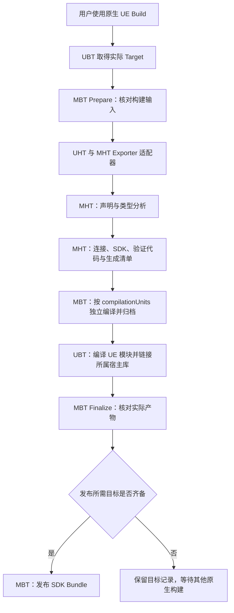

<!-- Copyright (c) 2026 Nelaric Contributors -->

# UnrealModFramework 游戏端详细设计

> 版本 设计草案 v0.5\
> 日期 2026 年 11 月 8 日\
> 基线 Unreal Engine 5.6 与 Windows Win64

本方案规定游戏工程中的 ModRuntime 源码插件、游戏接入编辑器、契约和 SDK 生成、运行时宿主及验收标准。游戏安装源码插件后，通过 C++ 或蓝图公开契约，在实际业务中接入扩展点；构建时确定全部类型投影、转换规则和类型化调用连接，冻结契约并发布 SDK；正式游戏在进入 Gameplay 前完成资源准备、实例解析和扩展链构建。

C++ 导出声明的语义分析与生成由 ModHeaderTool（MHT）承担，ModBuildTool（MBT）根据清单独立编译宿主实现并创建静态库；UBT 继续调度 UE 目标的 UHT、模块自身代码编译及最终链接。蓝图导出属于 ExportCodeGenerator 编辑器模块，后续 SDK 与开发者插件构建由 MST 编排。MHT 与 MBT 通过版本化的 Generated Artifact Manifest 交接，不共享第二套类型解析或转换规则实现。

当前仓库已有 MHT 的 C++ 扫描、参数校验和首个同步 UObject API 生成后端，支持标量参数、标量/void/World 对象返回、受限视图、宿主连接、编译验证及生成清单。宿主与视图实现是独立 `.cpp`，清单显式列出 `compilationUnits`；C# UHT Exporter 依次调用 MHT 和 MBT，已验证 UE 5.6 Win64 MSVC 的 Development Editor/Game 构建。任意类型闭包、完整 Event/Hook、通用 UBT 动作图、可信最终链接记录及跨平台自动接入仍需后续实现。当前 MHT 不扫描或校验蓝图资产。本文其余目标能力以锁定构建组合的实际验收为准。

性能目标采用同对象、同函数、同参数、同业务语义的 UE 原生调用作为基准。直接 API 消除框架新增的逐次契约查询、动态类型分析和通用转发；蓝图虚拟机、原生接口分派、对象有效性要求等属于相应原生基准。生成的对象视图构造、容器投影、Hook、Event、跨 ABI 转换、可撤销权限以及多模组决议的实际工作分别计量。代码生成不意味着这些工作没有成本。文中的能力和指标是设计要求，只有对应构建组合通过验收后才能在宿主能力报告中标记 Supported。

## 目录

- [1 游戏端最终交付](#1-游戏端最终交付)
- [2 固定架构决策](#2-固定架构决策)
- [3 物理模块与依赖](#3-物理模块与依赖)
- [4 运行时服务边界](#4-运行时服务边界)
- [5 作用域与生命周期](#5-作用域与生命周期)
- [6 宿主配置](#6-宿主配置)
- [7 契约与运行时数据模型](#7-契约与运行时数据模型)
- [8 游戏声明与蓝图接入](#8-游戏声明与蓝图接入)
- [9 SDK 与公共反射身份](#9-sdk-与公共反射身份)
- [10 契约生成与构建流水线](#10-契约生成与构建流水线)
- [11 类型化调用连接](#11-类型化调用连接)
- [12 Provider 与绑定租约](#12-provider-与绑定租约)
- [13 宿主状态机与就绪屏障](#13-宿主状态机与就绪屏障)
- [14 Native DLL 与稳定 C ABI](#14-native-dll-与稳定-c-abi)
- [15 模组清单与依赖决议](#15-模组清单与依赖决议)
- [16 Cook Profile 与资源准备](#16-cook-profile-与资源准备)
- [17 Shader 与渲染能力](#17-shader-与渲染能力)
- [18 Hook 语义与执行计划](#18-hook-语义与执行计划)
- [19 Event 通道与订阅](#19-event-通道与订阅)
- [20 内容注册与冲突决议](#20-内容注册与冲突决议)
- [21 世界扩展与 Patch](#21-世界扩展与-patch)
- [22 异步任务与并发规则](#22-异步任务与并发规则)
- [23 权限与信任边界](#23-权限与信任边界)
- [24 多人会话与存档](#24-多人会话与存档)
- [25 诊断与错误合同](#25-诊断与错误合同)
- [26 性能设计与验证方法](#26-性能设计与验证方法)
- [27 宿主能力报告](#27-宿主能力报告)
- [28 功能验收矩阵](#28-功能验收矩阵)
- [29 实施顺序与里程碑](#29-实施顺序与里程碑)
- [30 游戏接入示例](#30-游戏接入示例)
- [31 兼容性与发布变更规则](#31-兼容性与发布变更规则)
- [32 首版决策与后续验证](#32-首版决策与后续验证)
- [参考资料](#参考资料)

## 1 游戏端最终交付

| 交付 | 内容 | 使用者 |
| --- | --- | --- |
| Runtime | 契约目录、绑定、宿主生命周期、扩展点与资源服务 | 游戏接入模块和正式游戏 |
| ExportCodeGenerator | 当前提供 C++ 导出标记和 ModExportOptions；后续接入 Editor 声明导出和生成检查 | 游戏开发者与 CI |
| BlueprintIntegration | 独立导出面板、声明图、实现图、业务节点和编译展开 | 游戏开发者 |
| ModHeaderTool | 导出声明与真实类型分析、统一 IR、投影/调用/ABI/验证代码及生成清单 | 游戏开发者与 CI |
| ModBuildTool | Target 与工具链识别、构建输入和缓存管理、二进制兼容核对、SDK 产物收集与发布 | 游戏开发者与 CI |
| Game Export Definitions | Shipping 描述符、注册入口、投影类型、专用转换代码和类型化调用连接 | 正式游戏 |
| Game Mod SDK Bundle | 受限视图、公共投影与蓝图包装、ABI 头、源码/库/模块元数据、Cook Profile 和能力报告的同批交付 | 独立模组作者工程 |
| GameModSDKEditor | 消费同批 SDK 的游戏专属节点、注册与编辑器适配二进制 | 独立模组作者工程 |
| Host Capability Report | 精确构建组合、支持状态、限制和验收证据 | 游戏和制作工具 |

独立 DevelopmentEditor 消费 SDK 与能力报告。其制作、打包和发布界面不在本方案内；游戏端必须提供可机器读取的输入格式、验证规则、错误码和最小联调样例。

首版交付范围包含：固定模组集合、Global/World/Player 服务、公开 API、同步 Before/After Hook、类型化 Event、逻辑内容扩展和受控世界 Patch。Around Hook、可动态撤销入口、IoStore、原生 UE 扩展模块、模组材质 Shader 等采用独立能力开关，不因主体插件可运行而自动视为支持。运行时新增全局 Shader 类型、任意 DLL 热重载、任意反射类型替换和自动拦截未接入业务不属于首版默认能力。

## 2 固定架构决策

1. 声明产生契约，业务接入决定行为。API 标记不会替换所有既有调用；Hook 必须放入游戏实际执行路径，Event 必须显式发布。
2. 编辑器发现并验证声明，Shipping 只使用生成产物。运行时不以编辑器元数据决定公开范围。Epic 明确指出元数据只存在于编辑器，不应被游戏逻辑读取。[^R01]
3. Catalog 和 Binder 允许按 ID 查询；绑定结果必须落到构建期已生成的类型化入口，绑定成功后的普通 API 不经过统一的 InvokeById 入口。
4. 游戏依赖 Runtime；Runtime 不依赖具体游戏模块。实际访问真实成员的连接编译进该类型所属模块，接入模块只编排实例与公开注册入口。编辑器模块不得被 Shipping 间接链接。[^R02]
5. 定义、实现、实例、绑定分别保存。声明不能隐含生成服务对象，CDO 不作为默认玩法服务实例。
6. 蓝图保留独立导出面板、声明和实现图。编译结果可以是普通 UFunction，但编辑工作流不退化成普通函数上的导出开关。
7. 原生扩展默认经稳定 C ABI。直接 UE 模块扩展必须匹配专门发布的工具链和宿主构建组合。
8. 作用域 Ready 后固定实现选择。变更集合、DLL 或公共反射身份采用重启；重启层级由已产生的进程级状态决定。
9. 所有运行时操作都携带明确作用域。Global 指 GameInstance 会话，禁止以全局单例保存“当前 World”或“当前玩家”。
10. 失败处理分为提交前拒绝、受控补偿、关闭会话、重启进程。不能把 UObject、DLL 或引擎容器的任意副作用包装为可回滚事务。
11. C++ 使用声明前导出标记，MHT 独占导出语义与代码生成，UHT 继续负责 UE 反射；MBT 独立编译生成的宿主实现，UBT 编译 UE 模块自身代码并链接宿主库。MBT 不在回调中递归构建当前 Target；空宏和 PreBuildSteps 均不能替代宏共存与阶段时序的验收。
12. 宿主业务连接、公开 SDK 和游戏编辑器适配是不同产物，来自同一契约但按各自 Target 构建。完整 SDK Bundle 是交付单位，单个 DLL 不代表 SDK 或运行时能力已经交付。
13. MHT 以生成清单交付代码与契约，MBT 只对照清单、实际构建输入和产物凭证核对批次及兼容性。MBT 不重新理解成员的 C++ 类型、计算投影或补写连接代码。

### 静态生成原则

> 所有跨契约边界的类型映射、签名投影、参数与结果转换规则、可空性、只读性、错误表示、ABI 表示及调用连接，均由 Export Generator 在构建期确定并生成。
>
> 游戏开发者通过导出声明提供契约信息，无需手工编写对应的受限接口类型、第二套函数签名和常规转换代码。
>
> 生成器必须验证完整的类型依赖闭包。任何无法静态确定、存在歧义或不受支持的类型与转换，在生成或编译阶段失败。
>
> 运行时仅执行生成代码，使用已经建立的类型化绑定，并处理具体对象、作用域、授权和调用数据。不提供动态转换器选择或通用反射转换回退。
>
> 类型化访问面在编译期固定；UE 原有的虚调用与蓝图覆盖语义按契约保留。

本原则是固定架构约束，适用于 API、Event、Hook 及其 C++、蓝图和 C ABI 产物。下文的“类型转换层”指生成器中的类型分析与代码生成阶段；运行时只有已经生成的具体转换代码。

## 3 物理模块与依赖

| 模块 | 建议位置 | Target 与职责 |
| --- | --- | --- |
| ExportMetadata | Source/Runtime/ExportMetadata | Runtime；导出标识、容器与配置选项 |
| ExportCodeGenerator | Source/Editor/ExportCodeGenerator | Editor；当前提供标记及配置选项导出，后续提供 Editor 声明 IR 和生成检查 |
| BlueprintIntegration | Source/Editor/BlueprintIntegration | Editor；面板、图、K2 节点和编译扩展 |
| ModHeaderTool（MHT） | Plugins/ModRuntime/Tools/ModHeaderTool | 独立 C++ 工具；通过 C# UHT Exporter 适配器接入，拥有类型、投影和生成语义 |
| ModBuildTool（MBT） | Plugins/ModRuntime/Tools/ModBuildTool | 独立 CMake/C++ 工具；从原生 UBT 步骤取得上下文，管理构建输入、产物与发布 |
| ModSDKTool（MST） | Plugins/ModRuntime/Tools/ModSDKTool | 独立 CMake/C++20 工具；当前为 SDK 工程骨架，具体操作待实现 |
| GameModSDK | 游戏公共插件或模块 | Runtime；受限视图、公共投影、蓝图具体反射类型和调用桥声明 |
| GameModSDKEditor | 游戏 SDK 插件的 Editor 模块 | Editor；具体节点、显示与注册适配，消费 GameModSDK 和通用制作工具 |
| 真实类型所属模块 | 游戏现有 Source 或项目插件模块 | Runtime；编译该模块拥有类型的生成访问桥、参数转换和实际业务调用 |
| GameModIntegration | 游戏 Source 或项目插件，可选独立模块 | Runtime；Provider、GameplayGate、业务接入与各模块公开注册入口的编排 |

Runtime 和 Editor 是目录分类，模块身份来自各模块描述与 Build.cs。非标准目录布局须通过 UBT 发现和打包验证；必要时调整目录，不新增名为 Runtime 或 Editor 的空模块。

运行时层按具体职责建立模块，当前的 ExportMetadata 模块承载导出标识、容器与配置选项。Catalog、Binding、Lifecycle、Native、Resources、Hooks、Events、Content、WorldPatch、Diagnostics 等后续能力按实际功能、依赖与加载阶段组织，不再集中到名为 Runtime 的模块。Shader 的早期准备可以独立为经验证的早期桥接模块，不要求所有宿主服务提前初始化。

GameModSDK 承担公共契约模块这一逻辑角色。项目可以保留既有公共模块名；已发布的 /Script 身份不得因文档命名统一而重命名，也不额外生成重复反射定义。SDK Bundle 必须明确唯一的实际模块名与类型身份。

| 依赖方 | 允许的依赖与限制 |
| --- | --- |
| 游戏业务模块与 GameModIntegration | Runtime、GameModSDK 及明确的游戏公开入口；实际私有成员连接留在所属模块 |
| GameModSDK | 可随 SDK 提供的 Runtime 公开契约和所需 UE Runtime 模块；不依赖游戏私有模块或 Editor |
| GameModSDKEditor | GameModSDK、DevelopmentEditor 的公开扩展接口及所需 UE Editor 模块 |
| 引擎级 DevelopmentEditor | 自包含的版本化共享协议和 UE Editor 模块；不反向依赖项目级 GameModSDK、Runtime 或游戏业务模块 |

通用制作工具继续沿用仓库的共享协议边界；游戏专属适配模块可以依赖通用工具，通用工具通过注册协议消费适配结果。作者工程所需的 Runtime 契约及 UE 模块依赖必须随发布说明和可安装产物提供，不能从原游戏的相对路径隐式取得。插件和模块的安装层级须满足 UE 依赖方向。[^R02]

## 4 运行时服务边界

| 服务 | 主要持有数据 | 调用时机 |
| --- | --- | --- |
| Host Coordinator | 状态、阶段屏障、启动计划、关闭原因 | 启动、切图、退出 |
| Export Catalog | 不可变定义、类型和来源索引 | 注册、绑定、诊断 |
| Provider Binder | 提供者、实例、作用域代次、绑定租约 | 作用域建立和失效 |
| Dependency Resolver | 精确版本集合、约束图、稳定顺序 | 会话选择前 |
| Package Service | 验证记录、挂载状态、资产可见性 | Gameplay 前 |
| Native Loader | DLL 句柄、函数表、模组上下文 | 进程准备和会话建立 |
| Hook Service | 类型化分阶段快照、顺序和注册来源 | 注册与业务调用 |
| Event Service | 作用域通道、订阅快照与队列 | 订阅和发布 |
| Content Resolver | 逻辑内容候选、胜者、来源链 | 决议与对象创建 |
| World Patch Service | Patch 计划、应用凭证、对象来源 | 世界安全阶段 |
| Diagnostics | 阶段记录、错误链、按需采样 | 阶段变化和显式诊断 |

这是职责划分，不要求一行对应一个 Subsystem 或模块。协调器使用服务接口推进阶段，服务不能反向悄悄开启新的模组会话。包验证、DLL 装载与早期资源准备可以早于 GameInstance；玩法就绪仍由明确屏障决定。

Catalog 注册接口返回定义句柄；Binder 返回生成的类型化视图或专用入口与租约；Package Service 返回准备凭证；Hook/Event 注册返回拥有明确生命周期的 token；Patch 返回应用凭证。所有控制面结果统一带状态、稳定错误码、来源与可恢复性，普通热路径的错误表示由成员生成规则确定。

Runtime 不设置按 TypeId 查找转换器的服务。Catalog 中的类型描述用于装载、兼容检查和诊断；Binder 只在已生成且签名匹配的入口之间建立绑定，不解释类型描述以临时合成调用。

## 5 作用域与生命周期

| 层级 | 身份组成 | 所有权与失效 |
| --- | --- | --- |
| Process | ProcessBuildId | 契约模板、挂载、原生库；进程退出失效 |
| Session | SessionId 与 SessionGeneration | 一个 GameInstance；关闭会话失效 |
| World | SessionId、WorldId 与 WorldGeneration | 每个参与玩法的 UWorld；关闭或切图失效 |
| Player | 会话、游戏玩家身份与 PlayerGeneration | 游戏显式管理；不是全局玩家序号 |
| Object | 实际对象与原生对象有效性信息 | 调用者和游戏管理；无需注册全局服务 |

Global 服务限定于 Session。GameInstance/World Subsystem 可承担生命周期接点，但 Initialize 完成不代表模组 Ready。Subsystem 本身提供自动实例化与托管生命周期，业务就绪条件仍由本框架定义。[^R03]

PlayerScope 默认随其所属 World 关闭。跨无缝旅行保存的是游戏玩家稳定身份和可序列化状态；新 World 创建新的 PlayerScope 与绑定。即使 Actor 被引擎保留，也必须显式重新归属。LocalPlayerSubsystem 只适用于本地玩家；服务端玩家由游戏的 PlayerState、Controller 或专用提供者接入。

同一 Session 在旅行期间可以同时存在旧 World、过渡 World 和新 World。每个作用域独立标识；只有宿主指定的目标世界可进入玩法。EditorPreview、Thumbnail、非玩法 World 默认不建立模组玩法作用域，PIE、Game 和 Dedicated Server 的允许组合写入策略。

PIE 可隔离会话可变状态，却共享进程包命名空间与已注册反射类型。多个会话可选择同一已准备版本的不同启用子集；同一包身份的不同模组版本不能同时准备。需要对照不同版本时启动独立进程。Editor 中会影响契约、已缓存 UFunction 或反射身份的重新编译会使相关 PIE 会话失效，首版要求重新开始 PIE。

## 6 宿主配置

| 配置组 | 必填信息 | 验证规则 |
| --- | --- | --- |
| 身份与构建 | GameId、GameVersion、EngineBuildId、Runtime/ProtocolVersion、Target、架构 | 必须匹配发布产物 |
| Cook Profile | 后端、基础发布身份、RHI/Shader 平台、关键 Cook 设置、允许类型与插件 | 指纹匹配；差异按白名单评估 |
| 模组策略 | 启用集合、固定版本、可信来源、Native 策略、缓存根 | 会话 Ready 前冻结 |
| 契约注册 | 公共契约包、生成注册入口、SDK 指纹 | 不依赖运行时编辑器扫描 |
| 实例提供者 | ExportDefinition、ProviderKey、作用域、创建和释放责任 | 每个必需绑定有唯一决议结果 |
| 扩展点策略 | Hook 阶段、事件队列、内容槽、Patch 安全点 | 与声明和游戏接入一致 |
| 权限 | 能力名单、绑定期固定或动态撤销、服务端约束 | 权限模型与调用路径一致 |
| 网络与存档 | 联机模组策略、网络兼容指纹、存档迁移规则 | 加载玩法前完成核对 |
| 性能与资源预算 | 单包和总预算、队列上限、启动超时、回调预算 | 越限有明确失败策略 |
| 诊断 | 日志级别、采样、报告路径、发布构建开关 | 默认不逐次记录热路径 |

默认业务 API 在 Game Thread 执行；需要工作线程的函数逐项声明并验证。默认绑定在作用域内固定，默认关闭 DLL 热卸载和物理包卸载。可选模组失败默认要求确认后的新启用集合重新开始准备，禁止在 Ready 后静默切换实现。

Cook Profile、Host Capability Report、SDK 和游戏可执行文件必须带同一发布关联标识。任何可影响行为的配置参与会话指纹；本地绝对路径、时间戳、显示文本等不参与兼容性哈希。

## 7 契约与运行时数据模型

### 标识与签名

GameId、ModId、ExportId、TypeId、MemberId、ProviderId、ExtensionPointId 均为发布后稳定的显式标识。显示名称、文件路径和蓝图节点标题可修改，不用作唯一身份。创建标识后作为源数据持久保存，不能每次扫描重算随机值；删除后的已发布标识保留 tombstone，禁止复用。

SourceSignatureHash 记录原始游戏成员的所属类型、完整签名与限定符，用于发现生成产物过期。SignatureHash 对生成后的 Mod 侧规范化签名计算，覆盖参数顺序、公开 TypeId、值/引用/const/out、返回类型、同步或异步、公开继承约束、关联类型布局版本和必要分派语义。

ProjectionHash 记录原始类型与公开类型的映射、递归字段投影、可空/只读规则、容器复制或借用方式、输出提交规则、错误表示及转换规则版本。PolicyHash 覆盖作用域、线程、权限、Authority、取消、错误和顺序规则。改变错误表示等同时影响签名的规则时，相关摘要均更新。文档、分类和显示名不进入调用签名。默认参数变化单独报告，因为已编译调用方可能保留旧默认值。

ExportHash 表示公共定义集合；CookProfileHash 表示资源构建兼容性；NativeABIHash 表示服务表和边界布局；ResolvedModSetHash 表示精确模组集合、权限和决议配置。哈希命中仍保留可读字段用于差异诊断，冲突不能靠“同一个哈希”覆盖不同定义。

### 核心记录

| 记录 | 主要字段 | 约束 |
| --- | --- | --- |
| ExportDefinition | ID、版本、成员、所需类型、公开策略 | 注册后不可变 |
| TypeDefinition | ID、公开类型身份、种类、投影字段、布局/序列化版本、边界能力 | 公开投影的递归闭包可用 |
| MemberDefinition | MemberId、Mod 侧签名、源签名摘要、投影摘要、线程、作用域、权限、错误 | 不隐含实例，不要求开发者维护两套签名 |
| TypeProjection | 原始类型、公开表示、字段映射、可空/只读、所有权和转换规则 | 构建期 IR；全部解析后生成代码，不作为运行时转换脚本 |
| GeneratedCallPlan | 原始成员、Mod 签名、具体入口、检查、参数/结果转换、输出提交与分派规则 | 构建期生成依据；运行时执行其产物 |
| ImplementationDescriptor | ExportId、ProviderId、目标符号、实现形式、来源 | 一个定义可有多个候选 |
| ProviderDescriptor | ProviderKey、作用域、依赖、提供/释放方式 | 不以查找首个 Actor 决议 |
| InstanceRecord | 实际对象或 native context、ScopeKey、Generation、所有者 | 一个实例可实现多个契约 |
| BindingRecord | 调用方、成员、最终实例、生成入口/类型化表槽、签名、租约和权限模型 | 不承担逐次通用转发或转换方案选择 |
| ModInstance | ModId、会话上下文、生命周期状态、注册 token 集合 | 不与进程 DLL 句柄混同 |
| RegistrationReceipt | 所有者、作用域、资源种类、撤销动作、提交状态 | 支持重复清理 |

控制面保存完整来源：声明资产或 C++ 符号、生成器版本、模组包哈希和生成指纹。热路径只持有所需的类型化引用、连续处理器条目和最小生命周期信息，避免复制完整描述符。

### 类型能力

类型支持按 Native UE、Blueprint、C ABI、序列化和网络分别发布。每种支持都必须对应已生成的具体投影和转换连接。不能因某类型可出现在蓝图 Pin 上就认为可跨 DLL 或可复制。

| 类型族 | UE 与蓝图路径 | C ABI 首版策略 |
| --- | --- | --- |
| 定宽整数、浮点、枚举 | 保留 UE 类型语义 | 明确位宽、字节序、枚举范围；布尔规定表示 |
| 字符串与本地化文本 | 使用公共 UE 类型 | UTF-8 字节视图或缓冲区；FText 另定义本地化语义 |
| 公开 USTRUCT | 公共模块或契约资产中的生成投影；字段均允许同形公开时可使用恒等投影 | 仅已生成逐字段转换的固定布局 DTO |
| UObject、Actor | 生成的 `FModRuntimeObject<T>`；const 对象映射为只读视图 | 不透明句柄及专用验证代码，含类型、作用域、代次与授权 |
| Class | 生成的受限类引用；明确可构造类型及公开工厂 | 受限类句柄，不能直接获得任意 UClass 操作 |
| 软资产引用 | 保留包和对象身份 | 规范化路径或资源句柄；不自动同步加载 |
| TArray、TMap、TSet | 元素与嵌套类型递归投影；按声明固定复制、借用或受限序列形式，BP 只接受实际支持的组合 | 数组视图或复制记录；Map/Set 用受限条目序列，均生成专用转换 |
| 用户定义结构体与容器嵌套 | 按公开类型闭包与 Cook 验证 | 首版不自动获得 ABI 能力；需专门转换验收 |
| Delegate、latent、泛型通配 Pin | 单独契约或拒绝导出 | 不跨边界传 UE delegate 或任意函数对象 |

游戏侧原始签名可以使用真实游戏类型；生成器必须为其生成合法的受限视图或公开值投影。拒绝向 Mod 泄漏私有游戏类型的原生定义、裸引用与内存布局，拒绝编辑器专属类型、未定义所有权的指针/引用、ABI 中的 UE 容器对象和任意不受支持的 C++ 模板实例。不能形成完整投影的成员在构建期拒绝。

容器元素、嵌套字段、Map Key 的哈希/相等语义、对象可空性、数组长度和递归深度都需写入验证约束。仅在声明固定了缺省构造、遗漏字段处理和写回规则时，才允许将原始结构投影成字段更少的公开结构。

## 8 游戏声明与蓝图接入

### C++ 声明

C++ 导出采用声明前标记，指向真实游戏成员并提供导出范围、投影、作用域、权限与失败策略。游戏函数保持原始签名；MHT 从紧随标记的具体 AST 声明推导 Mod 侧签名，开发者无需重复写重载成员指针类型、第二套签名或常规对象包装。

以下展示拟定语法；完整选项由统一 Schema 定义，示例中的标记落点须通过第10节的标准 UHT 共存验收：

```cpp
#include "CoreMinimal.h"
#include "GameFramework/Character.h"
#include "ModExportMetadataAnnotations.h"
#include "MyCharacter.generated.h"

MOD_EXPORT_CLASS(ExportId = "game.character")
UCLASS(MinimalAPI)
class AMyCharacter : public ACharacter
{
    GENERATED_BODY()
    MOD_GENERATED_BODY()

public:
    MOD_EXPORT_API(
        ExportId = "game.character.get_health",
        ExportVersion = "1.0",
        Scope = World,
        Thread = GameThread,
        FailureRule = ReturnError,
        Permissions = ("character.read"))
    UFUNCTION(BlueprintCallable, Category = "Mod")
    float GetHealth() const;

    DECLARE_MULTICAST_DELEGATE_OneParam(FOnDied, AMyCharacter*);

    MOD_EXPORT_EVENT(
        ExportId = "game.character.died",
        ExportVersion = "1.0",
        Scope = World,
        Delivery = Sync,
        Payload = ReadOnlyBorrow,
        PublishPermissions = ("character.publish"),
        SubscribePermissions = ("character.observe"))
    FOnDied OnDied;

    MOD_EXPORT_HOOK(
        ExportId = "game.character.apply_damage",
        ExportVersion = "1.0",
        Scope = World,
        Stages = (Before, After, OnFailure),
        MutableInputs = (Amount),
        MutableOutputs = (ReturnValue),
        Permissions = ("character.modify_damage"))
    float ApplyDamage(float Amount);
};
```

| 标记 | 必须关联的实际声明 | 解析结果 |
| --- | --- | --- |
| MOD_EXPORT_API | 函数或明确支持的调用声明 | 完整原始签名、重载身份及调用策略 |
| MOD_EXPORT_EVENT | delegate/EventSource 字段或显式事件签名锚点 | 事件源、载荷和订阅签名 |
| MOD_EXPORT_HOOK | 游戏业务函数 | Core 签名、阶段上下文和允许修改范围 |

关联时只允许跨过 Schema 规定的 UE 标记、C++ 属性和注释；遇到其他声明、跨所有者或无法唯一绑定时拒绝。多个 Kind 叠加仅在 Schema 明确允许时成立。非 UFUNCTION 成员也可由 MHT 的 AST 前端解析，但必须处于支持的形状和后端范围，不依赖 UHT 解析任意 C++。

某个类存在任一导出时，MHT 为其建立类型记录和受限视图，MOD_EXPORT_CLASS 只提供类型级附加配置。没有类型级标记时，稳定 TypeId 仍须进入受版本控制的身份清单并持久保存，不能每次扫描重新生成。导出类型不创建实例，对象仍由 Provider、API 返回值、Event 或 Hook 显式提供。

普通 C++ 视角下，声明宏可为空。需要访问非公开成员时，类可以通过单独的 MOD_GENERATED_BODY 对当前类型的生成桥显式授权，示意为：

```cpp
namespace Mod::Generated
{
    template<class TOwner> struct TClassAccess;
}

#define MOD_EXPORT_CLASS(...)
#define MOD_EXPORT_API(...)
#define MOD_EXPORT_EVENT(...)
#define MOD_EXPORT_HOOK(...)
#define MOD_GENERATED_BODY() \
    friend struct ::Mod::Generated::TClassAccess<ThisClass>;
```

MHT 在宏被擦除前收集标记。上述友元形式要求类中存在正确的 ThisClass；生成器须验证授权类型，不猜测所有者。private/protected 只能通过合法公开入口或原类显式友元接缝访问，友元不继承、不传递，基类 private 成员需要基类自身授权。生成器不能绕过访问控制。MOD_EXPORT_API 也不替代模块的 DLL 导出说明符；跨模块链接仍由必要的逐方法/桥符号导出负责。[^R08]

### 统一选项 Schema

一个版本化 Schema 驱动 C++ 标记语法、蓝图编辑选项、默认值、验证器、文档及兼容摘要，C++ 和蓝图不得各自维护独立语义。已有 GameplayTags 和 DefaultGameMod 配置可提供标识与选项输入，但其可选值不代表运行时已经实现该能力；生成时须核对同一 Schema 与宿主能力策略。

宏中的契约标识沿用现有 `ExportId` 字段及已注册 GameplayTag 校验，类型映射、生成清单和发布清单均引用这份稳定身份；不引入另一套独立的 ContractId 身份。

| 类别 | 必须表达的配置 |
| --- | --- |
| 公共 | ExportId、版本、显示名称、描述、作用域、线程、Authority 与稳定身份关联 |
| API | 调用权限、FailureRule（可恢复失败统一 ReturnError）、同步/显式异步、完成/取消关联、Pure/执行引脚、副作用、绑定要求、参数方向与生命周期 |
| Event | 发布/订阅权限、发布/分发线程、同步/队列、载荷策略、顺序、重入/限深、容量/预算、溢出/合并、退订与监听失败 |
| Hook | 参与权限、阶段、输入/结果写入范围、取消及完整结果、Around/替代/组合规则、重入、阶段失败、排序与输入提交 |

语法支持字符串、布尔、数值、枚举、列表与嵌套字段；类型、成员路径和契约引用以明确的引用种类保存。未知/重复字段与非法组合直接报错。文本、权限列表和嵌套数据按公开的可配置预算验证，不使用未声明的固定数量或静默截断。

首版核心 DSL 使用字面量和 Schema 枚举。若以后允许命名 constexpr 表达式，必须交给 AST 常量求值，不能靠字符串替换模拟 C++。API 的 const 不自动意味着 Pure、线程安全或授权；Event 的只读性不要求发布者/监听者的 this 为 const；Hook Core 是游戏业务体，不是可供 Mod 注册的阶段。Around 等可选组合仍受独立能力开关限制。

业务接入点至少包括提供实例、调用 Hook、发布 Event、注册逻辑内容槽和登记世界锚点。它们可以由游戏 C++ 接入，也可以由对应蓝图业务节点接入。构建报告分别展示“已声明”“已实现”“已接入”“已 Cook 验证”，只标记声明不得显示为运行时可用。

### 蓝图工作流

独立面板包含 API、Hook、Event、Content Slot、World Extension 和 Provider 分类。每项声明拥有稳定 ID、原始参数与返回 Pin、投影规则、作用域、线程、权限、版本和来源；实现图引用声明 ID，Mod 调用 Pin 由生成后的签名推导，不能另存一份可漂移的签名。修改签名后按 PinId 重建连接，无法安全迁移的连线产生编译错误。

声明图定义“可被调用什么”，实现图定义当前提供者的行为。游戏声明和游戏实现可以使用真实游戏类型，Mod 侧使用生成的公共投影；这些公共类型来自共享契约模块或共享契约资产。实现图保留在游戏或模组工程，SDK 不暴露游戏私有实现。已有普通函数只有通过显式导入/适配动作才成为实现，其调用层数须记录。

C++ 与蓝图声明进入同一个 Export IR，经过同一套类型闭包分析、签名投影和检查规则解析，生成 C++ 受限视图、蓝图具体包装类型、API 函数桥、Event 回调签名、Hook 阶段上下文和节点展开规则。蓝图不直接使用任意 C++ 模板实例；所需的具体反射包装按第10节的构建顺序生成并编译。

独立实现图编译到正常反射成员或接口实现。调用节点在编译时连接到具体生成入口；恒等投影且无需附加检查时可展开为标准 UE 函数或接口调用，其余情况展开到专用桥。Provider 获取节点只用于作用域建立。禁止框架新增每次执行 GetService、FindFunction 和通用参数包的隐藏链；正常 UE 事件/接口内部为保留覆盖语义执行的查找属于原生基准。UE 蓝图编译包含节点展开、UFunction 建立和 VM 字节码生成；生成 C++ 风格调试输出不代表蓝图变成原生机器码。[^R05]

蓝图 API 默认使用带执行引脚的调用。只有已绑定、无副作用、无需动态权限/日志/异步操作的成员才允许 Pure；Pure 不能保证只求值一次，框架不得借其执行隐式注册或资源加载。同步 Hook 中禁止 latent 节点；异步 API 使用独立请求/完成/取消契约。

必需诊断包含重复 ID、未实现声明、未接入扩展点、私有类型泄漏、未解析/歧义/不支持的投影、可空或只读冲突、错误返回与绑定模式冲突、非法借用、错误 World/Player 来源、Pure 副作用、latent 混入同步链、缺少 Provider 和生成产物过期。双击诊断必须定位源资产、图、节点或 C++ 符号，并展示原始签名与 Mod 投影。

## 9 SDK 与公共反射身份

SDK 至少提供可读契约目录、生成的 `FModRuntimeObject<T>` 视图和只读视图、公共投影结构、蓝图具体包装、类型化调用声明、Event/Hook 类型、C ABI 头与布局说明、Cook Profile、基础发布依赖信息、能力报告、签名差异规则和一个独立作者工程样例。JSON 能描述约束，但不能独立满足 C++ 静态访问面或蓝图编译和 Cook 对反射类型的需求。

`FModRuntimeObject<AMyCharacter>` 中的 AMyCharacter 用于标识原始游戏类型。C++ SDK 可以只提供该类型的前置声明及生成的视图特化，使用者不需要获得游戏类的完整定义；模板主版本不得回退为开放原始对象的通用包装。蓝图使用另行生成的具体公共反射类型，不依赖私有游戏类的占位反射定义。视图内部表示不公开可绕过契约的原始对象指针或任意 Cast 入口。

C++ 视图的调用后端按 SDK 目标固定为宿主内 UE 连接或稳定 C ABI 专用连接。独立 DLL 中的视图仍通过生成的句柄、DTO 和函数表调用，不链接私有游戏 C++ 符号，不跨 ABI 传递视图模板实例或 UE 对象布局。

生成视图保留真实 T 的静态身份，示意如下；对象引用与绑定表的具体布局由目标后端固定：

```cpp
class AMyCharacter;
template<class TObjectType> class FModRuntimeObject;

template<>
class FModRuntimeObject<AMyCharacter>
{
public:
    TModResult<float> GetHealth() const;
    FMyCharacterEvents Events;
    FMyCharacterHooks Hooks;

private:
    FModObjectRef Object;
    const FMyCharacterBindings* Bindings;
};
```

API、Event 和 Hook 分别生成受限成员、类型化订阅入口与分阶段注册能力；子视图不自动授予实际权限。不提供获取原始 UObject 的 Get、隐式转换或解引用入口。无论声明来自 C++ 还是蓝图，本版可恢复 API 失败统一采用 ReturnError 与 TModResult，不引入可切换的 Try 签名。

Native 公共类型使用稳定的模块名与反射类型身份，例如 /Script/GameModSDK。作者工程与宿主以同一导出版本构建它；模组最终内容包不得重新提供宿主已拥有的同名脚本模块或反射定义。内容型契约资产采用稳定包路径、对象名、GeneratedClass 身份和依赖闭包，作为基线发布内容参与作者工程 Cook，模组容器只携带新增包。

`FModRuntimeObject<AMyCharacter>` 的 C++ 模板特化不自动成为蓝图变量类型。MHT 为蓝图生成具体共享反射视图，例如 FModCharacterRef，由实际的 GameModSDK Runtime 模块拥有；游戏和作者工程冻结相同的 /Script 模块名、类型名、字段及签名。GameModSDKEditor 提供编译节点，编译后的蓝图只引用游戏中存在的 Runtime 类型与函数。需要原始类继承或原始类资产引用的能力必须另外发布真正共享的公共反射定义，不能靠占位 UCLASS 冒充。

游戏侧的蓝图实现载体可选择共享公共基类或接口资产；独立实现图编译到实际提供者的成员实现。Mod 调用者持有生成的受限视图和绑定，生成入口在宿主内部取得实际提供者对象。将私有游戏类完整伪造成同名占位类不能作为通用 SDK 方案：父类、字段、布局、导入导出和 Cook 依赖可能不同。若必须用代理对象适配遗留业务，能力报告标记 Adapter，并把新增对象与转发成本纳入基准。

受限视图不要求把所有 API 改为 UE 接口。底层已存在具体类型且可以按原生语义直接调用时，生成连接保留该调用；需要蓝图可覆盖和多实现时采用相应的公共基类、事件或接口路径。两种形式分别与同样形式的 UE 原生调用比较，并单列投影和检查的新增成本。

SDK 发布原子地冻结定义、公共类型、Cook Profile 和能力报告。兼容性工具对新增/删除成员、参数变化、结构体布局、继承、作用域、权限、错误语义和网络/存档变化分别判断；SemVer 是发布说明，实际加载按所用成员指纹及边界约束判定。

### SDK Bundle 与二进制交付

SDK Bundle 是同批次的完整交付单元。只交付一个“导出 DLL”不能满足 C++ 编译、UE 模块装载或蓝图 Cook；制作编辑器插件消费头文件与适配源码并链接 SDK，DLL 不作为再次编译的源码。

这里的同批次指同一个已冻结的发布输入集；Game 与 Editor 可以各有对应上下文的生成批次，发布清单必须记录关联和共享公共契约的兼容性，不能要求忽略 Target 差异后强行共用全部文件。

| Bundle 内容 | 用途与约束 |
| --- | --- |
| SDK 清单 | 游戏身份、Schema/生成器版本、生成批次、Target/Profile、输入/契约/投影/ABI 摘要 |
| 生成的 Public 头 | 类型、受限视图、具体函数与回调声明；可独立消费 |
| 适配源码或等价可编译输入 | GameModSDKEditor 的节点、注册与桥接，不能包含游戏私有实现 |
| SDK 二进制与链接输入 | 作者 Editor 可加载的 DLL、Windows 隐式链接所需 .lib 及所声明依赖 |
| UE 模块描述 | .uplugin、.Build.cs、.modules，以及目标构建要求的预编译元数据 |
| 契约与显示目录 | 浏览、诊断、差异、稳定公共身份及生成连接信息 |
| 资源与验证描述 | Cook Profile、基础发布依赖、能力报告及与游戏发布关联的证据 |

以 MyGame 为例，发布包可以采用以下结构；实际模块名与既有公共反射身份保持一致：

```text
MyGameModSDK/
├── MyGameModSDK.uplugin
├── Source/
│   ├── MyGameModSDKRuntime/
│   │   ├── Public/                       # 生成视图、类型与调用声明
│   │   └── MyGameModSDKRuntime.Build.cs
│   └── MyGameModSDKEditor/
│       └── MyGameModSDKEditor.Build.cs
├── Binaries/Win64/                      # 对应目标的实际 DLL、模块元数据
├── Lib/Win64/                           # 声明需要的目标兼容导入库
├── Contract/
│   ├── MyGame.modcontract.json
│   ├── MyGame.generated-artifacts.json  # MHT 的生成清单
│   └── MyGameModSDK.manifest.json       # MBT 的发布清单
└── Resources/
```

MHT 提供生成文件与生成清单，MBT 核对后组织发布目录；DLL、LIB 和 UE 元数据只能从对应原生构建的实际结果收集。源码交付与预编译交付分别记录，不能因目录中有 `.Build.cs` 就认定预编译依赖完整。

Windows 隐式链接需要公开声明、导入库与运行时 DLL；显式动态加载可以不链接 .lib，但仍需正确的函数签名和 ABI 协议。[^R20] UE 二进制模块必须保留匹配的 BuildId、.modules 与依赖集合，不能修改标识强行装载。[^R09]

| 产物角色 | 构建目标 | 独立制作编辑器的使用方式 |
| --- | --- | --- |
| 游戏真实业务连接 | Game/Client/Server 等各自目标 | 不作为默认依赖，不加载 Shipping 游戏 DLL 来代替 Editor 模块 |
| 公开 GameModSDK | 游戏目标与匹配的作者 Editor 目标分别构建 | 加载 Editor 兼容版本，保持共享 Runtime 反射身份 |
| GameModSDKEditor | Editor | 消费 SDK Bundle，注册节点、UI 与编译规则 |
| 通用 DevelopmentEditor | Editor | 通过公开扩展协议接入游戏专属适配 |

游戏侧是否存在独立 DLL 取决于 Target 链接方式；monolithic 构建可以把相应代码链接进可执行文件。SDK Bundle 不承诺从任意 Shipping 目标导出一个 UE DLL。若产品另需独立 Native Bridge DLL，应生成稳定 C ABI 桥并由游戏模块注册类型化入口，它与 Editor SDK DLL 分别发布和验证。[^R08]

没有游戏私有源码或真实游戏实例的作者工程应能加载 SDK、浏览契约并编译 Mod 声明。实际业务调用仍需匹配的 Preview Host 或真实游戏 Provider；未连接时明确不可用，不返回伪成功结果，也不因导出一个类而自动创建游戏实例。

## 10 契约生成与构建流水线

### MHT、MBT 与原生 UBT 的职责

MHT 负责声明解析与代码生成；MBT 根据生成清单独立编译宿主实现并归档，通过原生构建扩展接入。默认使用 IDE、命令行或 CI 的正常 UE Build 入口，不要求游戏开发者改用另一个构建入口。宿主生成实现不进入 UBT 的 C++ 编译列表。

| 职责 | MHT | MBT | 原生 UE 工具 |
| --- | --- | --- | --- |
| 解析 MOD_EXPORT_*、检查配置和稳定契约 ID | 唯一负责方 | 传递版本化输入 | Editor 提供实际配置选项与标签目录 |
| 获取真实 C++ 类型与完整成员签名 | UhtTypeAdapter / CppTypeAnalyzer | 只提供真实构建上下文 | UHT 提供已解析反射信息 |
| 完整类型依赖闭包、游戏到 Mod/ABI 类型投影 | 唯一负责方 | 不解析类型或重算规则 | 不定义 Mod 导出语义 |
| 生成 FModRuntimeObject、参数/结果转换及调用连接 | 唯一负责方 | 独立编译生成实现，不生成代码 | 消费生成声明并链接宿主库 |
| 生成契约描述符、ABI 声明和编译期验证代码 | 唯一负责方 | 按清单编译具体函数体与校验单元 | 不通过包含实现重复编译 |
| 识别 Target、配置、平台、架构与工具链 | 消费已锁定上下文 | 核对 Profile 与构建输入 | UBT 提供实际 Target 环境 |
| 管理生成文件 | 生成内容、清单和语义依赖 | 管理构建输入、缓存与清单引用 | 按登记的依赖决定增量执行 |
| 检查 SDK 与二进制兼容性 | 提供契约/投影/ABI 摘要 | 核对构建身份、批次与实际产物 | 提供构建凭证及模块元数据 |
| 收集 DLL、LIB 和必要 UE 元数据 | 不负责 | 从成功目标的结果收集 | 按目标实际产生 |
| 组织 SDK 发布包 | 不负责 | 完整性检查与原子发布 | 不定义 Mod SDK 发布策略 |
| 编译 MHT 宿主实现 | 不负责 | 使用真实所属模块编译配方，独立编译并创建静态库 | 提供真实 Target 与模块编译上下文 |
| 编译 UE 模块与最终链接 | 不负责 | 提供宿主静态库和构建回执 | UBT 编译模块自身代码，将库链接到所属二进制 |

当前 C# UHT 适配器先调用 MHT `generate`，再调用 MBT `build-host`；已验证的 Win64 MSVC 后端从真实 UBT 编译数据库转交所属模块的生产者配方。MHT 在 `compilationUnits` 中列出全部独立编译单元，MBT 逐项编译并创建宿主库。所属模块通过私有 External 依赖登记库，MBT 成功后刷新 UE 文件缓存，UBT 才继续最终链接。更完整的 Prepare/Finalize 动作和可信最终链接记录仍需后续接入。MBT 不在回调中递归启动当前 Target，跨目标要求交给外层原生构建入口或 CI 分别执行。



图中箭头是逻辑依赖，不是已验证的引擎回调顺序。UE 5.6 提供 C# UHT Exporter 与 Target 的 PreBuildSteps/PostBuildSteps；Prepare 相对 UHT 的位置、Exporter 相对标准 Codegen 的关系、增量跳过路径及 Finalize 的执行条件，仍须在锁定的 Profile 中实测。需要多轮 UHT 或后置 Clang 分析的组合使用下述显式阶段，不宣称单次 PreBuildSteps 能提供任意中间屏障。[^R04][^R21]

### MHT 的声明关联与统一 IR

Export Generator 是逻辑能力，MHT 是唯一的导出语义分析与生成核心。C# UHT Exporter 适配器负责把 UHT 已解析的类型模型、模块及源位置交给 MHT，不另建一套投影规则。MBT 从 UBT 实际构建上下文取得目标类型、平台/架构、配置、WITH_EDITOR 等宏、include 根、强制包含、语言模式、工具链及依赖摘要，形成可核对的构建输入；不能手写一个近似编译环境代替该 Target。

UhtTypeAdapter 消费已反射类型的已解析信息；非 UFUNCTION 成员或需要完整 C++ 限定符、重载与模板信息的声明交给 CppTypeAnalyzer。该分析器由 MHT 自己完成词法标记记录和 Clang PPCallbacks/AST 关联，以具体 CXXMethodDecl 区分重载，生成精确成员指针 static_cast，不按函数名在全类中猜测。UHT 类型模型不等价于任意 C++ AST；某条后端不能完整还原签名时必须拒绝或进入已验证的完整分析阶段。具体 Clang 版本及 UE/MSVC 兼容选项由工具链 Profile 锁定并验收。[^R04][^R18][^R19]

当前实现处理 C++ 声明扫描、参数校验，以及首个同步 UObject API 后端的 AST 绑定、对象视图和宿主代码生成。完整设计中，蓝图声明仍由独立的 ExportCodeGenerator/Commandlet 前端通过 Asset Registry 发现和加载，导出资产、图、节点和 Pin 身份后向 MHT 生成核心提交 IR；MHT 不承担资产扫描，MBT 只管理该 IR 的输入依赖。最终覆盖报告包含所有要求参与的模块和资产，缺失所需输入不得发布“完整契约”。C++ AST 不以某个 Editor 进程恰好加载的 UFunction 集合作为唯一成员来源。

| IR 记录 | 已解析的信息 |
| --- | --- |
| FExportTypeIR | 稳定身份、真实 C++ 名称、继承、所属模块、公开投影 |
| FAPIIR | 具体成员、参数/返回、cv/ref/noexcept/调用约定、失败、权限与调用方式 |
| FEventIR | 源类别、载荷、回调、同步/队列、订阅与发布策略 |
| FHookIR | Core、阶段上下文、可写字段、Next/取消/结果协议 |
| FTypeUseIR | 类型使用角色、方向、空值、生命周期、所有权与目标后端 |
| FProjectionPlanIR | 原始类型到 Mod/ABI 类型的完整转换计划，对应第7节 TypeProjection |
| FSourceIR | 原始文件范围、快照映射，或蓝图资产/图/节点/Pin 身份 |
| FTargetProfileIR | UE、工具链、ABI、Target、Cook、模块依赖与输入兼容条件 |

类型分析保留 const FData&、FData&、FData* 和 FData 的方向与生命周期差异，不能先 remove_cvref 后只按基础类别处理。前置声明和递归类型可以在分析中间态等待解析，但发布前 unresolved 必须为零。生成计划标识仅用于构建和诊断，运行时不按该标识查找转换器。

### 类型分析与代码生成职责

MHT 以真实游戏成员与导出规则为输入，为每个 API、Event 和 Hook 生成完整调用形式。类型分析与转换方案选择均在本阶段完成；MBT 只核对 MHT 交付的清单和摘要，运行时描述符不承担解释这些方案的职责。

| 内容 | 生成期确定的结果 |
| --- | --- |
| 原始成员 | 所属类型、具体成员、完整签名、访问条件、const/ref/out 等限定符 |
| Mod 侧签名 | 参数、返回值、公开类型、输入/输出方向和结果表示 |
| 对象引用 | 对应的 `FModRuntimeObject<T>` 或只读视图、预期类型及所需作用域/授权 |
| 结构体 | 每个公开字段的表示、递归转换、缺省值、验证与写回规则 |
| 容器 | 元素和嵌套类型、长度限制、复制/借用/受限序列方式及生命周期 |
| 可空性 | 参数、结果、字段和容器元素是否可空，以及空值的明确表示 |
| 只读性 | 可调用的成员、可修改字段、只读视图和合法转换方向 |
| 输出参数 | 临时结果结构、转换和验证顺序、成功提交及失败处理 |
| 错误规则 | 成功值、失败分支、错误表示与业务提交状态 |
| Event | 具体载荷与回调签名、对象视图、参数转换、订阅/发布入口 |
| Hook | 各阶段上下文、固定字段、可修改范围、写回验证与调用链签名 |
| ABI 边界 | DTO 布局、句柄表示、错误码、专用函数表槽位与双向转换连接 |
| 调用目标 | 具体连接符号或类型化表槽、允许的实现形式及保留覆盖的分派方式 |

生成器递归验证完整的类型依赖闭包，包括结构字段、容器元素、可空性、引用方向、借用所有者和 ABI 目标。任何节点未解析、存在歧义、不受支持或不能合法生成时，生成或编译失败并报告从成员到问题字段的依赖路径。不得生成“运行时再决定”的占位转换，也不得在 Gameplay 通过反射补齐未知类型。

### 游戏签名与 Mod 签名的自动投影

游戏代码继续使用真实游戏类型。开发者声明导出成员及投影策略后，生成器自动建立源签名到 Mod 签名的对应关系；实现图、SDK 和调用连接均从这份关系派生。下列名称表示拟定的生成合同，不代表当前仓库已经实现这些产物。

| 游戏侧声明中的类型或位置 | 生成的 Mod 侧表示 |
| --- | --- |
| float 等标量 | 同形标量；需要可恢复失败时按统一规则生成结果类型 |
| AMyCharacter* | `FModRuntimeObject<AMyCharacter>`，包含声明要求的对象、作用域与授权关联 |
| const AMyCharacter* | `FModRuntimeObject<const AMyCharacter>`，只生成允许的只读操作 |
| `TArray<AMyCharacter*>` | 默认生成对象视图的值数组；其他受限序列形式必须由声明明确选择 |
| 含对象引用或嵌套容器的结构体 | 逐字段递归投影后的公开结构；不能直接暴露原始对象字段 |
| Event 的角色参数 | 对应对象视图；默认只读，额外修改能力必须显式声明与授权 |
| Hook 的阶段上下文 | 固定字段和修改范围的生成类型，连接到该阶段的具体回调签名 |

每种容器形式及其嵌套规则必须在声明或版本化生成配置中确定。默认按值复制；借用必须明确所有者、有效期、可变性、失效行为及保留方式。返回局部临时容器的借用视图、异步持有无保留凭证的借用、无法保持要求语义的 Map Key 投影等组合在构建期拒绝。模组作者无需手工把游戏对象或容器元素包装成视图。

原始游戏成员可以保持：

```cpp
float GetHealth() const;
```

声明选择 `FailureRule = ReturnError` 后，生成器在相应对象视图上生成：

```cpp
TModResult<float> GetHealth() const;
```

首版统一以 `TModResult<T>` 表示这类 API 的可恢复失败，void 成功值使用 `TModResult<void>`，不另设可切换的 Try 签名模式。结果包含成功值或稳定错误，失败时不得伪造默认成功值。原始游戏函数的签名不受这一投影影响。

存在 out/inout 参数时，生成器将原返回值及全部输出值收集到专用输出结构；ReturnError 调用返回该结构的 TModResult。inout 的输入以投影值传入，输出先在临时存储中转换并验证，全部成功后才向调用者提交。输出转换失败不能撤销原函数已经产生的业务副作用，错误必须保留提交状态。

保持原返回类型的无可恢复错误形式，仅适用于声明、授权和生命周期合同能够保证的成员。CheckedBinding、可失效对象、可撤销权限或可能失败的投影必须具有已生成的失败出口；与无错误出口等不兼容配置的组合在生成期拒绝。蓝图结果生成具体的成功/值/错误包装类型和分支，C ABI 生成状态码与输出字段；三者使用同一错误规则。

Event 的转换失败按事件声明的诊断/升级策略处理，不增加决定原业务成功与否的返回值；Hook 使用其已声明的 Continue、Cancel、Fail 及结果合同。生成器分别固定这些连接，不能将 API 结果包装规则机械地替换事件或 Hook 语义。

### 标准 UHT 共存与首次构建

默认通过 C# UHT Exporter 适配器接入 MHT，标准 UHT 继续处理 UE 反射。先确认三类声明标记与 UCLASS/UFUNCTION/UPROPERTY、delegate、访问控制、条件编译、GENERATED_BODY 及 `.generated.h` 的具体组合。Exporter 扩展不等于可以任意增加 UHT 关键字，普通编译器能消去空宏也不能证明 UHT 接受该落点；未验收的组合保持 NotVerified。[^R04]

UHT 调用 Exporter 时，MHT 不能假设本轮所有 `.generated.h` 已经写出。仅需 UHT 已解析反射信息的路径通过 UhtTypeAdapter 工作；需要完整 Clang AST 且依赖生成头的路径，必须先通过经验证的原生扩展或显式多阶段原生构建完成标准 Codegen，再运行 MHT 完整分析，由 MBT 独立编译宿主实现，最后由 UBT 链接。Exporter 的调用本身不构成生成头就绪屏障，MBT Prepare 也不通过递归调用当前 UBT 来补足这一条件。

MHT 负责识别 Target 的活动预处理分支，Editor-only 声明不能无条件进入 Shipping 契约。仅含非反射 C++ 声明的头不一定触发 UHT，Profile 必须为这些输入和配置依赖登记等价的 MHT 执行入口与失效规则。UBT 增量跳过 UHT 时，只有生成清单覆盖全部当前输入且摘要匹配才允许复用；不能把“UHT 没有运行”当作生成代码仍然有效的证据。

Exporter 通过 UHT 的 AddExternalDependency 登记 Schema、选项目录和其他影响生成结果的外部输入，MBT 的 DependencyTracker 同步记录构建层依赖。非 UHT 输入的执行入口也必须覆盖对应依赖，不能只登记已反射的头。[^R04]

默认不复制或改写全项目源码。若以后确需隔离快照，标记变换、友元接缝和完整源码映射由 MHT 负责；MBT 只管理已声明的模块路径、输入文件、依赖、输出与失效。UHT、MHT 和编译器必须读取同一份正式输入，插入内容及 GENERATED_BODY 行号也必须可追溯。快照后端另行验收，不能让 MBT 实现第二套宏或类型解释器。

首次构建先准备源码基线中的真实类型和可发现的模块描述，不用本轮尚未生成的 Mod 视图定义原始游戏成员。需要新公共反射包装时，MHT 先生成源码，再由后续原生目标执行正常 UHT；不能指望同一轮 Exporter 自动重新扫描新类型。当前选项目录需要通过已编译 Editor 的 ModExportOptions 导出，缺失时由外层原生构建流程显式准备导出器，不让 MBT 另写一套 INI 或 GameplayTags 解析。需要蓝图 IR 而导出器尚不可运行时同样采用标记为不可发布的引导批次，收集完整输入后重新生成和构建。

### 分阶段生成

| 阶段 | 负责方与输入 | 输出及退出条件 |
| --- | --- | --- |
| G0 构建准备 | UBT 实际 Target 上下文，MBT Prepare | 构建输入清单、Profile 和依赖就绪；不解析导出语义 |
| G1 声明输入准备 | 原生 UHT、C# Exporter 与独立 Editor 导出器 | UHT 已解析模型、MHT 标记记录及需要的声明 IR；依赖生成头的路径先完成标准 Codegen |
| G2 类型分析与签名投影 | MHT 消费真实上下文、声明与类型信息 | 精确成员、完整类型闭包、Mod 签名与转换规则确定；完整批次 unresolved 为零 |
| G3 代码与清单生成 | MHT 消费已解析 IR 和所属模块 | 宿主/SDK/Editor 源码、验证函数、契约及 Generated Artifact Manifest 同批完成 |
| G4 宿主库与目标构建 | MBT 消费显式编译单元，UBT 消费声明和静态库 | MBT 编译全部具体调用、转换与校验；UBT 编译 UE 模块并链接宿主库；新反射源码另行参加对应 UHT |
| G5 目标产物核对 | MBT Finalize 消费生成清单、实际输入及本次成功构建凭证 | 仅为本次 Target 记录已验证的 DLL、LIB 和模块元数据 |
| G6 SDK 发布 | MBT 消费发布配置及全部必需目标的产物记录 | SDK 完整、批次及目标兼容；原子发布并保留证据 |

UE 标准流程由 UBT 调用 UHT，再调度 UE 模块编译。MHT 宿主实现位于插件 Intermediate，生成器显式输出独立 `.cpp`，并在生成清单的 `compilationUnits` 中登记；MBT 只编译清单列出的当前所属模块单元，UBT 不扫描这些源码，也不通过固定游戏 `.cpp` 包含实现。需要新 UCLASS/USTRUCT/UFUNCTION 的 SDK 包装源码须先进入后续消费模块的正式输入，再运行相应 UHT；这类反射包装与 MBT 宿主实现分别构建。G1 至 G4 是否单轮完成由 Profile 决定。[^R04]

进入后续目标的 SDK 反射源码由构建准备步骤按生成清单原样放入正式模块的 Source 输入，模块描述使用明确的固定文件或生成结果；构建工具只登记路径、依赖并核对内容哈希，不编辑类型声明。普通非反射宿主连接保留在 Intermediate，由 MBT 直接编译，不复制到游戏 Source，也不作为实现被游戏源码包含。

引导批次的清单标记 Bootstrap，不能进入 G6；完整 C++ 分析不要求先完整编译游戏，蓝图或配置导出器确需运行 Editor 时才引入显式引导。全部最终投影在消费目标编译前完成，CI 通过 Commandlet 和原生命令行完成，不要求人工打开面板。Cook、Stage、资源挂载、模组依赖决议及宿主生命周期由各自系统负责；当前 MBT 只核对发布配置所要求的已有描述和证据，不实现这些服务。

### MBT Prepare、Finalize 与跨目标发布

Prepare 从实际 Target 锁定 GameId、UE 版本与 EngineBuildId、平台/架构、Target 名和类型、配置、WITH_EDITOR、工具链、Runtime/Protocol/Schema 版本与 SDK 交付模式。它检查输入目录、选项目录、生成器版本、已登记依赖和缓存记录，输出构建输入清单；导出宏、ID 和类型是否合法仍由 MHT 报告。缓存命中必须匹配完整依赖指纹，不能只比较时间戳。

Finalize 只接受成功构建的当前 Target，读取 MHT 生成清单、实际输入快照、UBT receipt/构建产物列表与 UE 模块元数据。它核对文件哈希、生成批次、目标上下文、契约/投影/ABI 摘要、DLL/导入库及依赖，形成单目标产物记录。生成代码应携带可核对的批次常量或等价身份记录，并由构建输入凭证关联到实际二进制；不能仅凭一个旧 receipt 或输出目录中恰好有 DLL 就认定本轮生成代码已被编译。

| 产物需求 | 原生构建的责任 | MBT 的完成判断 |
| --- | --- | --- |
| 宿主 Game/Client/Server 连接 | 对应 UBT Target 编译所属游戏模块 | 记录该目标的实际构建与契约批次，不假定有独立 DLL |
| 作者侧 GameModSDK | 匹配作者引擎的 Editor Target 构建公共 SDK | Editor 兼容头、DLL、所需 LIB 与模块元数据齐备 |
| GameModSDKEditor 适配 | 原生 Editor 构建或外层 UAT BuildPlugin | 只收集实际生成的 Editor 模块及声明依赖 |
| 完整 SDK Bundle | 外层流程分别完成所有要求的目标 | 跨目标公共契约一致，目标专有内容有兼容说明，独立作者消费证据满足发布要求 |

普通 MyGame Game Target 成功不能宣称 MyGameModSDKEditor DLL 已生成。每次 Finalize 只提交自己的目标记录，完整发布等待必需目标齐备；不同 Target 可以有不同生成上下文和目标专有声明，但必须来自同一发布输入集，并能证明共享公共契约兼容。目录之间随意复制 DLL、混用旧生成批次或修改 BuildId 均不构成兼容。

下面是拟定的构建步骤与发布接口，均尚未实现；`prepare` 和 `finalize` 由相应原生回调接入，`publish-sdk` 在所需目标完成后调用：

```text
ModBuildTool prepare --project MyGame.uproject --target MyGameEditor --platform Win64 --configuration Development --output <build-input.json>
ModBuildTool finalize --build-input <build-input.json> --generated-manifest <MyGame.generated-artifacts.json> --receipt <target-receipt> --output <editor-artifacts.json>
ModBuildTool publish-sdk --artifacts <game-artifacts.json> --artifacts <editor-artifacts.json> --output <release-dir>
```

MHT 的语义生成入口属于 MHT，由 UHT Exporter 或经验证的完整分析阶段调用，例如 `ModHeaderTool generate --build-input <build-input.json> --uht-input <uht-input> --output <generated-dir>`；当前已实现的 `scan` 报告不等价于生成清单。命令参数和阶段接入须随 Profile 一并冻结。

插件打包由外层原生流程使用 UAT BuildPlugin，调用前准备 SDK 与 Runtime 依赖，临时工程不能依赖只存在于原游戏目录的模块。MBT 从成功结果收集和整理产物；Windows 使用短暂存目录。

```bat
RunUAT.bat BuildPlugin -Plugin="<plugin.uplugin>" -Package="<package-directory>"
```

### Generated Artifact Manifest

两个工具之间固定使用版本化生成清单，例如 `MyGame.generated-artifacts.json`。MHT 在完整生成成功后提交清单，内容包括所有生成文件；清单本身不表示 DLL 已存在，也不代表某个 Target 已构建成功。以下展示当前 Host/Client 独立编译后端的关键字段，省略目标身份、requiredSymbols 与依赖等字段，哈希为占位值：

```json
{
  "schemaVersion": 3,
  "format": "UMF.GeneratedArtifacts",
  "generatorVersion": "0.4.0-context-handles",
  "gameId": "MyGame",
  "generationId": "<generation-input-fingerprint>",
  "status": "Complete",
  "inputHash": "<normalized-input-hash>",
  "buildContextHash": "<mht-analysis-context-hash>",
  "hostBuildContexts": {
    "MyGame": "<actual-host-context-hash>",
    "MyGameModClient": "<actual-client-context-hash>"
  },
  "contractHash": "<contract-hash>",
  "projectionHash": "<projection-hash>",
  "nativeABIHash": "<abi-hash>",
  "independentNativeABI": true,
  "unresolvedTypeCount": 0,
  "generatedFiles": [
    { "path": "SDK/Public/MyGame.modviews.h", "contentHash": "<view-hash>", "ownerModule": null, "role": "HostHeader" },
    { "path": "SDK/Public/MyGame.modcalls.h", "contentHash": "<calls-hash>", "ownerModule": null, "role": "HostHeader" },
    { "path": "SDK/Public/MyGame.modabi.h", "contentHash": "<c-abi-header-hash>", "ownerModule": null, "role": "SdkHeader" },
    { "path": "Host/MyGame/MyGame.modexports.h", "contentHash": "<host-header-hash>", "ownerModule": "MyGame", "role": "HostHeader" },
    { "path": "Host/MyGame/MyGame.modhost.cpp", "contentHash": "<host-hash>", "ownerModule": "MyGame", "role": "HostBinding" },
    { "path": "Host/MyGame/MyGame.modabi.cpp", "contentHash": "<c-abi-host-hash>", "ownerModule": "MyGame", "role": "HostBinding" },
    { "path": "Host/MyGame/MyGame.modverify.cpp", "contentHash": "<verify-hash>", "ownerModule": "MyGame", "role": "CompileVerification" },
    { "path": "SDK/Private/MyGame.modviews.cpp", "contentHash": "<views-implementation-hash>", "ownerModule": "MyGame", "role": "HostBinding" },
    { "path": "Client/MyGameModClient/MyGameModClient.modclient.cpp", "contentHash": "<client-hash>", "ownerModule": "MyGameModClient", "role": "HostBinding" },
    { "path": "Contract/MyGame.clientabi.json", "contentHash": "<connection-hash>", "ownerModule": null, "role": "Contract" },
    { "path": "Contract/MyGame.sdkcontract.json", "contentHash": "<sdk-contract-hash>", "ownerModule": null, "role": "Contract" },
    { "path": "Contract/MyGame.modcontract.json", "contentHash": "<contract-file-hash>", "ownerModule": null, "role": "Contract" }
  ],
  "compilationUnits": [
    { "ownerModule": "MyGame", "source": "Host/MyGame/MyGame.modhost.cpp" },
    { "ownerModule": "MyGame", "source": "Host/MyGame/MyGame.modverify.cpp" },
    { "ownerModule": "MyGame", "source": "SDK/Private/MyGame.modviews.cpp" },
    { "ownerModule": "MyGame", "source": "Host/MyGame/MyGame.modabi.cpp" },
    { "ownerModule": "MyGameModClient", "source": "Client/MyGameModClient/MyGameModClient.modclient.cpp" }
  ]
}
```

`generationId` 由规范化生成输入及生成器版本确定，输入指纹覆盖源码、传递头依赖、Schema、实际选项目录、工具链和活动 Target 上下文；不采用随机值或时间戳。`contractHash` 对应第7节的公共 ExportHash，投影与 ABI 摘要沿用同一规范。完整批次必须满足全部必需声明已解析且 unresolved 为零；Bootstrap 状态只供引导使用。蓝图包装、Editor 适配和其他 ABI 文件若有生成，也必须进入清单，不能把示例文件列表当成全部场景的固定集合。

文件路径相对于该批次输出根，必须规范化、唯一且不越界；每项有内容哈希、所属模块和用途。生成清单不把自身纳入文件哈希集合，避免自引用。MHT 负责原子提交文件与清单，并按上一份受管理清单清除失效输出；失败时不提交新的成功批次。旧批次只有仍匹配全部当前输入时才能复用。

`compilationUnits` 是 MBT 的显式编译输入。每项必须引用 `generatedFiles` 中同属该模块且哈希匹配的 `.cpp`、`.cc` 或 `.cxx`；MBT 不通过递归扫描猜测源文件，不接受 `.inl` 作为独立单元。MBT 验证清单与上下文后编译这些单元并创建静态库，再关联实际构建结果；不从 `.modcontract.json` 重新解释 `GetHealth` 的 C++ 类型或重算转换规则。宿主私有源码不作为作者 SDK 的公共文件发布。

### 客户端 ABI 与后续连接

当前 MHT 同时生成纯 C 的 `ContextHandlesV1` 边界和独立客户端实现，协议及文件列表见 [MHT 客户端 ABI](../UnrealModFramework/Plugins/ModRuntime/Tools/ModHeaderTool/README.zh-CN.md)。`.clientabi.json` 明确记录所属模块、宿主查询入口、函数表类型、Connect/Disconnect、对象释放入口、每个 ExportId 对应的宿主/客户端符号及签名哈希。公共 `.modabi.h` 提供版本、哈希常量和精确声明，后续工具无需猜测符号名或原生类型。

消费者先从实际所属二进制取得查询入口，以版本、表大小和 ABI 哈希查询函数表，再调用客户端 Connect。宿主批准 Caller、作用域和权限后，使用 `FNativeAccess::Open` 签发 context/scope token 并交付；Getter 返回 object token，成员调用接收 context/object 和定宽参数。API 入口重新验证线程、类型、权限和生命周期；撤销 Caller 或关闭作用域使旧 token 失效。模块卸载前 Disconnect 并等待调用结束；连接表按模块共享，调用身份按 context 隔离。

宿主四个单元与客户端单元均由 MBT 编译。清单 `requiredSymbols` 关联两类入口与相同 ExportId、签名及投影哈希，按所属模块检查唯一性。只有纯 C ABI 头是 `SdkHeader`；内部 UE 视图头是私有 `HostHeader`。MST 消费匹配的 `.sdkcontract.json`，现有适配器支持 LocalPlayerSubsystem Getter 与 float 实例方法的调用图；超出适配形状时 SDK 契约明确标记 Unsupported，原生 ABI 仍按已支持的 MHT 签名生成。装载器的自动连接、运行中 token 交付与可信最终链接回执仍需后续接入。

各清单分别承担不同作用：构建输入清单由 MBT 记录真实 Target 与依赖，生成清单由 MHT 记录本批生成内容，目标产物记录与 `MyGameModSDK.manifest.json` 由 MBT 关联原生构建及最终交付。未知 Schema、缺文件、内容哈希不符、Bootstrap 批次或目标身份不兼容时，MBT 拒绝完整发布并输出具体差异，不自行修复生成代码。

### 工具内部职责分区

以下是逻辑模块划分，沿用现有独立 CMake/C++ 工具。MHT 的 `include/ModHeaderTool` 与 `src` 布局可以按这些职责组织；C# 只用于对接 UE 的 UHT/UBT 扩展，不要求将 MBT 改写为 C# 工具。

```text
ModHeaderTool/
├── Frontend/       MacroParser、UhtTypeAdapter、CppTypeAnalyzer
├── Contract/       ContractSchema、ContractIR、ContractValidator
├── TypeSystem/     TypeResolver、TypeProjection、ConversionPlanner
├── Generator/      ViewGenerator、HostBindingGenerator、ABIGenerator、
│                   ValidationGenerator、ArtifactManifestWriter
└── Diagnostics/    声明位置、类型依赖路径与生成诊断

ModBuildTool/
├── Integration/    UbtBuildAdapter、BuildProfileResolver
├── Build/          BuildPreparation、DependencyTracker、BuildStateValidator
├── Artifacts/      ArtifactCollector、BinaryValidator、SdkPackager
└── Diagnostics/    构建身份、产物与发布差异
```

UHT Exporter 适配器归属 MHT 的集成层，只负责 UHT 模型与 MHT 输入的转换和调用；UbtBuildAdapter 归属 MBT，只处理实际构建上下文、依赖和产物回调。后续增加 Event、Hook 或类型后端时优先扩展 MHT 的契约、投影与生成能力，MBT 继续消费相同清单协议。

### 生成产物的职责

公共产物包含按类型和投影规则生成的对象视图、只读视图、字段投影结构、容器表示、结果类型、蓝图具体类型和 C ABI 定义。宿主产物为每个成员生成具体的参数转换、对象/线程/权限检查、调用连接、结果转换与输出提交代码；Event 和 Hook 同样生成各自的专用连接。

以第8节的 GetHealth 声明为例，MHT 保留源成员 `float AMyCharacter::GetHealth() const`，生成视图成员 `TModResult<float> GetHealth() const` 和访问真实成员的宿主连接。示例文件的职责如下；多个所属模块时分别生成自己的连接文件，避免跨模块私有符号依赖：

| MHT 生成文件 | 内容 |
| --- | --- |
| AMyCharacter.modview.h / MyGame.modviews.h | FModRuntimeObject<AMyCharacter> 特化及受限/只读声明，无生成函数体 |
| MyGame.modtypes.h | 公共投影结构、容器和具体结果类型 |
| MyGame.modcalls.h | 类型化调用声明、表槽及后端所需 ABI 声明 |
| MyGame.modexports.h | 宿主注册入口声明，不包含生成实现 |
| MyGame.modabi.h | 纯 C 公共声明、版本/哈希、状态码及宿主函数表 |
| MyGame.modhost.cpp | MBT 独立编译的真实成员调用、参数/结果转换、检查与注册实现 |
| MyGame.modabi.cpp | MBT 独立编译的宿主 C ABI 入口和函数表查询 |
| MyGame.modverify.cpp | MBT 独立编译的精确签名断言、完整转换和调用形状校验 |
| MyGame.modviews.cpp | MBT 独立编译的 SDK 视图方法、构造函数与 TypeId 实现 |
| MyGameModClient.modclient.cpp | 独立客户端库的连接、断开、释放及类型化转发入口 |
| MyGame.modcontract.json | 稳定契约身份、源/Mod 签名及投影/ABI 摘要 |

MHT 完成这些文件与生成清单后结束生成工作。宿主实现先由 MBT 编译成所属模块的静态库，再由 UBT 链入游戏可执行文件或所属模块 DLL；后续 SDK 的 UE 反射包装按其消费目标另行构建。

| 类别 | 宿主产物 | Mod/SDK 与 Editor 产物 |
| --- | --- | --- |
| API | 精确成员连接、参数/结果转换、检查与错误出口 | 受限成员、类型化表槽及具体调用节点 |
| Event | 事件源适配、发布接缝和载荷转换 | 订阅入口、回调签名与具体事件节点 |
| Hook | Core 接缝、阶段上下文、字段写回与 Continuation | 分阶段注册入口、能力子视图与节点 |

实际访问桥优先编译进拥有真实类型实现的模块，避免跨 DLL 依赖未导出的私有游戏符号。固定 Native 成员的生成连接可以是以下形式；有 UE 事件/接口覆盖语义的成员必须生成对应 UE 调用入口，不能套用这一示例跳过覆盖。

```cpp
// Generated code compiled in the module owning AMyCharacter.
template<>
struct Mod::Generated::TClassAccess<AMyCharacter>
{
    using FGetHealthMember = float (AMyCharacter::*)() const;
    static constexpr FGetHealthMember GetHealthMember =
        static_cast<FGetHealthMember>(&AMyCharacter::GetHealth);

    static float CallGetHealth(const AMyCharacter& Target)
    {
        return (Target.*GetHealthMember)();
    }
};
```

这只是源成员连接，完整生成代码还包含对象取得、授权/生命周期、参数和结果投影及错误处理。Event/Hook helper 同样不替代游戏在实际业务中显式发布或接入。

TypeProjection 和 GeneratedCallPlan 是生成器的工作数据。Runtime 仅保留兼容检查、绑定和诊断所需的描述及代码入口，不遍历这些计划来解释一次调用。共享模板辅助函数只允许编译期已确定类型和策略的实例化，不能成为动态转换器注册表或通用参数盒。

### 编译期检查与显式编译单元

| 要求 | MHT 检查 | 最终 C++ 编译检查 |
| --- | --- | --- |
| 成员存在 | 标记关联真实声明，缺失/跨所有者报错 | 生成代码引用实际符号 |
| 函数唯一明确 | 具体 AST 区分重载 | 精确成员指针转换与调用表达式合法 |
| 参数/返回可导出 | 类型闭包、角色、生命周期和后端投影完整 | 全部具体转换与调用函数体真实编译 |
| 限定符正确 | 保留 cv/ref/noexcept/调用约定 | 精确类型 static_assert 与合法调用 |
| 配置在构建期确定 | DSL 求值，允许表达式时使用 AST 常量求值 | 必要的 constexpr 一致性验证 |
| 配置组合有效 | Schema、跨项和全局策略校验 | 生成策略类型与后端连接一致 |

成员 traits 和 static_assert 是生成验证库，不替代标记解析、AST 关联或实际构建。识别 C variadic、引用限定或其他 C++ 形状不代表该形状已获所有后端支持。Event 不通过业务返回值或 out/inout 写回原业务，队列载荷必须具有拥有型或显式保留的传输方案；Hook 校验真实可写字段、取消完整结果与 Around 协议。任意回调正文是否私存或重复调用 Next 无法由声明完整静态证明，相应运行时检查按已生成协议执行。

每个拥有导出实现的模块必须在清单中明确列出全部 MBT 编译单元，例如：

```json
{
  "compilationUnits": [
    { "ownerModule": "MyGame", "source": "Host/MyGame/MyGame.modhost.cpp" },
    { "ownerModule": "MyGame", "source": "Host/MyGame/MyGame.modverify.cpp" },
    { "ownerModule": "MyGame", "source": "SDK/Private/MyGame.modviews.cpp" },
    { "ownerModule": "MyGame", "source": "Host/MyGame/MyGame.modabi.cpp" },
    { "ownerModule": "MyGameModClient", "source": "Client/MyGameModClient/MyGameModClient.modclient.cpp" }
  ]
}
```

这五个 `.cpp` 分别提供宿主调用/注册、签名断言、UE 视图实现、宿主 C ABI 和独立客户端实现。游戏编译单元只包含声明头并调用注册入口，不包含生成 `.cpp` 或 `.inl`。MBT 缺少编译单元、文件哈希不符或上下文不匹配时必须失败；空导出模块也保留定义稳定注册入口的编译单元。模板转换必须显式实例化或被 MBT 实际编译的具体函数体使用，不能只保留未实例化模板或只用 requires 检查函数声明存在。

### 可重复性与过期检测

MHT 计算的生成输入摘要包括原始成员与限定符、导出声明、头文件依赖、预处理活动配置、Schema、完整类型依赖、投影/错误规则、容器所有权、ABI、生成器及工具链版本、引擎构建与配置。快照方式及规范转换规则参与缓存依赖，诊断用文件/行号不作为稳定契约身份。输出包含源签名、Mod 签名及投影摘要，按稳定 ID 排序；哈希排除机器路径和时间戳。同输入重复生成必须得到相同规范产物。删除声明时移除对应旧 SDK 成员和注册项，不保留失效输出。

MHT 在临时目录完成生成并校验后原子替换文件与生成清单；MBT 的 DependencyTracker 管理构建层缓存和失效，语义依赖来自 MHT 的清单及已记录输入，不另行推导类型闭包。MBT 在暂存目录完成 SDK 收集与校验后原子发布，发布清单记录各目标批次、输出和依赖摘要；中断不得留下半份 SDK。源签名或投影变化后，旧连接不能继续参与构建或装载。

各真实类型所属模块显式引用其生成注册入口，游戏接入编排再引用必要的公开入口，防止 Shipping 链接裁剪未引用的注册对象。Cook 后验证 Runtime 模块中没有 UnrealEd、KismetCompiler、编辑器图类型或运行时元数据查询依赖；Stage 中不存在作者 SDK 占位包、Editor 模块、调试凭证或额外同名基础包。

## 11 类型化调用连接

| 调用组合 | 绑定后路径 | 对应原生基准 |
| --- | --- | --- |
| UE C++ 调用固定 Native 实现 | 生成视图/专用入口执行固定转换与检查，调用具体成员 | 同实例同成员；另列同投影语义的手写连接对照 |
| UE C++ 调用可覆盖成员 | 生成入口后执行正常虚调用、事件或接口分派 | 保留相同覆盖行为的原生调用 |
| 蓝图调用公开 Native 函数 | 具体包装节点连接生成桥；符合条件时展开为标准 K2 调用 | 同 Target 与 UFunction，并单列投影/检查成本 |
| 蓝图调用蓝图实现 | 生成的具体参数连接后执行标准反射函数/接口调用 | 同 Target 与覆盖语义的普通节点 |
| C++ 调用蓝图实现 | 生成参数与结果连接，使用正确事件/接口包装或经验证的 UFunction 调用 | 同参数与覆盖语义的 UE 调用 |
| 独立 DLL 调用宿主 | 类型化 C 函数表与专用转换桥 | 普通 UE 原调用与同 ABI 最小桥两组对照 |
| Hook 与 Event | 预建类型化链或快照 | 同数量处理器与相同语义的手写实现 |

### 专用入口与静态访问面

对于 `Character.GetHealth()`，生成器已经确定所属契约、对应游戏成员、参数与结果类型、对象/作用域/线程/权限检查方式及具体连接入口。绑定阶段按 ID、版本和签名摘要核对实际 Provider 与对象，将已生成的兼容入口写入调用者绑定集合；不再推导签名或选择转换算法。

普通 API 调用不执行按 TypeId 查找转换器、字符串参数类型解释、遍历 FProperty 决定转换、通用 Variant/参数盒重组签名或统一 `Invoke(ExportId, Arguments)` 分发。导出 ID 和描述符保留在装载、兼容检查、绑定和诊断控制面。

`FModRuntimeObject<T>` 的成员集合在 SDK 生成和编译时固定。例如 SDK 只导出了 GetHealth：

```cpp
Character.GetHealth();     // 已生成的成员
Character.InternalReset(); // 未生成，编译失败
```

实际对象即使是 AMyCharacter 的派生实例，也不会自动扩大 `FModRuntimeObject<AMyCharacter>` 的访问面。只读视图只生成声明允许的只读成员，不能隐式转成可写视图。合法的类型收窄或能力提升必须有显式声明及生成入口，并验证本次对象和授权，不能通过原始指针逃逸。

不同 Mod 的授权记录不改变这个 C++ 类型已经生成的成员集合。生成代码依据当前调用者和绑定授权决定本次访问是否允许；固定授权可以在满足 FrozenBinding 条件时于绑定阶段验证，可撤销授权必须进入专用检查路径。

保留动态语义是直接调用的前提。BlueprintNativeEvent 和可由蓝图实现的接口必须使用保留覆盖的 UE 路径；直接调用 _Implementation 可能跳过蓝图实现，不能作为等价优化。纯蓝图实现的接口也不能假设具有可 Cast 得到的原生接口子对象。[^R06]

必要的 UE VM、反射参数构造、接口分派和虚调用属于相应原生语义。生成代码使用已确定的参数结构和转换方式进入这些路径；保留 UE 动态覆盖不会引入框架运行时类型分析。C ABI 的字符串转换、句柄校验和函数表间接调用单独核算，不能以“已缓存入口”声明为零成本。

### 构建期规则与调用时数据

| 构建期确定 | 调用时处理 |
| --- | --- |
| 对象使用哪种视图、允许哪些成员 | 当前实际对象、原有虚调用或蓝图覆盖实现 |
| 作用域与代次检查方式 | 本次作用域是否仍有效、是否正在关闭 |
| 权限要求与检查入口 | 当前调用者和授权记录是否允许本次访问 |
| 容器的元素投影、复制或借用算法 | 本次长度、元素、空值和所有者状态 |
| 错误返回形式与输出提交规则 | 本次是否成功、具体错误与实际提交状态 |
| Hook 上下文、字段修改范围与链签名 | 本次业务数据、已注册处理器和执行结果 |

例如游戏函数返回 `TArray<AMyCharacter*>`，生成器已经固定结果数组中的视图类型、空元素表示、作用域与授权关联，以及元素验证失败的返回方式。调用时只执行生成好的遍历、验证和视图构造代码，处理本次数组和对象状态。非法非空元素按固定错误分支处理，不能通过寻找另一种转换器或静默丢弃元素来补齐结果。

生成代码可以包含循环、复制、分配和句柄检查；这些成本按实际工作计入预算。代码生成消除的是运行时类型分析与转换方案选择，不消除数据处理本身。

缺少必需 Provider 时作用域不进入 Ready；可选 Provider 在绑定结果中明确表示不可用，调用节点要求显式分支。禁止返回一组默认输出假装成功。诊断工具可以按 ID 查询声明；若提供可执行诊断，只能连接已经生成的专用诊断入口，不能据任意运行时签名合成调用或提供通用反射转换回退。

## 12 Provider 与绑定租约

### 提供者协议

Provider 声明它提供的契约、作用域、ProviderKey、是否拥有实例、依赖和准备条件。实例来源可以是既有 Subsystem、由游戏创建的 UObject、指定 Actor/组件、玩家对象或 native context。禁止通过“场景里第一个同类 Actor”或“索引为零的玩家”实现隐式选择。

同一契约、ProviderKey 和作用域存在多个候选时，先执行宿主配置中的显式选择；唯一候选直接采用；多个候选且无明确规则则拒绝绑定。Broadcast 需要声明为 Event 或多提供者能力，普通 API 不因冲突隐式变成多播。

分离实例创建与初始化调用：先登记并准备全部必需实例，再解析绑定依赖，最后激活业务。必须初始化完成后才能提供的依赖形成 Ready 图；检测循环并报告最小环。只有双方明确支持的两阶段初始化协议才允许打破依赖环，不靠半初始化对象隐式解决。

### 生命周期与引用

租约记录绑定拥有者、ScopeKey、Generation、目标所有权和释放顺序。拥有者使用受 GC 跟踪的引用管理 UObject；非 UObject 管理器采用显式 GC 引用机制或合适的强引用。弱引用用于可独立销毁目标，使用前遵守有效性规则。普通裸指针不会自动保活；UPROPERTY 中的 TObjectPtr 与非拥有的 TWeakObjectPtr 具有不同 GC 语义。[^R07]

`FModRuntimeObject<T>` 关联该对象的作用域、代次、授权及生成入口，不因包装为视图就自动延长 UObject 的玩法生命周期。生成器固定检查方式，运行时检查的是本次引用与租约状态；视图的复制、借用和保留遵循声明的所有权规则。

作用域与授权关联由宿主及生成连接建立，不能由 Mod 自报身份替代。视图跨 Mod 传递时按声明验证接收者和可转授范围；复制视图不能获得原调用者的额外授权。

最短生命周期决定可缓存时长。Session 服务不得长期强持有 World Actor；Player 服务不得持有上一 World 的绑定。对象 Destroy/EndPlay 与 GC 保活不是同一语义，即使仍有强引用也不能继续把已经退出玩法的 Actor 当作 Ready 服务。

为兼顾直接调用与撤销，发布两种绑定合同。FrozenBinding 在作用域 Ready 至 Draining 期间固定，宿主保证先停止调用来源、清理定时器和任务再释放目标。CheckedBinding 每次通过固定专用入口检查租约代次、权限和有效性，适用于可撤销能力或生命周期无法完全静态保证的目标。其检查开销明确计入新增语义。

FrozenBinding 仅适用于目标在整个租约期间持续可调用、全部调用来源可被宿主关闭协议管理的实例。可以独立 Destroy/EndPlay、替换、退出玩家作用域或被未受控线程调用的目标，必须使用 CheckedBinding，或先完成阻止新调用并排空旧调用的失效屏障，再执行销毁。固定实现选择本身不保证对象有效。

CheckedBinding 在 Game Thread 上按同一串行生命周期执行检查和调用。工作线程入口必须把检查与调用期保护作为一个受同步保障的进入操作；进入成功后，目标在调用退出前不能回收。Draining 拒绝新进入并等待在途调用归零；单独比较一次 Generation 不能解决检查后销毁的竞态。

不能向模组发放可绕过受控入口的裸函数/对象引用，同时承诺运行中强制撤销该权限。需要撤销的能力只发放生成的受控视图和 CheckedBinding 入口。宿主内部的原生对象引用不因实现直接调用而成为 Mod 侧的公开返回类型。

## 13 宿主状态机与就绪屏障

### 模组与会话状态

模组控制状态为 Discovered、Verified、Resolved、Prepared、Instantiated、Bound、Ready、Draining、Stopped。Rejected 表示提交前拒绝；Failed 表示执行中失败；RestartRequired 表示当前进程不能安全恢复。状态变化带单调递增序号，重复请求返回已有结果，不能重复实例化或重复注册。

进程维护 PreparedVersions 与挂载/DLL 状态；会话维护固定选择集合；每个 World/Player 另有 Preparing、Binding、Ready、Draining、Closed 状态。进程 Prepared 不等于任一会话 Ready，会话 Ready 也不代表尚未建立的 World 可调用。

### 启动时序

1. 读取宿主配置和生成注册入口，核对 Game/Engine/SDK/Cook Profile 关联标识。
2. 只解析有大小和数量限制的模组清单，验证文件、可信来源、所需能力和兼容性。
3. 解析精确版本和依赖，形成不可变启动计划；完成内容冲突、包身份冲突与权限决议。
4. 按后端准备容器和索引；按依赖图装载提供公共反射类型的已批准 UE 模块，确保类型在依赖资产首次反序列化前就绪。早期 Shader 类型在其更早的专用阶段完成。
5. 准备 Shader 库并加载验证必需资源；按依赖要求装载并核对稳定 C ABI 库；为当前 Session 创建模组上下文与 Global 实例。C ABI 库不承担 UE 类型注册。
6. 建立实例依赖与调用绑定；注册 Hook/Event/Content/Patch 声明，冻结会话选择。
7. 创建目标 World 的上下文、Provider 和预加载任务，完成 Patch 前置依赖绑定，再在世界安全阶段应用 Patch。
8. 绑定 Patch 新产生的 Provider，发布最终 Hook/Event 快照；检查整个准备依赖图无环，满足 GameReady 条件后释放 Gameplay 屏障。Patch 不能依赖只能由它自身尚未完成的操作产生的服务。
9. 玩家进入时建立独立 PlayerScope；其必需服务 Ready 后允许相关玩家业务执行。

### Ready 条件

WorldReady 同时要求必需模组 Bound、必需 Provider 就绪、签名一致、权限满足、必需资源可用、Hook/Event 快照已发布、Patch 成功、网络/存档预检通过。可选资源有显式降级值；可选模组是否可以剔除必须在形成最终会话计划前决定。

游戏必须提供真实 GameplayGate，例如启动地图/加载界面和明确的开始游戏流程。不能假设某个统一的 World 回调天然早于所有 Actor 的 BeginPlay；需要在目标游戏中验证接入时序。部分 BeginPlay 已执行后失败，按会话失败处理，不宣称回到从未开始的世界。

### 失败与关闭

提交前拒绝不改变已运行会话。资源准备失败按准备凭证回收可回收资源；已产生的进程包/反射/原生静态状态若无法证明可撤销，标记进程需要重启。必需模组激活失败不进入玩法；可选模组的预定义降级也必须重新验证依赖闭包和最终指纹。

关闭依次停止新业务入口，进入 Draining，提升作用域代次或关闭受控入口，撤销发布/订阅来源，取消任务与定时器，等待在途业务退出，撤销 Patch 和内容实例，再释放 Provider 与模组上下文。依赖者先于被依赖者释放。关闭必须可重复调用，部分启动失败也使用同一凭证清理机制。

模组停止回调在依赖服务仍可用时获得受限 Cleanup Context，仅允许注销、归还资源和保存已授权的清理状态。不得先销毁依赖服务，再要求模组借助它们完成清理；Cleanup Context 不重新开放 Gameplay 或创建新长任务。

业务回调中请求关闭只登记请求，在最外层调用退出后的安全点执行，避免在回调栈内销毁自己的 World 或 Provider。等待超时不得强制卸载仍可能执行的 DLL，也不得正常释放仍被在途任务访问的 context、Provider 或 World。进入 RestartRequired 后关闭逻辑玩法入口，禁止新会话、切图和进程复用；无法证明安全排空的执行最终由进程终止和重启回收，不能只保留 DLL 后返回菜单继续运行。

## 14 Native DLL 与稳定 C ABI

### 装载和协议协商

清单在执行 DLL 代码前给出架构、入口协议、导入依赖、能力和文件摘要。DLL 必须位于验证后冻结的本地缓存路径，以绝对路径加载；不能直接从 Pak 虚拟路径交给操作系统。Windows 依赖 DLL 按名称解析，已加载的同名库会影响后续绑定，因此私有依赖必须使用唯一名称或明确共享同一版本，不能靠放入不同目录声称隔离。[^R10]

引导入口仅协商版本和能力表。库级初始化、CreateSession、Bind、Activate、BeginShutdown、DestroySession 分开；每个 GameInstance 获得独立 native context。DLL 句柄可以进程共享，玩法状态不能隐含放入唯一静态全局。加载器无法阻止 DLL 静态初始化或入口自身的恶意行为，执行前必须完成信任决策。

服务表使用显式结构大小、主/次版本与能力位。主版本不匹配拒载；次版本只允许尾部追加可选字段，调用方只能访问双方已协商的有效范围。改变已有函数签名、枚举表示、所有权或布局必须新建版本，不能只增加表大小。

Export Generator 为每个跨 ABI 的 API、Event 和 Hook 生成明确的 DTO、句柄表示、类型化函数表槽、参数/结果转换与回调连接。协商只选择已编译且兼容的表项和能力；缺少所需生成连接时拒绝绑定，不根据运行时 Schema 组装通用 ABI 调用。

### 数据与内存合同

ABI 固定 Win64 调用约定、定宽标量、枚举底层表示、布尔编码、字节序、结构对齐、每个字段偏移及 UTF-8 字符串语义。对齐策略由公共头、布局指纹和跨工具链用例共同验证，不能依赖编译器默认值。结构中的 size/version 字段只用于预先规定的可扩展结构，不允许读取未知尾部。

边界传输只使用值、指针加明确长度的借用视图、规定的 DTO 与不透明句柄。禁止跨边界传递 FString、TArray、STL 容器、C++ 虚表、UE 对象内存布局或异常。内存由分配方提供释放入口，或由调用方提供容量明确的输出缓冲区；缓冲区过小返回所需长度，不越界写入。

借用输入默认只在当前调用有效；异步任务必须复制或获得显式保留凭证。返回对象句柄说明是否拥有、何时失效及谁释放。对象句柄包含不可混淆的作用域和代次，专用生成代码按构建期确定的预期类型、所有者和权限要求验证当前句柄后，才在宿主内部取得 UE 引用；不能把句柄数值当对象地址，也不能按句柄 TypeId 临时选择转换器。Mod 侧 C++ 视图与 ABI 句柄的对应连接同样由生成器确定。

所有异常在各自模块内转成错误结果，不能跨 ABI 展开。进程访问违规、死锁、无限循环与 UE 致命错误不属于可捕获业务失败；C ABI 不提供进程沙箱或崩溃隔离。严格隔离需要另设进程外协议，与本设计的进程内直接调用性能目标分别评估。

### 调用与关闭

初始化阶段可以按 ExportId 协商，Gameplay 使用专用类型化表项和会话 context，执行已生成的转换与调用。默认只能在 Game Thread 调用宿主玩法接口。工作线程调用需要显式线程能力，线程切换使用请求队列并计入延迟，不能让调用方误以为同步完成。

Native 模组必须登记它创建的回调、定时器和任务。BeginShutdown 后禁止新任务，注销回调并等待已知任务结束；只有全部退出后才销毁会话 context。首版保留已装载 DLL 到进程退出，不支持替换磁盘文件后的进程内热重载。

### 同构 UE 模块能力

NativeUEModule 与 NativeCABI 独立。前者要求精确工具链、运行库、引擎/游戏构建身份、公共契约布局、模块导出与 Target/Configuration 均通过验证。UE API 导出宏在 monolithic 构建中可为空，不能由类带 API 宏推导任意 Shipping 可装入依赖该类的 DLL。[^R08]

不得修改 .modules 或强制匹配 BuildId 来绕过不兼容检查。BuildId 保护针对同批构建产物；官方不建议强制固定以绕过保护。本框架自己的 C ABI 兼容协商也不赋予 UE 模块兼容性。[^R09]

## 15 模组清单与依赖决议

清单至少包含 SchemaVersion、ModId、ModVersion、ModReleaseId、GameplayCompatibilityDigest、TargetArtifactDigest、GameId、运行时/协议范围、实际要求的契约成员、CookProfileId、目标平台与构建、依赖和冲突、能力请求、内容根、入口资产、原生文件、资源索引及签名信息。共同发行身份描述一组获准互操作的 Client/Server 目标产物；每个目标产物另有独立字节摘要。未知必需字段或必需能力拒绝；未知可选扩展可忽略并记录。

发布摘要的输入为排除摘要字段本身及签名封装后的规范化清单正文，以及按稳定路径排序的载荷摘要表；签名覆盖该发布摘要，避免自引用。协议固定摘要算法标识、UTF-8 编码、规范化版本、键排序、数字表示和文件边界；每个载荷记录路径、长度与精确字节摘要。缓存键使用目标产物摘要，准备时重新确认文件未变化；路径规范化后验证仍位于允许缓存根，拒绝路径穿越、重复大小写身份、同名文件歧义和超限解包。文件完整性校验与来源信任分别记录，哈希正确不等于作者可信。

硬依赖决定是否可加载；软依赖只在存在时增加可用能力。Before/After 是顺序约束，不自动意味着可调用对方 API；API 需求仍必须有依赖或明确的可选绑定。Incompatible 声明用于互斥，不由排序解决。

首版每个 ModId 每进程只准备一个版本。解析器先固定用户/服务器锁定版本，再求满足约束的集合，输出精确版本、摘要和选择理由。候选不同而无法唯一决定时报告冲突，不随机选目录中第一个。可重复运行必须得到相同 ResolvedModSetHash。

构建硬依赖图并拓扑排序。顺序边加入后检测循环，报告相关 ModId 和约束来源。并列节点以稳定 ModId 决定顺序。显式优先级只能排列未被约束决定的节点，不能突破硬依赖。缺失的软顺序目标忽略并在报告中说明。

加载顺序、Hook 顺序、Event 顺序和内容胜者是不同决议。依赖 A 不意味着 A 的内容覆盖 B，也不意味着所有 A 的 Hook 都先于 B。各扩展点以自身规则生成稳定结果；所有结果参与诊断和必要的玩法指纹。

## 16 Cook Profile 与资源准备

### 准备状态

| 状态 | 完成条件 | 屏障意义 |
| --- | --- | --- |
| Verified | 文件、路径、摘要、来源、Profile 通过 | 尚未修改引擎资源状态 |
| DependenciesReady | 基础发布、公共类型、外部包依赖满足 | 可以开始容器准备 |
| Mounted | 容器后端确认挂载并保存凭证 | 不代表资产能枚举或加载 |
| Indexed | Cook 索引或框架目录通过验证并接入 | 可以查询所声明资源 |
| RequiredLoaded | 入口类与必需资源加载成功 | 不代表材质已正确渲染 |
| ResourcesReady | Shader 与必需渲染准备满足游戏策略 | 可以交付会话资源租约 |

资源处理应按依赖 DAG 执行，表中状态是聚合屏障而非僵硬的单一路径。例如 Shader 库应在可能触发材质创建的对象加载前可访问；渲染验证则在资源创建后完成。无渲染的 Server Profile 不执行客户端 Shader 就绪条件。

Cook Profile 锁定引擎精确构建、基础游戏发布标识、自定义序列化版本、公共契约身份、目标类型、容器后端、压缩/加密要求、RHI、Shader Platform、Feature Level、关键渲染选项、基础包排除规则和资产索引格式。凡改变序列化或资源布局的配置都要影响 Profile 指纹。

### 包身份与后端

每个模组拥有稳定唯一的合法虚拟根，例如 /UMF_M<稳定标识>/，具体名称由包名验证器确定。物理缓存目录可以包含版本和摘要，逻辑包身份不包含本地缓存路径。同名包不能依靠挂载优先级成为普通模组冲突规则；游戏发行补丁若需要覆盖基础包，使用单独受控流程。

PakCookedContent 和 IoStoreCookedContent 分别发布能力。UE 5.6 Zen Loader 在 Stage 离线处理包依赖，并将相关数据放入 utoc/ucas 容器；对应 Pak 挂载可关联容器挂载，但这不能证明任意外部容器与宿主互操作。其加载限制使运行时重定向不能作为修复任意已 Cook 包身份的方案。[^R11]

容器后端必须证明挂载、包导入、Bulk Data、公共类型、依赖包和 Shader 数据均可用。只做文件存在、挂载返回成功或 LoadObject 一个简单资源的测试，不足以宣布完整内容能力。容器文件、索引和清单必须对应同一个发布摘要。

### 资产索引与引用

Cooked Runtime 的资产注册信息在 Cook 时生成并裁剪。IAssetRegistry 提供 AppendState 等能力，但接入方式仍需以目标 Shipping 构建验证。本框架使用生成的运行时资产目录或经过验证的 cooked registry 增量，不依赖编辑器扫描恢复资产，也不把 IoStore 当普通目录扫描。[^R12]

索引导入前验证资产根、类身份、公开项和依赖闭包。分别验收“已知路径加载”和“枚举公开目录”；允许使用框架目录时不能同时声称全局 Asset Registry 已完整合并。全局注册表可见也不自动授予当前会话对未启用模组的业务访问权。

软引用仅描述定位，不保证对象加载和保活。资源租约持有已加载对象所需的有效引用，并在移交 Provider 或实例时明确接收方。资源加载只允许在明示的准备、创建或异步流程发生；直接 API 不隐式同步加载。

### 缓存与卸载

缓存文件完成验证后以内容寻址方式保留，清理策略不得删除仍有进程挂载或会话租约的版本。会话释放租约不自动卸载容器。首版挂载、公共反射类型和 DLL 通常保留到进程退出；需要更换同身份版本时重启进程。

未来 RuntimeContainerUnmount 必须独立证明无对象、类/CDO、异步 I/O、渲染任务、Shader 库引用、其他会话租约，并有正确的索引和 Package Store 移除路径。仅关闭文件句柄不构成安全卸载。

## 17 Shader 与渲染能力

| 能力 | 定义 | 首版发布条件 |
| --- | --- | --- |
| ExistingMaterialInstance | 引用宿主已 Cook 的材质与变体 | 父材质和依赖闭包通过 |
| MaterialShaderLibrary | 使用模组新增 Cook 材质的已编译 Shader 库 | 指定 RHI/Shader Platform 的实际渲染验收 |
| HostShaderExtension | 使用宿主已注册的 Shader 类型或预定义 Pass | 仅开放约定参数和资源 |
| EarlyShaderTypeModule | 新增全局 Shader/渲染类型的早期 UE 模块 | 启动前选择、同构模块与早期注册验收 |
| RuntimeShaderTypeRegistration | 游戏已运行后新增任意 Shader 类型 | 首版 Unsupported |

FShaderCodeLibrary 提供运行时打开命名库和插件库的接口；这支持“使用已 Cook 的 Shader 代码库”的接入方向，不代表 Shipping 可编译任意模组 HLSL。库名、目录、容器、Shader Platform 和资源加载顺序必须匹配。[^R13]

新增 Global Shader 类型的模块须在引擎初始化前装载，官方文档给出 PostConfigInit 等早期接入要求。普通 Session 级加载流程不能新增该类类型；选择含早期 Shader 类型的模组需要进程启动前固定，集合变化要求重启。[^R14]

PSO 预热和 Shader 字节码可用是两个条件。宿主分别报告库可用、必需 PSO 请求完成、冷缓存首帧/首次使用耗时和后台预热策略。UE 的 PSO 预热可以异步进行，也有延迟代理创建、默认材质或阻塞等策略；不能仅因开启预热就承诺无卡顿。[^R15]

验收必须实际渲染模组材质、网格和相关效果，检查缺失 Shader、错误回退材质、跨地图加载和多个模组库共存。Dedicated Server 的独立 Profile 必须验证客户端资源剔除后仍可加载服务器需要的玩法类型。

## 18 Hook 语义与执行计划

### 定义与接入

HookDefinition 包含 HookId、输入/输出签名、Scope、允许阶段、修改字段、取消策略、重入策略、错误策略、线程、权限和顺序规则。游戏把 Hook 放在真实业务入口，显式划定 Core 业务体和提交边界。声明函数为 Hook 不会自动拦截已有 C++、蓝图或引擎调用。

生成器分别生成各阶段的具体上下文、对象视图、处理器签名、必要的 Next 类型及游戏上下文的双向连接。只读字段不生成写入入口，可修改字段按声明生成转换、验证和提交代码；处理器不能凭字段名或 FProperty 任意写回游戏对象。未知字段、只读写入和不支持的上下文投影在生成或编译阶段失败。

首版基础能力是同步 Before/After，OnFailure 是显式结果通知，Around 单独启用。所有处理器保持类型化参数和专用调用入口，不使用“事件名称加任意参数字典”。未注册处理器时保持直接 Core 路径；若需要运行时空链检查，其分支也计入 Hook 成本。

### 阶段规则

| 阶段 | 可读写范围 | 默认行为 |
| --- | --- | --- |
| Before | 只允许声明字段的输入修改 | 正序执行；Continue、Cancel 或 Fail |
| Around | 参数、结果与单次 Next | 可包围后续 Around/Core；单独能力 |
| Core | 游戏原业务体 | 每个 Hook 调用帧至多执行一次 |
| After | 最终结果；仅声明字段可改写 | 成功且未取消时按该阶段顺序执行 |
| OnFailure | 原错误与执行来源 | 只读诊断；不恢复成功、不重新执行 Core |

Cancel 仅在定义允许时有效，停止尚未开始的 Before、Around 和 Core，并返回定义要求的合法取消结果。After 默认不执行；取消若需要观察，使用单独声明的完成/取消通知。Fail 停止业务阶段，进入 OnFailure，错误结果不能伪装成返回值默认初始化。若 Core 已产生不可逆业务效果，After 报错不会把这些效果恢复，诊断必须标记提交状态。

调用帧记录 CoreEntered、CoreReturned 和业务提交标识。Core 已进入后不能再声称“未执行的取消”；只能传播实际失败或修改允许的成功结果。After 失败停止剩余 After 并进入 OnFailure；OnFailure 自身的错误只作为次要诊断，不再次触发 OnFailure，不重新执行 Core。必须无论结果如何运行的资源清理由宿主调用帧负责，不寄托于成功阶段 After。

Before 默认按快照顺序逐个修改允许字段，后一个处理器能看到前一个结果；这种组合是明确的串行业务语义。投影连接按固定规则验证候选并提交允许字段，失败时按本阶段的 Fail 合同处理。单个处理器执行到一半失败时，不承诺撤销其外部副作用。需要“候选输入成功才生效”的扩展点必须定义复制/验证策略，由生成器固定连接，并把复制成本纳入该 Hook 的预算。

Around 的 Next 只能在当前同步栈调用零次或一次，不得存储、跨线程、跨帧或调用两次。零次仅在允许替代结果时合法，并必须给出完整结果；一次继续后续链。第二次调用在进入后续业务前被拒绝，不能造成 Core 重复扣款或重复伤害。Next 的令牌、使用检查和链步进成本均属于 Around 语义。

需要运行时安全拒绝过期 Next 的入口使用宿主管理的稳定槽位与代次令牌。调用结束先使令牌失效，再释放帧内资源；迟到请求只检查仍可验证的记录，不解引用已销毁的调用帧。槽位复用必须更换代次。允许重入时嵌套调用建立独立帧，Core 分帧计数，共同受深度上限约束。

重入默认以 HookId、ScopeKey 和业务对象键识别并拒绝同键重入；声明允许时仍设深度上限。调用未包围的 Core 是专门的游戏内部入口，不能通过再次进入同一 Hook 模拟。同步 Hook 禁止等待可能回到当前 Game Thread 的异步任务。

### 顺序与快照

每个阶段先处理显式 Before/After 约束，再以优先级、稳定 ModId、RegistrationId 处理并列项；约束循环在提交前拒绝。Around 的进入顺序是外层到内层，退出自然反向。After 是独立阶段，其顺序由自身声明决定，不能把未配对的 Before/After 自动当成调用栈。

优先级统一约定为小值先执行。排他替代型 Hook 在 Ready 前必须只剩一个合格替代者，多个未决候选拒绝；可组合 Around 才允许多个处理器嵌套。稳定字典序用于有序组合的并列排序，不默认替用户选择排他业务胜者。

有顺序保证的链采用框架排序后的类型化数组。UE multicast delegate 的 Broadcast 顺序没有定义，不能依赖注册顺序实现有序 Hook。[^R16]

同一调用持有一个不可变快照，执行期间不修改数组。注册变更只在规定安全点发布，旧快照在所有在途调用退出后释放。默认 Game Thread 注册/执行简化所有权；工作线程链需要独立的发布、保活和并发验收。签名和阶段固定后不允许处理器私自改变调用策略。

## 19 Event 通道与订阅

EventDefinition 包含 EventId、PayloadType、Scope、发布权限、线程、顺序要求、同步或队列模式、重入与容量策略。Event 表示发生的事实，不返回业务结果，不用订阅者 out 参数决定原操作是否成功；需要修改行为时使用 Hook。

生成器从同一 Export IR 生成具体载荷投影、回调签名、订阅/发布入口和所需参数转换。角色等对象参数使用对应 `FModRuntimeObject<T>`，默认只读时使用只读视图；监听者无需手工包装游戏对象。队列载荷的复制或保留方式也在构建期确定，不在发布时解释字段类型。

通道以 EventId 与 ScopeKey 定位，建立时解析，调用方持有生成的类型化 Publisher/Subscriber 句柄。默认 Payload 对监听者只读，借用生命周期仅覆盖同步分发；监听者要长期保存必须按生成规则复制或保留。只读对象视图限制监听者通过该视图可执行的操作，不冻结实际 UObject，也不阻止其他已授权业务修改该对象。允许监听者取得额外修改能力时必须显式声明并授权。

同步 Event 在 Game Thread 顺序执行。只有声明 Ordered 的通道承诺顺序；其排序规则与 Hook 的稳定规则一致。无序通道可采用合适的原生委托，但测试不得依赖碰巧出现的顺序。[^R16]

普通订阅和退订在最外层 Publish 结束后的安全点提交。当前快照和其嵌套发布保持原集合；在 A 回调中退订尚未调用的 B，B 在本轮仍可能收到事件。token 的请求释放与回调对象实际释放分开，目标在快照完成前必须有效。对可外部销毁 UObject 使用弱引用有效性检查，销毁后的目标跳过，此检查成本与同类原生监听基准一致。

需要“本轮尚未开始的 B 立即停止”的通道显式声明 ImmediateUnsubscribe，分发前检查活动标志，检查成本计入事件语义。即使提供立即退订，也不承诺中断已经进入的回调。跨线程退订若要求无后续回调，需要等待在途执行退出的确认协议。

默认禁止同一 EventId/Scope 的直接递归发布；允许重入的事件设置深度上限，并明确同一发布树使用固定快照。用于链式通知时可选择下一安全点队列，避免无限递归。订阅重复默认按 ModInstance、SubscriptionKey 和作用域幂等处理；确需重复接收必须不同 key。

订阅 token 包含通道、作用域代次、SubscriptionKey 和订阅代次。同一幂等键只有回调目标、签名和策略完全相同才返回既有记录；不同内容报冲突，不隐式替换。重复请求不创建第二份自动退订所有权。退订完成后重新订阅获得新代次，旧 token 无权删除新记录；发布期间先退订后重订按安全点提交顺序处理。

队列事件复制可传输载荷，记录序号、来源与作用域代次。只保证单通道入队顺序；多个生产者的到达次序不构成跨机器确定性。每通道指定容量、单帧预算和 Reject/DropOldest/Coalesce 等溢出策略；首版可靠业务通知默认 Reject，不静默丢弃。跨 World 关闭的队列项取消或丢弃并计数，不能送入新 World。

公共载荷的生成投影失败时，本次发布不交付无效载荷，并按事件策略诊断或升级；单个监听者的专用参数转换、授权或回调失败时，默认记录并跳过该监听者，继续其他监听者，具体事件可声明升级为会话失败。发布不保证事务性，也不保证网络投递；本地 Event 不自动成为 RPC。大量监听者的遍历与调用成本随监听数增长，不能因快照预建而称为常数成本。

## 20 内容注册与冲突决议

游戏通过 ContentSlotDefinition 公开逻辑内容槽，字段包括稳定 SlotId、类型约束、允许 Extend/Replace/Transform、候选条件、冲突策略、默认候选和决议时机。模组注册 ContentCandidate，包含逻辑 ContentId、来源、资产引用/工厂、依赖和优先级。

Extend 向集合增加独立内容；同一逻辑 ID 重复时按槽策略报错或显式别名。Replace 从多个候选中选择一个；允许用户/服务器明确指定胜者，其次执行槽声明的优先级规则，仍冲突则拒绝。Transform 是对某种可变数据的有序转换，必须定义输入副本、读写字段和验证器，首版默认不提供任意对象变换。

决议在 Session 或 World Ready 前完成，产出 ContentId 到最终资产/工厂的不可变映射与完整来源链。对象创建阶段可查询逻辑 ID，并缓存最终类型化引用；对象已创建后不会因为目录变化自动变成另一个类。既有对象替换需游戏专门提供迁移流程。

游戏业务必须改用 Content Resolver、生成后的内容表或公开工厂来消费候选。原代码硬编码加载原资产的路径不会因声明模组替换而自动改变。直接 UE 对象调用和内容创建决议是不同路径，不能为了消除创建时查询而绕开内容冲突语义。

游戏原内容作为默认候选注册，其优先级与受保护规则明确发布。禁止模组通过物理包覆盖隐式替换基础资产，避免基础包路径、PIE 进程共享和 Cook 身份相互冲突。

## 21 世界扩展与 Patch

WorldExtensionPoint 是由游戏显式提供的稳定锚点和操作协议，包含 AnchorId、世界/关卡/流式单元身份、允许操作、可用阶段和回收策略。可以接入固定生成点、数据表注册区、组件挂接点或游戏定义的地图扩展接口，不以任意 Actor 名称或每帧全量扫描作为默认定位方式。

PatchRecord 包含 PatchId、ModId、扩展点、目标条件、依赖、冲突键、操作列表、应用阶段、幂等策略、必需性与撤销能力。目标缺失可配置为必需失败、可选跳过或有截止时间的等待；三者在声明中固定，不在运行时随机降级。

World Patch 分为 Plan、Validate、Stage、Commit、Active、Revert。Plan 收集声明；Validate 验证锚点、权限、冲突和依赖；Stage 加载资源并准备可审查的操作；Commit 在游戏安全点应用；Active 保存来源与撤销凭证；Revert 只执行已有逆操作。

首版优先支持框架拥有的对象创建、明确允许的组件挂接和数据注册。修改游戏对象必须提供按版本校验的受控操作及逆操作；销毁原版 Actor、任意写私有属性、执行任意蓝图脚本不能自动享有回滚保证。

幂等键至少包含 SessionId、WorldId 与各自代次、AnchorId 与实例代次、ModId、PatchId 及已解析修订标识。PatchId 在 ModId 命名空间内唯一，修订变化不能复用旧凭证。同一流式锚点本次激活只应用一次；卸载并再次激活可生成新锚点代次，按策略重新应用。对 World Partition/流式关卡依靠锚点注册和移除通知，不假设整个地图一次加载完成。

事务只覆盖明确可逆的操作集合。生成 Actor 的构造、组件注册或 BeginPlay 都可能产生外部副作用，不能以“后来销毁 Actor”声称完整回滚。游戏可在暂存期禁止业务效果，提交后必需 Patch 失败则关闭目标 World；已经不可逆的效果记录为 FailedCommitted，并执行声明的补偿或重启。

Patch 退出按依赖逆序回收自有对象，校验操作目标仍是自己创建/修改的版本，防止覆盖之后的游戏变更。来源表允许从对象定位到 ModId、PatchId、锚点和创建时机，用于崩溃归因、存档与编辑器诊断。

## 22 异步任务与并发规则

所有异步任务记录 RequestId、OwnerModInstance、ScopeKey、Generation、终态和取消入口。后台计算结束只进入内部 ResultReady；最终提交方在同一受同步保障的操作中检查取消状态及作用域代次，并唯一决定 Completed、Failed 或 Cancelled。Completed 表示结果已提交到有效接收方；旧 World 的结果不能绑定到新 World。终态通知最多一次，未提交结果由唯一责任方恰好释放一次；接收方关闭后不再调用其业务回调。

解析清单、文件摘要、解压和可复制 DTO 的纯计算可以在工作线程执行。UObject 创建、蓝图调用、Provider 变更、Hook/Event 默认发布和世界修改在 Game Thread 完成；渲染操作走专用渲染提交接口。声明 AnyThread 不等于目标 UE API 天然线程安全，必须有逐项依据和测试。

工作线程完成只移交结果和有效的拥有权，不能持有未保活的裸 UObject。禁止持有目录/注册表锁调用模组回调；回调可能重入控制面，需先取得不可变快照再退出锁。

FStreamableHandle 的活动句柄可保留已加载资源，CancelHandle 会释放该句柄并抑制完成回调；这不代表所有底层共享 I/O 都停止，也不能取消模组另行派发的任务。本框架仍在最终回调入口检查代次，并清理已转交的后续任务。[^R17]

跨线程立即撤销采用“禁止新调用、在途计数或等价同步、等待排空、释放目标”的协议。普通 Game Thread 固定绑定不添加同等原子计数成本；其安全前提是调用源和销毁顺序受宿主管理。两种模式分别报告性能。

## 23 权限与信任边界

权限以明确能力表达，例如调用某契约、发布某 Event、修改特定内容槽、在特定锚点创建对象、访问模组专属存档和请求网络业务。声明能力、宿主允许、当前作用域允许三者共同决定授权；清单请求不会自动获得权限。

固定授权在绑定时决议，相关调用来源在作用域关闭时统一停止。动态撤销通过专用 CheckedBinding 执行逐次检查，并定义撤销生效点：阻止尚未进入的新调用，已进入调用按完成或协作取消处理。撤销不能倒转已经发生的游戏副作用。

SDK 的静态成员集合由导出规则固定，不随每个 Mod 的实际授权增加或删除 C++ 成员；授权由生成入口关联的当前调用者和授权记录控制。权限规则及检查方式在生成期确定，调用时只判断当前授权状态。取得派生实例或复制对象视图不能扩大契约访问面。

受限视图约束受支持 SDK 的访问面，进程内 Native 代码仍可绕过框架，因此框架 API 权限不是强安全沙箱。权限机制用于受信任扩展的能力组织和误用防护；需要抵御恶意扩展的场景必须选择更窄执行环境，不能把本方案描述为隔离执行。

首版默认 Content/Blueprint 与 Native 分级启用，Native 来源需要明确允许。内容包和蓝图也包含复杂反序列化与可执行业务，不能简单称为完全无风险。宿主可施加资源大小、对象数量、队列长度与执行预算，但对进程内无限循环无法提供安全抢占保证。

## 24 多人会话与存档

### 多人握手

服务器权威策略决定影响玩法的模组集合、权限和内容/Hook/Patch 决议。握手比较游戏网络兼容标识、必需 ModId/ModReleaseId、GameplayCompatibilityDigest、契约成员兼容性、基础发布和玩法决议指纹。各端分别验证自己的 TargetArtifactDigest，宿主发行清单声明哪些 Client/Server 产物属于同一兼容集合；不能要求因服务器剔除渲染资源而不同的目标包字节摘要彼此相等。客户端专属表现模组必须声明不改变服务端玩法结果，是否允许由游戏规则决定。

核对在模组相关网络类型被解析和玩家进入玩法前完成。不匹配返回具体差异；下载或切换集合如需提供，应进入准备/重启流程，不能在已活跃会话里替换反射类型。Dedicated Server 和 Client 的资源 Profile 可以不同，但必须对应同一玩法契约和已验证的网络兼容集合。

API 导出不自动成为 RPC，Event 不自动跨网络，ExportId 不能自动充当 NetGUID。游戏通过既有复制或明确 RPC 入口传递经过验证的数据，并检查玩家身份、Authority、拥有权和业务条件。任意 mod 服务对象不会自动复制。

### 存档与迁移

存档头保存游戏/框架存档版本、基础导出版本、所需模组及数据 Schema；各模组在命名空间下保存数据块。引用使用逻辑 ContentId、游戏持久对象 ID 和必要来源，不保存内存地址、函数指针、临时绑定句柄或 FName 内部索引。

加载先检查缺失/冲突模组、类型和内容决议，再执行声明的版本迁移，最后创建玩法对象。缺失必需模组时拒绝正常载入；缺失可选模组时可保留其不透明数据块，但不能静默丢弃后覆盖原存档。迁移失败保留原始文件，并给出版本和数据块来源。

迁移函数需要确定性输入、输出版本、失败结果及资源预算。游戏负责决定能否把旧内容映射到新内容，框架不能仅凭相同显示名自动迁移。网络协议、存档 Schema 与调用签名三个版本维度分别管理。

## 25 诊断与错误合同

每个控制面错误包含 ErrorCode、Stage、ModId、ScopeKey、Export/Member/Asset/Provider 标识、Expected、Actual、来源链、恢复建议与是否需重启。日志文本可以本地化，稳定错误码与结构字段不随语言改变。

| 错误码示例 | 触发条件 | 默认处理 |
| --- | --- | --- |
| AnnotationSyntaxError 或 AmbiguousDeclaration | 未知/重复选项、语法错误、标记不能唯一关联 AST 声明 | 前端失败，定位原始标记与字段范围 |
| BuildInputMismatch 或 GeneratedCodeStale | Target、快照、头文件依赖与生成清单不一致，或固定编译入口缺失/过期 | 构建失败，不跳过生成代码继续编译 |
| GeneratedManifestInvalid 或 ArtifactHashMismatch | 清单 Schema 不支持、路径越界、文件缺失、内容哈希或构建关联不匹配 | MBT 拒绝复用或发布，交由 MHT 重新生成，不补写代码 |
| IncompleteSdkBundle 或 SdkTargetMismatch | 交付缺少头/库/模块元数据，混用 Game/Editor 或生成批次 | 发布/独立消费前拒绝，显示缺失依赖与目标差异 |
| UnresolvedTypeProjection、AmbiguousTypeProjection 或 UnsupportedTypeProjection | 原始成员的类型闭包或转换规则无法唯一确定/不受支持 | 生成或编译失败，定位依赖路径 |
| FailureRuleConflict 或 InvalidBorrowLifetime | 错误出口、绑定模式、借用与输出提交规则不兼容 | 生成失败，禁止留下运行时补齐入口 |
| ExportSignatureMismatch | 所需成员签名不匹配 | 绑定前拒绝 |
| ProjectionMismatch | SDK、宿主或连接的投影规则与布局不兼容 | 构建/绑定前拒绝，显示源签名与 Mod 签名差异 |
| ProviderMissing 或 Ambiguous | 必需实例缺失或决议不唯一 | 作用域不 Ready |
| ScopeClosed 或 StaleGeneration | 关闭后调用或迟到回调 | 受控入口拒绝/结果丢弃 |
| DependencyCycle | 版本、加载或初始化依赖有环 | 输出环和约束来源 |
| CookProfileMismatch | 构建或资源身份不匹配 | 挂载前拒绝 |
| PackageIdentityConflict | 同身份不同内容或版本 | 要求新进程 |
| ShaderLibraryUnavailable | 必需 Shader 库不可用 | ResourcesReady 失败 |
| CapabilityUnavailable | 宿主未支持要求的能力 | 载荷执行前拒绝 |
| PatchFailedCommitted | 产生副作用后 Patch 失败 | 补偿或关闭 World |
| ShutdownTimeout | 任务/回调无法排空 | 保留库，要求重启 |

启动报告包含最终启用集合、版本与摘要、拒载列表、能力协商、依赖顺序、提供者与绑定结果、资源准备各阶段、Hook/Event 快照、内容胜者和 Patch 来源。所有时间数据区分 CPU、等待 I/O、线程排队和渲染准备。

编辑器诊断显示每个声明的源签名、Mod 投影、生成入口、是否已实现、是否有 Provider、是否已接入业务、哪些 Target/Cook Profile 通过验证。生成错误包含问题字段、转换方向、所选规则和完整依赖路径；运行时的对象失效、授权失败或本次数据越限只进入预生成的错误分支，不触发类型分析或转换回退。诊断工具允许按 ID 查询；普通 Gameplay 调用不因此增加日志、字符串格式化或目录查询。性能采样显式开启并报告采样成本。

## 26 性能设计与验证方法

### 计量原则

把观测总成本分为原生同语义调用成本、边界必要成本和框架新增语义成本。以实际行为逐项对照，不能把新增接口分派、代理转发、数据复制或权限检查移进基准后声称全部消失。

如果原业务是公开具体对象的成员调用，框架不得为了 SDK 方便强制改成接口后再只与接口基准比较；应同时报告原路径、公开适配路径和模组路径，并解释为何需要适配。跨 DLL 路径另设同 ABI 的手写专用桥基准，同时列出其相对 UE 内部调用的绝对成本。

投影路径另列具有相同对象视图、可空性、容器所有权、错误和授权语义的手写类型化连接对照。它用于衡量生成代码的附加调度成本，不能替代原始 UE 调用基准。生成代码中的元素遍历、视图构造、复制、分配、结果暂存和句柄检查均计入总量。

### 基准矩阵

| 维度 | 必测场景 | 目的 |
| --- | --- | --- |
| 调用形式 | Native、BP 到 Native、BP 到 BP、覆盖接口、C ABI | 防止混用基准 |
| 载荷 | 标量、递归投影结构、小/大对象视图数组、字符串、对象句柄 | 展示元素遍历、视图构造、复制、分配和转换成本 |
| 扩展数量 | 0、1、4、16、64 处理器或监听者 | 区分固定成本与线性工作 |
| 生命周期 | 绑定、切图、玩家进出、关闭与取消 | 验证成本未转为泄漏 |
| 资源 | 冷/热缓存、Pak/IoStore、首个材质使用 | 分离启动与稳态 |
| 构建 | Win64 Development、Shipping、Server | 防止以 Editor 代替发布能力 |

Direct API 的结构性验收为：框架新增通用 ID 查询、运行时类型分析、动态转换器选择、FProperty 转换遍历、动态参数解释和额外通用转发层均为零。恒等投影且原生基准本身不分配的直接调用要求框架新增堆分配为零。需要投影容器或暂存输出的成员按固定生成规则单列分配预算，不能声称与无转换标量路径同样零分配。因字符串/容器业务自然发生的分配仍计入总量，不能用“业务分配”掩盖框架追加副本。

性能数值采用同机器、同频率策略、同目标构建、同 LTO/优化设置、同对象/函数/参数、相同线程和有效性语义。预热、随机化交替测量、足够批次数和防止死代码消除都是必需条件。空函数、真实小业务和有代表性的业务分别测试，报告绝对差、比值、p50/p95/p99 与置信区间。

拟定验收可将小型稳态直接调用的等价区间设为基准的 ±5%，同时给出由测量噪声校准的绝对误差阈值；这是待基准工程确认的目标，不是已测结果。对于极短调用不能只看比例；对于长业务不能靠总耗时掩盖固定附加成本。最终阈值由宿主基准报告锁定。

Hook、Event、CheckedBinding、ABI 转换分别记录每次固定成本、每处理器增量和载荷复制。预建快照减少注册查询与排序，不减少真正要执行的处理器数量。0 监听者的分支、快照引用计数和 Around 的 Next 检查都应如实计量。

启动预算按扫描/验证、依赖决议、容器、索引、Shader、对象加载、绑定和 Patch 分项。没有目标游戏内容规模与硬件数据时不写虚构毫秒承诺；CI 使用经游戏确认的启动、内存和首帧预算，并保存原始测量与构建指纹。

## 27 宿主能力报告

报告的身份包含 ReportSchema、HostBuildId、EngineBuildId、GameExportHash、CookProfileId、Runtime/ProtocolVersion、Platform、Architecture、Target、Configuration、RHI、ShaderPlatform、Toolchain、SchemaVersion、MhtVersion、MbtVersion、FrontendProfileHash、GeneratorVersion、GenerationId、GeneratedManifestHash、TargetArtifactManifestHash 和 TestSuiteVersion。跨目标发布另记录各目标的构建身份与批次关联。能力按组合分别记录，不允许一个顶层 supportsMods=true 代替它们。

| 能力组 | 最小粒度 | 证据要求 |
| --- | --- | --- |
| 声明与构建 | 原始宏/UHT 共存、UHT Exporter、完整类型前端、Prepare/Finalize、Host/Editor SDK 组合 | 首次/增量构建、生成头时序、目标活动分支、完整函数体编译、清单/目标凭证关联及 Bundle 独立消费证据 |
| 调用 | NativeDirect、BlueprintCall、BlueprintOverride、CABIBridge | 展开/调用栈证据及正确性、性能数据 |
| 数据 | 每个公开 TypeId、投影规则摘要与参数形态 | 源/Mod 签名、只读/可空、容器所有权、转换连接、边界和布局证据 |
| 生命周期 | Global、World、Player、MultiPIE、Travel | 隔离、关闭、迟到回调和销毁用例 |
| 扩展 | BeforeAfterHook、AroundHook、OrderedEvent、ImmediateUnsubscribe | 精确定义和顺序/取消/重入用例 |
| 内容 | LogicalContent、WorldPatch、StreamingAnchor | 冲突、幂等、部分失败与回收用例 |
| 资源 | Pak、IoStore、Registry、CookedBlueprint、MaterialShaderLibrary | 独立 Cook 到 Shipping 的完整链路 |
| 原生与渲染 | NativeCABI、NativeUEModule、EarlyShaderTypeModule | ABI、构建、符号与加载阶段验证 |
| 联机与存档 | ServerProfile、NetworkHandshake、SaveMigration | 不兼容拒绝和数据保留验证 |

每项使用 Supported、Experimental、Unsupported、NotVerified 四种状态，附限制、证据编号、失败原因和测试日期。Supported 只表示列出的组合；同 UE 小版本、同平台但不同 Target 或 Cook 配置仍需匹配报告。Experimental 必须由宿主显式允许，NotVerified 不可自动提升。

框架声明的默认不支持项与尚未实现/验证项要区分。没有对应测试结果时，本设计中的拟定能力保留 NotVerified；已确定不在首版开放的能力标为 Unsupported。制作工具据此过滤不支持的输出组合，宿主仍在装载时再次验证，避免只依赖作者工具提示。

## 28 功能验收矩阵

以下是交付测试要求，并非已经完成的测试记录。完整用例记录输入产物、宿主构建、实际步骤、预期/实际结果、日志和证据摘要。核心路径在 Win64 Shipping 执行；涉及 Editor 或 Server 的能力分别增加对应目标。

### 契约与调用

| 编号 | 场景 | 通过条件 |
| --- | --- | --- |
| C01 | 独立作者工程仅安装完整 SDK Bundle 和工具 | 匹配 Editor 的头/库/模块依赖可独立加载；无需游戏私有源码、真实实例或手写第二套签名即可浏览/编译，再 Cook 并进入不含模组源内容的宿主 |
| C02 | Shipping 剔除编辑器模块和元数据 | 契约注册、绑定和业务均成功 |
| C03 | 原生、BP 和纯 BP 接口实现 | 相同已投影声明绑定到正确实际实现，覆盖语义保留；派生实例与不同授权不扩大静态访问面 |
| C04 | 缺失/过期生成产物、删除声明残留、错误 Target 或混用批次 | 固定编译入口和清单核对使构建/发布/激活前拒绝；缓存覆盖头文件与配置依赖，定位差异 |
| C05 | 同名重载、重复稳定 ID 或不明确的标记关联 | AST 精确区分重载，错误关联/重复 ID 在生成期拒绝，不覆盖既有定义 |
| C06 | 公共投影泄漏私有原生定义/Editor 类型，或递归转换未解析、歧义、不受支持 | 生成或编译失败并显示源/Mod 签名与完整类型依赖路径；无运行时反射转换回退 |
| C07 | SDK 基础资产被打入模组容器 | Cook/Stage 检查拒绝，避免覆盖宿主 |
| C08 | 普通直接 API 及 C++/蓝图投影编译产物 | 所属模块实际编译全部具体调用/转换函数体，不能仅靠未实例化模板或 requires；节点/视图连接专用入口，无动态转换器、FProperty 转换遍历、通用参数盒或统一 Invoke，未导出/只读禁止访问无法编译 |
| C09 | C ABI 跨已声明工具链组合 | 生成的具体表槽、DTO、句柄转换、字段布局、字符串、容量和分配/释放正确 |
| C10 | 不兼容 UE 模块进入普通 Shipping | 明确拒载，不改 BuildId 绕过检查 |

### 生命周期与权限

| 编号 | 场景 | 通过条件 |
| --- | --- | --- |
| L01 | 两个 PIE Session 使用不同启用子集 | Provider、状态、订阅和结果互不串扰 |
| L02 | 同包身份准备不同版本 | 当前进程拒绝，报告需要独立进程 |
| L03 | 普通/无缝切图与过渡 World | 新旧作用域分离，旧绑定不进入新 World |
| L04 | 分屏、远端玩家、重生与离开 | Player 身份正确，只关闭相关作用域 |
| L05 | 加载未完成时关闭 World | 不访问旧 World；终态至多一次，未提交结果恰好释放一次 |
| L06 | 准备各阶段注入失败并重复清理 | 不重复销毁、不泄漏已登记资源，状态准确 |
| L07 | Frozen 目标将独立销毁 | 必须先失效屏障或拒绝该绑定模式 |
| L08 | Checked 调用与关闭并发 | 无检查后释放竞态，排空后才回收 |
| L09 | 动态权限撤销完成 | 新调用拒绝，在途调用按协议结束 |
| L10 | Native 任务无法按时结束 | 库和在途目标不提前销毁，不开放新玩法，要求进程重启 |

### Hook 与 Event

| 编号 | 场景 | 通过条件 |
| --- | --- | --- |
| H01 | 打乱发现和注册顺序 | 声明相同则最终快照顺序与摘要相同 |
| H02 | 顺序约束成环或排他替代冲突 | Ready 前拒绝，给出来源链 |
| H03 | Before 取消或失败 | Core 零次；结果完整；阶段符合第18节 |
| H04 | Around 两次 Next 或延迟 Next | 同一调用帧 Core 至多一次，失效令牌不访问旧帧 |
| H05 | Core 已执行后 After 失败 | 不重试 Core，不声称已回滚，记录提交状态 |
| H06 | 同键重入与处理器中请求关闭 | 按策略限深/拒绝，在途上下文保持有效 |
| E01 | A 中新增 C 与普通退订 B | C 不进当前发布树；B 遵循旧快照直到安全点 |
| E02 | ImmediateUnsubscribe 退订 B | B 尚未开始则跳过；已开始允许结束 |
| E03 | 旧 token、销毁监听者和重复订阅 | 不误删新条目、不悬空调用、不意外重复 |
| E04 | 队列满、跨线程生产与旧代次消息 | 容量策略可观察，旧消息不进入新作用域 |

### 内容与资源

| 编号 | 场景 | 通过条件 |
| --- | --- | --- |
| R01 | Pak 独立模组的多种 Cook 资产 | 路径加载、蓝图实例化、Bulk Data 与渲染正确 |
| R02 | IoStore 同组内容 | 独立通过基础包、导入、索引和 Shader 用例 |
| R03 | 已知路径加载和公开目录枚举 | 两项分别成功，不借助 Editor 扫描 |
| R04 | Profile、摘要或依赖损坏 | 执行载荷前尽早拒绝，未进半激活玩法 |
| R05 | 多模组材质库与冷缓存首用 | 渲染正确；卡顿数据单独归档 |
| R06 | 已运行后请求新增 Shader 类型 | 根据能力拒绝或要求早期重启流程 |
| P01 | 内容优先级最高者并列 | 无显式策略则拒绝，给出所有候选 |
| P02 | 重复 Patch 与流式锚点重激活 | 每锚点代次恰好一份效果 |
| P03 | Patch 中途失败 | 可逆部分补偿，不可逆部分不伪报回滚 |
| P04 | Patch 写后目标被游戏更新 | 撤销不覆盖后续合法更新 |

### 网络 存档与性能

| 编号 | 场景 | 通过条件 |
| --- | --- | --- |
| N01 | 客户端缺少必需模组或契约不兼容 | 在解析相关网络类型和进玩法前拒绝 |
| N02 | Client 与 Dedicated Server | 各自 Profile 可运行，玩法兼容性一致 |
| S01 | 存档缺失模组与迁移失败 | 保留原始数据，不静默覆盖丢失 |
| S02 | 绑定重建后载入存档 | 依赖稳定逻辑身份，不恢复旧内存句柄 |
| F01 | Direct API 微基准与真实业务 | 结构性指标通过，统计误差和阈值明确 |
| F02 | 多处理器和撤权入口 | 线性工作、固定成本和复制分别归档 |
| F03 | 连续进入退出和资源租约释放 | 活动实例/请求归零，稳定资源基线可解释 |
| F04 | 启动和首帧预算 | 各阶段与冷/热缓存均在宿主锁定预算内 |

## 29 实施顺序与里程碑

### 阶段 P0 验证关键技术边界

先确认声明宏落点与标准 UHT 的共存、UHT Exporter 和 MBT Prepare/Finalize 的真实时序、首次生成头准备、实际 Target 分析上下文与增量失效。需要后置 Clang 分析、新反射类型或不可发布引导时分别确认原生阶段边界；源码快照仅作独立后备路径。随后完成四个最小纵向样例：独立作者蓝图调用公共 Native/BP 实现；同对象同语义性能对照；一个指定 Cook 后端的外部模组资产进入 Shipping；双 PIE 与切图关闭。样例必须使用真正不在基础游戏包内的内容，避免误测基础副本。

输出可重复构建样例、调用展开证据、首个能力矩阵和阻塞项。若公共符号或 Cook 方案失败，先调整契约公开边界或资源 Profile；不要继续扩大面板功能掩盖底层不可行。P0 也要确认 Source 目录布局、模块发现和 Shipping 链接保留策略。

### 阶段 P1 契约与编辑器闭环

完成稳定 ID、统一 Export IR、源签名到 Mod 签名的完整类型闭包与投影、受限/只读对象视图、递归结构与容器转换、统一结果表示、独立声明/实现图适配、规范哈希、SDK 发布和差异报告。使 CI 可从干净输入复现生成与构建，全部未解析或不支持的规则在构建期阻断。退出条件为 C01 至 C08 的相关功能与重复生成一致性通过。

声明前端的完成定义是：三类声明前标记、版本化 Schema、源码定位、真实类型关联、蓝图同义 IR、六项生成检查、验证代码和强制编译入口形成闭环。MHT 提交完整生成清单，UBT 实际编译各目标，MBT 完成目标凭证关联和完整发布；仅有空宏、traits 或未实例化模板不满足该阶段。随后以同一发布输入集的宿主/SDK/Editor 产物及独立作者消费闭环交付完整工具链。

### 阶段 P2 宿主与直接调用

完成进程/会话/World/Player 状态、Provider、Frozen/Checked 绑定、GameplayGate、异步代次、关闭凭证和结构化报告。绑定到已生成的成员专用入口，运行时只处理具体对象、授权和数据，保留实际 UE 覆盖语义，验证不会重入类型解释或通用分发。退出条件为生命周期核心用例及 F01 通过。

### 阶段 P3 基础扩展语义

实现 Before/After Hook、有序 Event、逻辑内容槽与受控 Patch；冻结第18至21节语义。先实现 Game Thread 同步版本，再按真实需求加入 Around、立即退订或工作线程版本。退出条件为顺序、取消、错误、幂等和失败补偿用例通过。

### 阶段 P4 原生与资源能力

实现生成的稳定 C ABI 专用服务表、DTO/句柄边界转换、缓存验证与原生关闭协议；在 P0 已通过的资源后端上完善索引、Shader 库和预算。IoStore、NativeUEModule、早期 Shader 模块分别设独立任务和验收，失败不影响已验证能力的准确发布。

### 阶段 P5 发布与游戏联调

完成多人握手、存档迁移、Dedicated Server、长会话稳定性和安装到目标游戏的流程。生成与游戏同批发布的 SDK、能力报告、兼容报告和全部验收证据。未验收能力保持 NotVerified/Unsupported，制作工具不得显示为普遍支持。

### 导出工具链工作包

| 工作包 | 主要输出 | 关联阶段 |
| --- | --- | --- |
| A Schema 与标记解析 | 三类完整选项、规范化、源范围和字段诊断；C++/蓝图同义 | P1 |
| B UE 5.6 原生构建集成 | UHT Exporter、UBT Prepare/Finalize、宏共存、真实 Target、生成头时序、首次引导与增量依赖 | P0/P1 |
| C AST 与契约 IR | 重载/继承/限定符/角色解析、完整投影计划，发布前 unresolved 为零 | P1 |
| D 三类代码与编译验证 | 所属模块的真实连接、SDK 受限访问面、Event/Hook 接缝及全部函数体编译 | P1/P2/P3 |
| E SDK 与 Editor 交付 | MHT 生成清单、MBT 目标凭证和发布清单，分目标 GameModSDK/GameModSDKEditor 完整 Bundle | P1/P5 |
| F 游戏联调与能力发布 | 独立 Mod 进入真实宿主，固定 Target 的调用/生命周期/版本证据与报告 | P2 至 P5 |

工作分工以契约/编辑器、运行时/生命周期、资源/构建、游戏业务接入四条线组织。共同依赖是稳定 IR、作用域身份和状态合同；这些先冻结再并行。计划按退出条件排期，不在缺少人员和现有代码数据时给出虚构工期。

## 30 游戏接入示例

以下为伤害系统的示意数据和时序，用于联调，不是实现代码或性能测量。

游戏公开 World 作用域 DamageService，以及 DamageRequest、DamageResult 的公共投影。游戏侧伤害目标 Actor 继续作为真实类型的显式参数，不注册成进程级服务；生成的 Mod 签名使用相应 `FModRuntimeObject<T>`，请求/结果中的对象字段也递归投影。游戏提供者返回当前 World 的 DamageService 实例，生成入口关联当前调用者与租约，SDK 只公开受限视图、契约和所需投影类型。

游戏把真实 ApplyDamage 业务划成参数校验、Before、可选 Around、Core、After 与结果发布。生成器为各阶段生成固定上下文及字段转换：Before 只允许修改最终伤害候选值和原因标签；Core 按权威游戏规则验证目标并提交生命值变化；After 只允许修订约定的显示信息，不能把已经应用的伤害改成“没有发生”。DamageApplied Event 在游戏定义的提交时机通过生成的载荷与回调连接发布。游戏接入不需要手写第二套签名或角色对象包装代码。

假定基础伤害为100，模组A提供明确先执行的乘0.8规则，模组B随后减5且下限为0，则 Core 收到75。这个结果来自声明顺序。若相反执行则为76，说明排序是业务语义，不能从加载偶然顺序推导。浮点、舍入和下限规则属于该游戏 Hook 的契约。

模组A还在逻辑内容槽 DamageVfx 注册新效果；Content Resolver 在 World Ready 前选定资产，DamageService 创建效果时取得已决议引用。Vfx 的 Shader 库和必需资源在玩法屏障前准备完成。另一个 Patch 在游戏发布的训练场锚点创建测试目标，每个锚点激活代次只创建一次。

启动时序为：选定集合和权限，准备基础与模组资源，创建 World 服务和模组实例，绑定 DamageService，冻结 Hook 与事件快照，决议 Vfx，应用训练场 Patch，释放 GameplayGate。调用时只经过实际业务需要的链；查询服务、选择模组和资源搜索都不在每次伤害调用中进行。

切图时先停止新伤害来源和新事件发布，等待在途伤害完成，取消旧 Vfx 异步任务，注销监听，清理 Patch 自有目标并释放 World Provider。新 World 获得新代次和新绑定；迟到加载结果无法作用于新训练场。

## 31 兼容性与发布变更规则

| 变更 | 调用兼容性判断 | 发布动作 |
| --- | --- | --- |
| 只改文档或显示名 | 通常不改变调用身份 | 更新文档摘要 |
| 新增独立可选成员 | 旧使用集合可继续匹配 | 新 SDK，保留旧成员 |
| 改默认参数 | 旧已编译调用方可能保留旧值 | 单独警告并评估行为兼容 |
| 改参数、引用方向或返回类型 | 直接签名不兼容 | 新 MemberId/版本或显式适配 |
| 改 Mod 侧类型投影、可空/只读、容器所有权、输出提交或错误表示 | 影响静态访问面、签名或调用语义；分别核对 SignatureHash、ProjectionHash、PolicyHash 与 ABI 布局 | 重新生成连接和 SDK，报告字段差异，按实际破坏程度发布新版本 |
| 改 Schema、MHT 前端、生成清单协议、MBT 集成或分析工具链 | 按影响使生成输入与构建缓存失效；公共语义是否兼容另按实际投影判断 | 锁定新 Profile，重建并保存原生阶段、清单关联、完整编译和 Bundle 消费证据 |
| 改 SDK Target、BuildId、链接方式或预编译元数据 | 影响二进制消费，不能仅凭契约一致判定可加载 | 分目标重建同批 Bundle，不修改标识绕过 UE 二进制检查 |
| 改公共结构布局或继承 | 不能按“追加字段”自动认定兼容 | 重新 Cook/ABI 验证，必要时新类型 |
| 改 UE 包或类型身份 | 已 Cook 引用可能失效 | 明确迁移与重新构建策略 |
| 改线程、作用域或权限 | 即使二进制形状不变也可能不兼容 | PolicyHash 变更并重新绑定评估 |
| 改排序、取消或错误规则 | 影响业务语义 | 导出版本更新与回归用例 |
| 改 Cook Profile 或基础发布 | 资源兼容性需独立判断 | 发布新 Profile 和实际验收结果 |
| 改网络或存档 Schema | 独立于普通函数签名 | 网络兼容标识或数据迁移 |

弃用分为宣布、限制新引用、保留旧绑定、最终移除四步。兼容适配器是独立实现，标记来源与新增成本；不能通过改显示名或强制哈希匹配隐藏不兼容。旧 MemberId 不复用给其他含义。

原始游戏签名变化而公开投影保持兼容时，仍必须重新生成并编译宿主连接，通过差异与语义验证后才可继续支持既有 SDK；不能保留指向旧源成员的连接。只要可以证明模组所需成员集合、投影和资源/ABI 边界兼容，全量 ExportHash 不同不必一律拒绝；同一发布批次的宿主描述符、连接和 SDK 自身不一致则始终拒绝。兼容决定附证据，避免简单字符串版本范围掩盖反射或 Cook 实际差异。

## 32 首版决策与后续验证

首版固定采用声明前宏、MHT 唯一导出语义与生成核心、原生 UHT/UBT 构建及 MBT 产物管理。MHT 在构建期完成完整类型分析、签名投影、全部转换/调用连接和验证代码，生成 Mod 侧受限视图及统一 ReturnError。两个工具以生成清单交接；UBT 按 Game/Editor 目标实际编译宿主、SDK 与适配产物，MBT 依据目标凭证和兼容信息交付完整 SDK Bundle。宏/UHT 共存、Exporter/构建回调时序、生成头及增量依赖分别验收。当前 MBT 的导出与 Mod 调用范围不扩展为 Cook、挂载、模组依赖决议或完整宿主生命周期管理。

运行时不提供动态转换器选择或通用反射转换回退。整体 Runtime 在上述工具边界之上采用固定集合、Game Thread 玩法入口、固定服务实现、独立公共契约、显式业务接入、基础 Before/After、有界事件队列、逻辑内容决议和受控 Patch。运行中更换相同包身份、DLL 和反射定义统一走新进程；只有没有进程级身份冲突且宿主已验证的场景才允许仅重建 Session。

主要技术风险集中在公共蓝图符号与 Cook 身份、目标 Shipping 的模块导出、容器/索引互操作、Shader 注册阶段、可销毁目标的绑定安全、Patch 外部副作用和实际性能。每个风险都有对应 P0 样例或验收项；未验证结果不转成能力承诺。

游戏接入前需要填实的工程参数为 GameId/版本、公共契约模块与包根、首个 Cook Profile、Provider 清单、GameplayGate 位置、首批扩展点、Native 信任策略、多人/存档规则及性能预算。它们属于游戏内容和业务配置，不改变本方案的基本依赖与生命周期合同。

## 参考资料

引擎机制参考 Epic 官方 UE 5.6 文档，解析与 Windows 链接机制另参考 Clang、Microsoft 官方资料。MHT/MBT 接口、Schema、生成/构建/发布清单、阶段依赖、协议、默认语义、数据结构和验收门槛均为本框架的拟议设计，须通过锁定工具链与目标游戏实测。

[^R01]: [Metadata Specifiers](https://dev.epicgames.com/documentation/en-us/unreal-engine/metadata-specifiers-in-unreal-engine?application_version=5.6)。依据：元数据的编辑器边界。

[^R02]: [Plugins](https://dev.epicgames.com/documentation/en-us/unreal-engine/plugins-in-unreal-engine?application_version=5.6)。依据：模块、插件与依赖层级。

[^R03]: [Programming Subsystems](https://dev.epicgames.com/documentation/en-us/unreal-engine/programming-subsystems-in-unreal-engine?application_version=5.6)。依据：自动实例化和托管生命周期。

[^R04]: [Unreal Header Tool](https://dev.epicgames.com/documentation/en-us/unreal-engine/unreal-header-tool-for-unreal-engine?application_version=5.6)。依据：UBT/UHT 顺序、C# Exporter、类型模型、外部依赖登记与生成输出约束；不证明 Exporter 执行时标准生成头已全部就绪。

[^R05]: [Blueprint Compiler Overview](https://dev.epicgames.com/documentation/en-us/unreal-engine/compiler-overview-for-blueprints-visual-scripting-in-unreal-engine?application_version=5.6)。依据：图展开、函数建立、VM 字节码与重实例化。

[^R06]: [Unreal Interfaces](https://dev.epicgames.com/documentation/en-us/unreal-engine/interfaces-in-unreal-engine?application_version=5.6)。依据：Execute 与 Implementation 的区别、蓝图接口实现限制。

[^R07]: [Object Pointers](https://dev.epicgames.com/documentation/en-us/unreal-engine/object-pointers-in-unreal-engine?application_version=5.6)。依据：强弱引用、GC 与生命周期。

[^R08]: [Module API Specifiers](https://dev.epicgames.com/documentation/en-us/unreal-engine/module-api-specifiers-in-unreal-engine?application_version=5.6)。依据：模块化与 monolithic 导出差异。

[^R09]: [Versioning of Binaries](https://dev.epicgames.com/documentation/en-us/unreal-engine/how-to-version-binaries-in-unreal-engine?application_version=5.6)。依据：BuildId 与不兼容模块保护。

[^R10]: [Third Party Libraries](https://dev.epicgames.com/documentation/en-us/unreal-engine/integrating-third-party-libraries-into-unreal-engine?application_version=5.6)。依据：Windows DLL 装载、同名依赖和本地文件要求。

[^R11]: [Zen Loader](https://dev.epicgames.com/documentation/en-us/unreal-engine/zen-loader-in-unreal-engine?application_version=5.6)。依据：IoStore、离线依赖和加载限制。

[^R12]: [IAssetRegistry](https://dev.epicgames.com/documentation/unreal-engine/API/Runtime/AssetRegistry/IAssetRegistry?application_version=5.6)。依据：Cooked Registry、全局接口及 AppendState。

[^R13]: [FShaderCodeLibrary](https://dev.epicgames.com/documentation/unreal-engine/API/Runtime/RenderCore/FShaderCodeLibrary?application_version=5.6)。依据：已 Cook Shader 代码库与运行时打开接口。

[^R14]: [Adding Global Shaders](https://dev.epicgames.com/documentation/en-us/unreal-engine/adding-global-shaders-to-unreal-engine?application_version=5.6)。依据：引擎初始化前的 Shader 类型注册要求。

[^R15]: [PSO Precaching](https://dev.epicgames.com/documentation/en-us/unreal-engine/pso-precaching-for-unreal-engine?application_version=5.6)。依据：异步预热及首次使用策略。

[^R16]: [Multicast Delegates](https://dev.epicgames.com/documentation/en-us/unreal-engine/multicast-delegates-in-unreal-engine?application_version=5.6)。依据：多播执行顺序与对象绑定语义。

[^R17]: [FStreamableHandle](https://dev.epicgames.com/documentation/unreal-engine/API/Runtime/Engine/FStreamableHandle?application_version=5.6)。依据：资源保活、取消和回调行为。

[^R18]: [Clang LibTooling](https://clang.llvm.org/docs/LibTooling.html)。依据：独立 C++ AST 工具的前端机制；具体 UE Target 兼容性需单独验收。

[^R19]: [Clang PPCallbacks](https://clang.llvm.org/doxygen/classclang_1_1PPCallbacks.html)。依据：预处理器事件与宏记录接口；使用版本由工具链 Profile 锁定。

[^R20]: [Link an executable to a DLL](https://learn.microsoft.com/en-us/cpp/build/linking-an-executable-to-a-dll?view=msvc-170)。依据：Windows 隐式导入库链接与显式动态加载的区别。

[^R21]: [Unreal Engine Build Tool Target Reference](https://dev.epicgames.com/documentation/en-us/unreal-engine/unreal-engine-build-tool-target-reference?application_version=5.6)。依据：PreBuildSteps、PostBuildSteps 与 Target 构建属性；相对 UHT 的精确时序仍需在目标 Profile 中验证。
